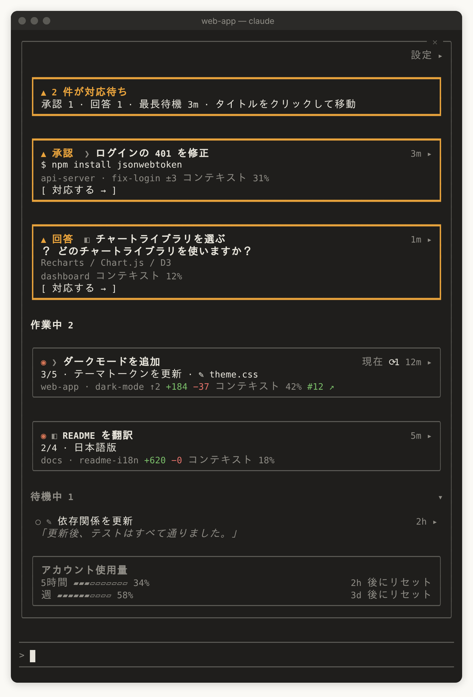

<p align="center">
  
</p>

[English](README.md) | [繁體中文](README.zh-TW.md) | [简体中文](README.zh-CN.md) | 日本語 | [한국어](README.ko.md)

[](https://ko-fi.com/Y8H028VWRF)

# switchboard：Claude Code のセッション監視ウィンドウ（Claude Code mod）

**Claude Code mods** で作られた **Claude Code プラグイン**です。ローカルのすべての Claude Code セッションを **監視ウィンドウ** ペインにまとめて表示し、どのセッションが作業中で、どれが待機中で、どれが**あなたの対応を待っているか**をひと目で分かるようにします。Desktop の Code タブのセッションも、iTerm、Terminal.app、VS Code のターミナルで動くセッションも、同じ一覧に並びます。Desktop とターミナルを同等にサポートしており、どちらか一方だけでもすべての機能を使えます。

<p align="center">
  
</p>

<p align="center"><sub>イメージ図：対応が必要なセッションが 2 つ（承認待ちと回答待ち）、作業中が 2 つ、待機中が 1 つ。</sub></p>

電話交換手がどの回線のランプが点いているかを見るように、switchboard は各セッションに自分の状態を報告させ、あなたを待っているものを一番上に並べます：

| 状態 | 意味 | 例 |
|---|---|---|
| **対応が必要** | あなたが見ないと先に進まない | `npm install` の権限確認で停止、選択式の質問、Desktop のターン終了時の質問ボックス、API エラーで止まったターン |
| **作業中** | Claude がターンを実行中 | 思考、ツール呼び出し、サブエージェントの実行 |
| **待機中** | ターンが終わり、何もブロックされていない | 完了して次の指示待ち、自分で中断したターン |
| **終了** | セッションが閉じられた、またはプロセスが終了した | すぐに一覧から消える |

**テキストでの質問はなぜ待機中なのか？** 対応が必要は明確なシグナル（権限確認、選択式の質問、Desktop のターン終了時の質問ボックス、エラー）にだけ反応するので、点灯したときは本当にあなたを待っています。Claude が普通のテキストで質問した場合は待機中になり、その行の最後の返信のプレビューで気づけます。

## クイックスタート

```bash
claude plugin marketplace add wide3751/switchboard
claude plugin install switchboard@switchboard
```

続けて、Claude Code を使う場所に合わせてどちらかの手順に進みます（両方でもかまいません）：

**Desktop**：Claude Desktop を再起動し、Code タブのセッションをどれか開きます。右側に監視ウィンドウが自動で表示され、上部に `▲ 2 件が対応待ち` のような行が出ます。以降はすべての Desktop セッションで自動的に開きます。表示されない場合は `/switchboard:open` と入力してください。

**ターミナル**：`claude` を再起動します。入力欄の上に **▦ 監視ウィンドウを開く** ボタンが表示され、あなたを待っているセッションがあると件数が付きます（例：**▦ 監視ウィンドウを開く · ▲2**）。ボタンをクリックするか `/switchboard:open` と入力すると、ターミナルの中に監視ウィンドウが開きます。常に表示したい場合は、監視ウィンドウ右上の **設定 ▸** で「すべての CLI セッションに表示」をオンにします。自動で開くにはターミナルの幅が 144 桁以上必要です（[制限事項](#制限事項)を参照）。

<p align="center">
  
</p>

<p align="center"><sub>イメージ図：80 桁のターミナルで、入力欄の上に表示された監視ウィンドウ。タイトルの前の <code>❯</code> はターミナルのセッション、<code>◧</code> は Desktop、<code>✎</code> は VS Code。</sub></p>

一覧にあなた自身のセッションしかないときは、監視ウィンドウに「ほかのセッション（Desktop またはターミナル）を開くとここに表示されます。インストール前から開いていたセッションは再起動してください」と表示されます。詳しくは[インストール](#インストール)と[使い方](#使い方)を参照してください。

## AI エージェントでインストール

次の文を Claude Code などのコーディングエージェントに貼り付けてください：

> Install switchboard by following https://github.com/wide3751/switchboard/blob/main/README.md

## 動作要件

- macOS
- 次のどちらかの Claude Code（両方でもかまいません）：
  - [Claude Desktop](https://claude.ai/download) アプリの Code タブ
  - ターミナルの `claude`（iTerm、Terminal.app、VS Code の統合ターミナルなど）
- mods に対応した Claude Code：**v2.1.299** で開発・テストしています。動作する最低バージョンはまだ確認できていません。Desktop では Code タブで `/status`、ターミナルでは `claude --version` でバージョンを確認できます。Desktop に同梱の Claude Code はターミナルのものとバージョンが違うことがあるので、それぞれ確認してください
- 任意：`git`（ブランチと変更の情報）、ログイン済みの [`gh`](https://cli.github.com/)（プルリクエストの情報）

## インストール

1. マーケットプレイスを追加してインストールします。方法は 2 つあり、**GitHub からを推奨**します：

   **方法 A：GitHub から（推奨）**　プロジェクトをダウンロードする必要はありません：

```bash
claude plugin marketplace add wide3751/switchboard
claude plugin install switchboard@switchboard
```

   新しいバージョンに更新するときは、マーケットプレイス、プラグインの順に更新して Claude Desktop または `claude` を再起動します（インストール済みのプラグインに `install` をもう一度実行してもアップグレードされません）：

```bash
claude plugin marketplace update switchboard
claude plugin update switchboard@switchboard
```

   **方法 B：ローカルフォルダから**　プロジェクトを clone して、自分の変更をインストールしたい場合：

```bash
git clone https://github.com/wide3751/switchboard.git ~/Projects/switchboard
claude plugin marketplace add ~/Projects/switchboard
claude plugin install switchboard@switchboard
```

2. Claude Desktop または `claude` を再起動し、`/switchboard:open` と入力して、監視ウィンドウが開くことを確認します。

インストール前から開いていたセッションには mod が読み込まれません。監視ウィンドウには表示されますが、基本的な状態だけです。詳細を表示するには、それらのセッションを再起動してください。

## アンインストールと無効化

**一時的に無効にする**（インストールしたまま、あとで有効に戻せます）：

```bash
claude plugin disable switchboard@switchboard
```

有効に戻すときは `claude plugin enable switchboard@switchboard` を実行します。

**完全に削除する**：

```bash
claude plugin uninstall switchboard@switchboard
claude plugin marketplace remove switchboard
rm -rf ~/.claude/switchboard
```

- `marketplace remove` はそのマーケットプレイスのプラグインもアンインストールするので、これだけ実行しても削除できます。`uninstall` のあとに実行しても問題ありません
- `~/.claude/switchboard/` には各セッションのステータスレポートが入っていて、プラグインを削除しても自動では消えません。`CLAUDE_CONFIG_DIR` を設定している場合は `$CLAUDE_CONFIG_DIR/switchboard` を削除してください
- 無効化や削除のあと、Claude Desktop と開いている `claude` を再起動すると反映されます

## 使い方

| コマンド | 説明 |
|---|---|
| `/switchboard:open` | このセッションで監視ウィンドウを開きます。Desktop セッションでも CLI セッションでも使えます |

**監視ウィンドウの内容：**

- **上部**：あなたを待っているセッションの数と、最も長く待っているものの待ち時間。移動できるセッションが 1 つ以上あれば「最長待機 3m · タイトルをクリックして移動」と表示されます。同じ数がペインのタイトルにも表示されます（例：`Switchboard · 2`）
- **セクション**：対応が必要 → 作業中 → 待機中。対応が必要は待っている時間が長い順で（ヘッダーの「最長」が一番上のカード）、新しく入ったものは下に追加されます。作業中はセッションを開始した順で、承認で行き来しても位置は変わりません。待機中は最終アクティビティが新しい順。待機中のセッションはどれだけ時間が経っても自動では消えず、待機中セクションは折りたためます
- **アカウント使用量**：サブスクリプションでは 5 時間と週ごとのレート制限の使用率とリセットまでの時間、API 課金では全セッションの合計コスト。普段は一覧の最後にあり、対応が必要なカードを押し下げません。5 時間または週の使用量が 95% に達したときだけ、上部のステータスの下に移ります
- **タイトル**：Desktop のセッションはそのタイトル、`/rename` で名前を付けた CLI セッションはその名前を表示します。それ以外の CLI セッションは最初のプロンプトの先頭約 40 文字、まだ送信していなければプロジェクトフォルダ名（worktree ではリポジトリ名）です。同じタイトルになる行にはブランチ名、またはセッションを開始した順に `#2`、`#3` が付きます。タイトルの前の 1 文字の記号でセッションの場所がわかります：`◧` Claude Desktop、`❯` ターミナル（iTerm、Terminal.app など）、`✎` VS Code の統合ターミナル。今いるセッションには **現在** が付き、監視ウィンドウが狭いときは `✦` になります
- **タイトルをクリック** するとそのセッションへ移動します。Desktop セッションは Claude Desktop の該当セッションへ、iTerm・Terminal.app の CLI セッションは該当するタブへ切り替わります。これらのセッションが対応を待っているときは **対応する →** もあります
- 各行の **展開 ▾** で残りの詳細を表示します
- **設定 ▸** で下の設定を開きます

Desktop セッションでも CLI セッションでも、監視ウィンドウが閉じているときは、入力欄の上に **▦ 監視ウィンドウを開く** ボタンが表示され、コマンドを入力せずにワンクリックで開けます。あなたを待っているセッションがあると、ボタンに件数が付きます（例：**▦ 監視ウィンドウを開く · ▲2**、最大 15 秒ほど遅れます）。待っているセッションがないとき、またはセッションの状態を読み取れないときは、ボタンだけが表示されます。ターミナルだけを使う場合、監視ウィンドウを閉じている間の手がかりはこれだけです。

あるセッションで監視ウィンドウを自分で閉じると、セッションを再起動するか、`/switchboard:open` を実行するか、このボタンを押すまで、そのセッションでは自動で開きません。自動で開く設定のときに閉じると、そのことを知らせるメッセージが表示されます。すべてのセッションで自動で開かないようにするには、**設定 ▸** で「すべての Desktop セッションに表示」または「すべての CLI セッションに表示」をオフにしてください。

### ターミナルで使う

CLI セッション（iTerm、Terminal.app、VS Code の統合ターミナル）で `/switchboard:open` を入力すると、そのターミナルの中に監視ウィンドウが開きます。内容は Desktop と同じで、ターミナルの幅に合わせて切り詰められます。全画面で幅が 110 桁以上あれば会話の横に、そうでなければ入力欄の上に表示されます。

マウスのクリックを伝えないターミナルでは、キーボードで操作します（Claude Code のデフォルトのキー）：

| キー | 動作 |
|---|---|
| `ctrl+x tab` | 入力欄から監視ウィンドウに移動（監視ウィンドウが閉じているときは、入力欄の上の **▦ 監視ウィンドウを開く** ボタンに移動） |
| `tab`／`shift+tab` | 監視ウィンドウ内のボタンとタイトルの間を移動 |
| `enter` | 選択中のボタンやタイトルを押す |
| `↑`／`↓` | 監視ウィンドウをスクロール |
| `esc` | 監視ウィンドウを開いたまま入力欄に戻る |
| `ctrl+x x` | 監視ウィンドウを閉じる（枠の右上の ✕ をクリックしても閉じられます） |

**対応ターミナル：**

| `claude` を実行している場所 | 一覧に表示 | 監視ウィンドウを開く | タイトルから移動 | 動作確認 |
|---|---|---|---|---|
| Claude Desktop の Code タブ | ✓ | ✓ | ✓ そのセッションへ切り替え | ✓ |
| iTerm | ✓ | ✓ | ✓ 該当するタブへ切り替え | ✓ |
| Terminal.app | ✓ | ✓ | ✓ 該当するタブへ切り替え | ✓ |
| VS Code の統合ターミナル | ✓ | ✓ | フォルダを表示 | 未確認 |
| その他のターミナル（Warp、Ghostty など）と tmux | ✓ | ✓ | フォルダを表示 | 一部（tmux：一覧表示と監視ウィンドウを開く） |
| VS Code 拡張機能（グラフィカル UI） | — | ✕ | — | 未確認 |

どのターミナルのセッションも一覧に表示され、状態を報告します。これは Claude Code 自体だけで動くためです。移動にはターミナルがほかのアプリからのタブ切り替えを許可している必要があるため、今のところ iTerm と Terminal.app のみ対応です。tmux の中で動くセッションは外側のターミナルではなく tmux として扱われるため、フォルダの表示になります。iTerm と Terminal.app は移動を含めてすべて実際に確認しました。tmux では一覧表示と監視ウィンドウを開くことだけを確認しています。VS Code の統合ターミナル、Warp、Ghostty、VS Code 拡張機能はまだ確認しておらず、表は想定される動作です。

**iTerm・Terminal.app への移動：** 初回の移動時に、macOS が Claude Desktop（または Claude Code を実行しているターミナル）に iTerm や Terminal の操作を許可するか尋ねるので、許可してください。拒否した場合は「システム設定 › プライバシーとセキュリティ › オートメーション」でオンにします。そのときは switchboard もここを案内するメッセージを表示します。移動できないときは、理由とセッションのフォルダが表示されます：

- VS Code、Warp、Ghostty など対応していないターミナル：「VS Code のセッションへはまだ直接移動できません。場所：…」
- 0.6.0 より前に開いた CLI セッション（ターミナルを記録していない）：「このセッションを開き直すと移動できるようになります」
- ターミナルが 10 秒以内に応答しない：移動をあきらめ、「…に切り替えられませんでした」と表示

### 対応が必要なときに通知を受け取る

switchboard 自身は通知を送りません（[ADR-0005](docs/adr/0005-no-own-needs-you-alert.md)）。権限確認や質問の通知は Claude Code と Claude Desktop 自身が送ります：

- **ターミナル**：`claude` で `/config` を入力し、通知方法を設定します（バージョンによって **Notifications** または **Local notifications** と表示されます）。デフォルトの `auto` では iTerm、kitty、Ghostty でデスクトップ通知、Terminal.app でベルが鳴ります。VS Code、Warp、tmux などほかのターミナルでは `auto` だと何も通知されないので、`terminal_bell` を選んでください。あわせて「システム設定 › 通知」でターミナルアプリの通知を許可します
- **Claude Desktop**：「システム設定 › 通知」で Claude の通知を許可します

**設定**（**設定 ▸** パネル。グローバルに保存され、すべてのセッションで共有。あるセッションで設定を変えると、ほかの開いている監視ウィンドウも次の更新時、約 3 秒以内に反映されます）：

| 名前 | デフォルト | 値 |
|---|---|---|
| すべての Desktop セッションに表示 | オン | オン：Desktop セッションの開始時とターン終了時に自動で開くので、セッションを切り替えても表示されたまま。オフ：`/switchboard:open` を実行したセッションだけに表示 |
| すべての CLI セッションに表示 | オフ | オン：CLI セッション（ターミナルで実行した `claude`）の開始時とターン終了時に自動で開きます。オフ：`/switchboard:open` を実行したセッションだけに表示。Desktop の項目とは別に設定します |
| 言語 | 自動 | 自動、EN、日本語、한국어、简中、繁中。自動では環境変数 `LC_ALL`、`LANG` の順に見て、どちらもない（または `C`、`POSIX`）ときだけ macOS の言語設定を使い、それもなければ英語になります。そのためターミナルではたいてい `LANG` に、Desktop ではたいてい macOS の言語に従います |
| 課金 | 自動 | 自動、サブスク（レート制限を表示）、API（コストを表示） |
| 設定対象 | 作業中 | 下の密度と項目をどのセクションに適用するか：対応が必要、作業中、待機中 |
| 密度 | セクションごと | コンパクト、標準、詳細。項目を自分で選ぶとカスタムになります |

各行に表示できる **項目**：

| 項目 | 表示内容 |
|---|---|
| 時間 | 現在の状態になってからの時間 |
| 場所 | プロジェクトフォルダ |
| ブランチ | git ブランチ、ahead/behind、未コミットのファイル数 |
| 変更行数 | ベースブランチに対する追加／削除行数（Desktop の Changes と同じ） |
| PR | このブランチのプルリクエスト。未プッシュの変更があり PR がない場合は **PR を作成しに行く →** でそのセッションへ移動（Desktop と iTerm・Terminal.app のセッション） |
| 進捗 | ToDo の進捗と現在の項目 |
| 現在の操作 | 実行中のツール呼び出し |
| バックグラウンドタスク | 実行中のサブエージェントとバックグラウンドのシェルコマンド |
| コンテキスト | コンテキストウィンドウの使用率 |
| コネクタ | 接続済みの MCP コネクタと、認証が必要なもの |
| 最後の返信 | Claude の最新の返信の短い抜粋 |
| モデル | 使用モデル。作業中のセッションが他と異なるモデルを使っている場合は常に表示 |
| 使用量 | ターン数。API 課金ではコストも表示 |
| 環境 | Worktree または Remote Control |
| ソース | CLI セッションが動いているターミナルの名前（タイトルの前の記号は常に表示） |
| フルパス | 作業ディレクトリのフルパス |

対応が必要な行には、承認リクエストの概要（実行しようとしているコマンド）、質問と選択肢、またはターンを止めたエラーが必ず表示されます。

### 例

Desktop のセッションが 3 つ動いています。1 つは権限確認で止まっていて、1 つは作業中、1 つは完了しています。監視ウィンドウの上部には次のように表示されます：

```
▲ 1 件が対応待ち
承認 1 · 最長待機 3m · タイトルをクリックして移動
```

その行には実行しようとしているコマンド（例：`$ npm install jsonwebtoken`）と **対応する →** が表示されます。

待っているものがないとき：

```
✓ 対応が必要な項目はありません
作業中 1 · 待機中 2
```

## 制限事項

- **macOS のみ**：監視ウィンドウは Claude Desktop とターミナルの Claude Code で開けます。VS Code 拡張機能のグラフィカル UI には対応していません。Linux などほかの OS でも `/switchboard:open` で開けますが、カードをクリックしても移動できないことが表示されます。Windows には `ps` がないため、セッションの状態を確認できません。
- **CLI セッションへの移動は iTerm と Terminal.app のみ**：ほかのターミナル（VS Code、Warp、Ghostty など）ではクリックするとフォルダが表示されるだけです。
- **ターミナルが狭いと自動では開きません**：「すべての CLI セッションに表示」をオンにしても、Claude Code が自動で開いたペインを描くのはターミナルの幅が 144 桁以上（ここで開いたことがあれば 110 桁以上）のときだけです。それまでは入力欄の上に **▦ 監視ウィンドウを開く** ボタンが表示されたままです。ボタンを押すか `/switchboard:open` を入力すれば、幅に関係なく開きます。ターミナルを広げると、待機中の監視ウィンドウも自動で表示されます。
- **ポーリングで更新**：監視ウィンドウは 3 秒ごとなので、変化は即時ではなく数秒以内に反映されます。監視ウィンドウを表示している各セッションがそれぞれスキャンします。監視ウィンドウを開いていないセッションは、開くボタンに件数を付けるために 15 秒ごとに軽いスキャンをします（セッション記録とステータスレポートを読み、`ps` を 1 回実行するだけで、`git`、`gh` は実行しません）。そのため、ボタンの件数と監視ウィンドウの件数が一時的に食い違うことがあります。
- **mod が読み込まれていないセッションは基本状態のみ**：エラー停止、承認リクエストの概要、最後の返信は表示されません（インストール前から開いていたセッションなど）。
- **ローカルのセッションのみ**：サブエージェントとクラウドセッションは表示しません。

## トラブルシューティング

| 症状 | 対処 |
|---|---|
| `/switchboard:open` が hooks が読み込まれていないと返す | 1. お使いの Claude Code が mods に対応しているか確認し、対応していなければ更新します。2. このセッションを再起動します（インストール前から開いていたセッションには読み込まれません）。3. それでも解決しなければ、`claude --debug` で起動し、デバッグログで `hooks module switchboard` のエラーを確認します |
| ここでは監視ウィンドウを表示できないと返される | VS Code 拡張機能のグラフィカル UI で実行しています。Desktop の Code タブか、ターミナルの Claude Code で入力してください |
| 上部に `⚠ 現在セッションの状態を確認できません` と出て、セッションの記録が 1 件もない（このセッションの分も）と表示される | Claude Code が古く、まだセッションの記録を書かないバージョンか、`CLAUDE_CONFIG_DIR` が Claude Code の実際のフォルダ以外を指しています |
| 上部に `⚠ 現在セッションの状態を確認できません` と出て、フォルダを読み込めないと表示される | そのフォルダが存在し、読み取り権限があるか確認してください。`CLAUDE_CONFIG_DIR` を設定している場合は、Claude Code が実際に使うフォルダを指しているか確認してください |
| 行に `switchboard 未読み込み、基本状態のみ` と表示される | そのセッションはインストール前から開いていました。再起動してください |
| PR が表示されない | `gh` をインストールして `gh auth login` を実行。セッションのフォルダが GitHub リポジトリである必要があります |
| CLI セッションをクリックしてもパスが表示されるだけ | 移動できるのは iTerm と Terminal.app だけです。ほかのターミナルへは自分で切り替えてください。iTerm・Terminal.app でも移動できない場合は、メッセージに従って「システム設定 › プライバシーとセキュリティ › オートメーション」で操作を許可するか、そのセッションを再起動してください（0.6.0 より前に開いたセッションはターミナルを記録していません） |
| 「すべての CLI セッションに表示」をオンにしたのに、ターミナルに監視ウィンドウが出ない | ターミナルが狭すぎて（144 桁未満）、自動で開いたペインが描かれていません。入力欄の上の **▦ 監視ウィンドウを開く** を押すか、`/switchboard:open` を入力するか、ターミナルを広げてください |
| コードを変更しても反映されない | インストール済みのコピーは `plugin.json` の `version` でキャッシュされます。バージョンを上げて `claude plugin update switchboard@switchboard` を実行し、再起動してください |

## プライバシーとデータ

switchboard はすべて Mac 上で動作し、独自のサービスにデータを送信することはありません。

- **ローカルに書き込むもの**：各セッションのステータスレポート（`<Claude 設定ディレクトリ>/switchboard/reports/<sessionId>.json`、平文の JSON）。内容は最初のプロンプトの先頭約 40 文字（タイトル用）、モデル、ブランチ、ToDo の進捗、現在の操作、承認リクエストの概要、質問、エラー、最後の返信の短い抜粋、バックグラウンドタスク、レート制限、コネクタ、プルリクエスト。セッションが終了して 1 分以上経つと、次にいずれかのセッションがスキャンしたときにレポートが削除されます。監視ウィンドウを一度も開かなくても削除されます
- **マスクはベストエフォート**：書き込む前に、コマンド・承認リクエストの概要・質問・最初のプロンプトに含まれる機密らしき部分（`Bearer …`、`token=…`、`--token …`、`API_KEY=…`、`sk-…`、`ghp_…` など）を `•••` に置き換えます。すべてを検出できるわけではなく、コマンドのそれ以外の部分は平文のまま保存されます
- **ローカルで読むもの**：Claude Code 自身の `~/.claude/sessions/*.json` とこれらのレポート。他のセッションの `.jsonl` 会話ログは読みません
- **実行するコマンド**：`git`（ブランチと変更）、`gh pr view`（プルリクエスト。あなた自身の `gh` ログインで GitHub に接続）、`ps`（どのセッションが生きているか。監視ウィンドウを閉じている間も、開くボタンの件数のために 15 秒ごとに実行）、`defaults read -g AppleLanguages`（UI の言語）、`open`（セッションへの移動）、`osascript`（iTerm・Terminal.app の該当タブへの切り替え）

## 仕組み

すべてのセッションに mod が読み込まれ、次の 2 つの役割を持ちます：

1. **Reporter**：自分のセッションのイベント（`session.start`、`turn.start`、`tool.call`、`turn.complete` など）を受け取り、ステータスレポートを書き出します。
2. **監視ウィンドウ**：監視ウィンドウを表示しているセッションは、3 秒ごとにレポートと Claude Code のセッション記録を統合し、プロセスが存在しないセッションを除外して一覧を描画します。監視ウィンドウを開いていないセッションは、同じ統合を 15 秒ごとに行い、入力欄の上のボタン用に対応待ちの件数だけを数えます。`git`、`gh` は実行しません。

セッションが存在するかどうかは、Claude Code 自身の記録とプロセスが生きているかだけで判断するので、古いレポートが残っていても終了したセッションが一覧に残ることはありません。2 つの情報源が食い違う場合は新しい方を採用します。

## コントリビュート

Issue やプルリクエストを歓迎します。動作を変更する前に、[GLOSSARY.md](GLOSSARY.md) の用語と [docs/adr/](docs/adr/) の決定事項（いずれも中国語）を読んでください。UI のテキストを追加・変更する場合は、[agens-view/hooks/i18n.ts](agens-view/hooks/i18n.ts) の 5 言語すべてを更新してください。

## ドキュメント

- [GLOSSARY.md](GLOSSARY.md)：用語（セッション、対応が必要、監視ウィンドウ、ステータスレポート…）
- [docs/adr/](docs/adr/)：アーキテクチャの決定事項

## ライセンス

[MIT](LICENSE)
