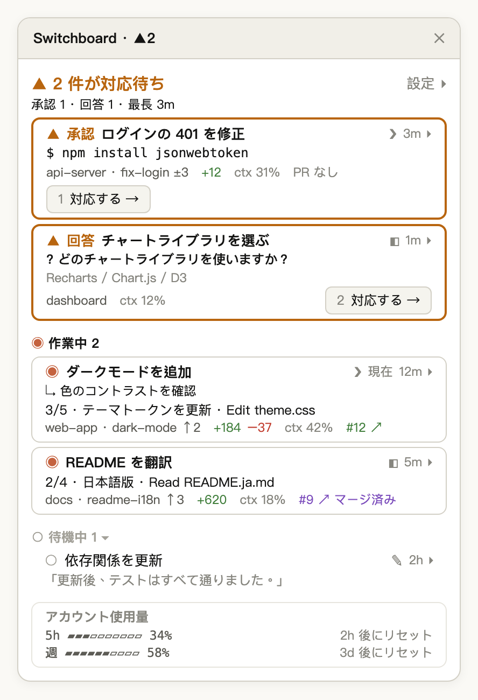

<p align="center">
  
</p>

[English](README.md) | [繁體中文](README.zh-TW.md) | [简体中文](README.zh-CN.md) | 日本語 | [한국어](README.ko.md)

# switchboard：Claude Code のセッション監視ウィンドウ（Claude Code mod）

**Claude Code mods** で作られた **Claude Code プラグイン**です。ローカルのすべての Claude Code セッションを Claude Desktop の **監視ウィンドウ** ペインにまとめて表示し、どのセッションが作業中で、どれが待機中で、どれが**あなたの対応を待っているか**をひと目で分かるようにします。Desktop の Code タブのセッションも、iTerm、Terminal.app、VS Code のターミナルで動くセッションも、同じ一覧に並びます。

<p align="center">
  
</p>

<p align="center"><sub>イメージ図：対応が必要なセッションが 2 つ（承認待ちと回答待ち）、作業中が 2 つ、待機中が 1 つ。</sub></p>

電話交換手がどの回線のランプが点いているかを見るように、switchboard は各セッションに自分の状態を報告させ、あなたを待っているものを一番上に並べます：

| 状態 | 意味 | 例 |
|---|---|---|
| **対応が必要** | あなたが見ないと先に進まない | `npm install` の権限確認で停止、選択式の質問、Desktop のターン終了時の質問ボックス、API エラーで止まったターン |
| **作業中** | Claude がターンを実行中 | 思考、ツール呼び出し、サブエージェントの実行 |
| **待機中** | ターンが終わり、何もブロックされていない | 完了して次の指示待ち、自分で中断したターン |
| **終了** | セッションが閉じられた、またはプロセスが終了した | すぐに一覧から消える |

**テキストでの質問はなぜ待機中なのか？** 対応が必要は明確なシグナル（権限確認、選択式の質問、Desktop のターン終了時の質問ボックス、エラー）にだけ反応するので、点灯したときは本当にあなたを待っています。Claude が普通のテキストで質問した場合は待機中になり、その行の最後の返信のプレビューで気づけます。

## クイックスタート

```bash
claude plugin marketplace add wide3751/switchboard
claude plugin install switchboard@switchboard
```

Claude Desktop を再起動し、Code タブで：

1. `/switchboard:open` と入力するか、入力欄の上の **▦ 監視ウィンドウを開く** をクリック
2. 右側に監視ウィンドウが開き、上部に `▲ 2 件が対応待ち` のような行が表示されます

以降は、デフォルトですべての Desktop セッションで監視ウィンドウが自動的に開きます。詳しくは[インストール](#インストール)と[使い方](#使い方)を参照してください。

## AI エージェントでインストール

次の文を Claude Code などのコーディングエージェントに貼り付けてください：

> Install switchboard by following https://github.com/wide3751/switchboard/blob/main/README.md

## 動作要件

- macOS
- Code タブのある [Claude Desktop](https://claude.ai/download) アプリ。監視ウィンドウはここでのみ開きます
- mods に対応した Claude Code（**v2.1.299** で開発・テスト。Code タブで `/status` と入力するとバージョンを確認できます）
- 任意：`git`（ブランチと変更の情報）、ログイン済みの [`gh`](https://cli.github.com/)（プルリクエストの情報）

## インストール

1. マーケットプレイスを追加してインストールします。方法は 2 つあり、**GitHub からを推奨**します：

   **方法 A：GitHub から（推奨）**　プロジェクトをダウンロードする必要はありません：

```bash
claude plugin marketplace add wide3751/switchboard
claude plugin install switchboard@switchboard
```

   新しいバージョンに更新するときは、マーケットプレイス、プラグインの順に更新して Claude Desktop を再起動します（インストール済みのプラグインに `install` をもう一度実行してもアップグレードされません）：

```bash
claude plugin marketplace update switchboard
claude plugin update switchboard@switchboard
```

   **方法 B：ローカルフォルダから**　プロジェクトを clone して、自分の変更をインストールしたい場合：

```bash
git clone https://github.com/wide3751/switchboard.git ~/Projects/switchboard
claude plugin marketplace add ~/Projects/switchboard
claude plugin install switchboard@switchboard
```

2. Claude Desktop を再起動し、Code タブで `/switchboard:open` と入力して、監視ウィンドウが開くことを確認します。

インストール前から開いていたセッションには mod が読み込まれません。監視ウィンドウには表示されますが、基本的な状態だけです。詳細を表示するには、それらのセッションを再起動してください。

## 使い方

| コマンド | 説明 |
|---|---|
| `/switchboard:open` | この Desktop セッションで監視ウィンドウを開きます。CLI セッションでは Desktop で開くよう案内するだけです |

**監視ウィンドウの内容：**

- **上部**：あなたを待っているセッションの数と、最も長く待っているものの待ち時間。同じ数がペインのタイトルにも表示されます（例：`Switchboard · 2`）
- **アカウント使用量**：サブスクリプションでは 5 時間と週ごとのレート制限の使用率とリセットまでの時間、API 課金では全セッションの合計コスト
- **セクション**：対応が必要 → 作業中 → 待機中。同じセクション内では最終アクティビティが新しい順。待機中のセッションはどれだけ時間が経っても自動では消えず、待機中セクションは折りたためます
- **タイトルをクリック** すると Claude Desktop の該当セッションへ移動します。対応が必要な行には **対応する →** もあります
- 各行の **展開 ▾** で残りの詳細を表示します
- **表示** で下の設定を開きます

Desktop セッションで監視ウィンドウが閉じているときは、入力欄の上に **▦ 監視ウィンドウを開く** ボタンが表示され、コマンドを入力せずにワンクリックで開けます。あるセッションで監視ウィンドウを閉じると、再び `/switchboard:open` を実行するかこのボタンを押すまで、そのセッションでは自動で開きません。

**設定**（**表示** パネル。グローバルに保存され、すべてのセッションで共有）：

| 名前 | デフォルト | 値 |
|---|---|---|
| すべての Desktop セッションに表示 | オン | オン：Desktop セッションの開始時とターン終了時に自動で開くので、セッションを切り替えても表示されたまま。オフ：`/switchboard:open` を実行したセッションだけに表示 |
| 言語 | 自動 | 自動（macOS の言語に従う）、EN、日本語、한국어、简中、繁中 |
| 課金 | 自動 | 自動、サブスク（レート制限を表示）、API（コストを表示） |
| 設定対象 | 作業中 | 下の密度と項目をどのセクションに適用するか：対応が必要、作業中、待機中 |
| 密度 | セクションごと | コンパクト、標準、詳細。項目を自分で選ぶとカスタムになります |

各行に表示できる **項目**：

| 項目 | 表示内容 |
|---|---|
| 時間 | 現在の状態になってからの時間 |
| 場所 | プロジェクトフォルダ |
| ブランチ | git ブランチ、ahead/behind、未コミットのファイル数 |
| 変更行数 | ベースブランチに対する追加／削除行数（Desktop の Changes と同じ） |
| PR | このブランチのプルリクエスト。Desktop セッションに未プッシュの変更があり PR がない場合は **PR を作成 ↗** でそのセッションへ移動 |
| 進捗 | ToDo の進捗と現在の項目 |
| 現在の操作 | 実行中のツール呼び出し |
| バックグラウンドタスク | 実行中のサブエージェントとバックグラウンドのシェルコマンド |
| コンテキスト | コンテキストウィンドウの使用率 |
| コネクタ | 接続済みの MCP コネクタと、認証が必要なもの |
| 最後の返信 | Claude の最新の返信の短い抜粋 |
| モデル | 使用モデル。作業中のセッションが他と異なるモデルを使っている場合は常に表示 |
| 使用量 | ターン数。API 課金ではコストも表示 |
| 環境 | Worktree または Remote |
| ソース | CLI セッションが動いているターミナル |
| フルパス | 作業ディレクトリのフルパス |

対応が必要な行には、承認リクエストの概要（実行しようとしているコマンド）、質問と選択肢、またはターンを止めたエラーが必ず表示されます。

### 例

セッションが 3 つ動いています。1 つは権限確認で止まっていて、1 つは作業中、1 つは完了しています。監視ウィンドウの上部には次のように表示されます：

```
▲ 1 件が対応待ち
承認 1 · 最長 3m
```

その行には実行しようとしているコマンド（例：`$ npm install jsonwebtoken`）と **対応する →** が表示されます。

待っているものがないとき：

```
✓ 対応が必要な項目はありません
作業中 1 · 待機中 2
```

## 制限事項

- **macOS と Claude Desktop のみ**：CLI セッションは一覧に表示され状態も報告しますが、自身では UI を表示しません。
- **CLI セッションへの移動はまだ未対応**：クリックすると、そのセッションのフォルダが表示されます。
- **ポーリングで更新**：3 秒ごとなので、変化は即時ではなく数秒以内に反映されます。監視ウィンドウを表示している各セッションがそれぞれスキャンします。
- **mod が読み込まれていないセッションは基本状態のみ**：エラー停止、承認リクエストの概要、最後の返信は表示されません（インストール前から開いていたセッションなど）。
- **ローカルのセッションのみ**：サブエージェントとクラウドセッションは表示しません。

## トラブルシューティング

| 症状 | 対処 |
|---|---|
| `/switchboard:open` が hooks が読み込まれていないと返す | `claude --debug` またはデバッグログで `hooks module switchboard` のエラーを確認 |
| 監視ウィンドウは Claude Desktop でのみ開けると返される | CLI セッションで実行しています。Desktop の Code タブで入力してください |
| 行に `switchboard 未読み込み、基本状態のみ` と表示される | そのセッションはインストール前から開いていました。再起動してください |
| PR が表示されない | `gh` をインストールして `gh auth login` を実行。セッションのフォルダが GitHub リポジトリである必要があります |
| CLI セッションをクリックしてもパスが表示されるだけ | 現状の仕様です。そのターミナルへ自分で切り替えてください |
| コードを変更しても反映されない | インストール済みのコピーは `plugin.json` の `version` でキャッシュされます。バージョンを上げて `claude plugin update switchboard@switchboard` を実行し、再起動してください |

## プライバシーとデータ

switchboard はすべて Mac 上で動作し、独自のサービスにデータを送信することはありません。

- **ローカルに書き込むもの**：各セッションのステータスレポート（`<Claude 設定ディレクトリ>/switchboard/reports/<sessionId>.json`）。内容はモデル、ブランチ、ToDo の進捗、現在の操作、承認リクエストの概要、質問、エラー、最後の返信の短い抜粋、バックグラウンドタスク、レート制限、コネクタ、プルリクエスト。存在しなくなったセッションのレポートは削除されます
- **ローカルで読むもの**：Claude Code 自身の `~/.claude/sessions/*.json` とこれらのレポート。他のセッションの `.jsonl` 会話ログは読みません
- **実行するコマンド**：`git`（ブランチと変更）、`gh pr view`（プルリクエスト。あなた自身の `gh` ログインで GitHub に接続）、`ps`（どのセッションが生きているか）、`defaults read -g AppleLanguages`（UI の言語）、`open`（セッションへの移動）

## 仕組み

すべてのセッションに mod が読み込まれ、次の 2 つの役割を持ちます：

1. **Reporter**：自分のセッションのイベント（`session.start`、`turn.start`、`tool.call`、`turn.complete` など）を受け取り、ステータスレポートを書き出します。
2. **監視ウィンドウ**：監視ウィンドウを表示しているセッションでのみ動作します。3 秒ごとにレポートと Claude Code のセッション記録を統合し、プロセスが存在しないセッションを除外して一覧を描画します。

セッションが存在するかどうかは、Claude Code 自身の記録とプロセスが生きているかだけで判断するので、古いレポートが残っていても終了したセッションが一覧に残ることはありません。2 つの情報源が食い違う場合は新しい方を採用します。

## コントリビュート

Issue やプルリクエストを歓迎します。動作を変更する前に、[CONTEXT.md](CONTEXT.md) の用語と [docs/adr/](docs/adr/) の決定事項（いずれも中国語）を読んでください。UI のテキストを追加・変更する場合は、[agens-view/hooks/i18n.ts](agens-view/hooks/i18n.ts) の 5 言語すべてを更新してください。

## ドキュメント

- [CONTEXT.md](CONTEXT.md)：用語（セッション、対応が必要、監視ウィンドウ、ステータスレポート…）
- [docs/adr/](docs/adr/)：アーキテクチャの決定事項

## ライセンス

[MIT](LICENSE)
