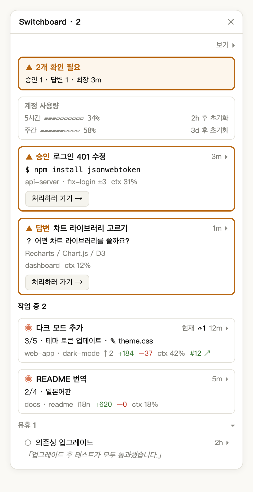
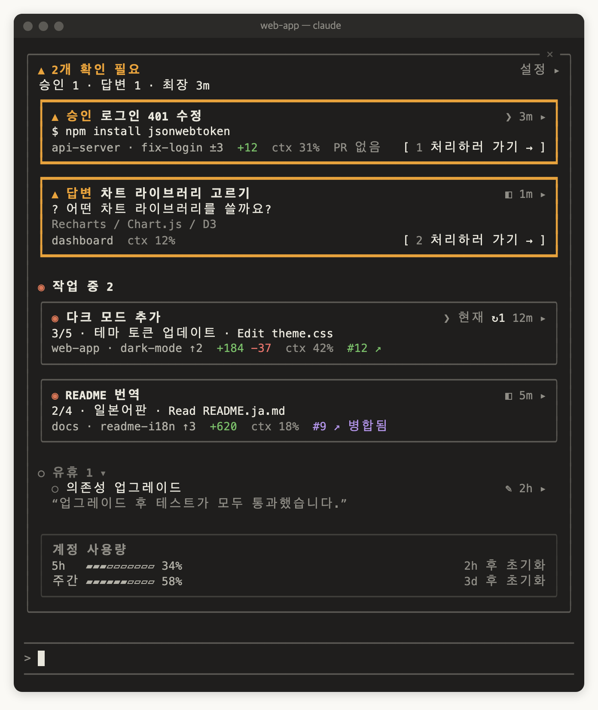

<p align="center">
  
</p>

[English](README.md) | [繁體中文](README.zh-TW.md) | [简体中文](README.zh-CN.md) | [日本語](README.ja.md) | 한국어

[](https://ko-fi.com/Y8H028VWRF)

# switchboard: Claude Code 세션 모니터 창 (Claude Code mod)

**Claude Code mods**로 만든 **Claude Code 플러그인**입니다. 로컬의 모든 Claude Code 세션을 **모니터 창** 패널 하나에 모아 보여 주어, 어떤 세션이 작업 중이고, 어떤 세션이 유휴 상태이며, 어떤 세션이 **나를 기다리는지** 한눈에 알 수 있습니다. Desktop Code 탭의 세션과 iTerm, Terminal.app, VS Code 터미널의 세션이 모두 같은 목록에 표시됩니다. Desktop과 터미널을 똑같이 지원하므로 둘 중 하나만 써도 모든 기능을 쓸 수 있습니다.

<p align="center">
  
</p>

<p align="center"><sub>예시 이미지: 확인이 필요한 세션 2개(승인 대기, 응답 대기), 작업 중 2개, 유휴 1개.</sub></p>

교환원이 어느 회선에 불이 들어왔는지 보듯이, switchboard는 각 세션이 자기 상태를 직접 보고하게 하고 나를 기다리는 세션을 맨 위에 둡니다:

| 상태 | 의미 | 예 |
|---|---|---|
| **확인 필요** | 내가 보지 않으면 진행되지 않음 | `npm install` 권한 확인에서 멈춤, 선택형 질문, Desktop 턴 끝의 질문 상자, API 오류로 멈춘 턴 |
| **작업 중** | Claude가 턴을 실행 중 | 생각하기, 도구 호출, 서브에이전트 실행 |
| **유휴** | 턴이 끝났고 막힌 것이 없음 | 끝나고 다음 지시를 기다리는 중, 직접 중단한 턴 |
| **종료** | 세션이 닫혔거나 프로세스가 종료됨 | 목록에서 즉시 사라짐 |

**텍스트로 한 질문은 왜 유휴인가요?** 확인 필요는 명확한 신호(권한 확인, 선택형 질문, Desktop 턴 끝의 질문 상자, 오류)에만 반응하므로, 켜졌을 때는 정말로 나를 기다리는 것입니다. Claude가 일반 텍스트로 질문하면 유휴로 처리되며, 해당 행의 마지막 응답 미리보기로 알아챌 수 있습니다.

## 빠른 시작

```bash
claude plugin marketplace add wide3751/switchboard
claude plugin install switchboard@switchboard
```

이어서 Claude Code를 쓰는 곳에 맞춰 둘 중 하나를 따르세요(둘 다 해도 됩니다):

**Desktop**: Claude Desktop을 다시 시작하고 Code 탭의 세션을 아무거나 엽니다. 오른쪽에 모니터 창이 저절로 나타나고, 상단에 `▲ 2개 확인 필요` 같은 줄이 표시됩니다. 이후에는 모든 Desktop 세션에서 자동으로 열립니다. 나타나지 않으면 `/switchboard:open`을 입력하세요.

**터미널**: `claude`를 다시 시작합니다. 입력창 위에 **▦ 모니터 창 열기** 버튼이 나타나고, 나를 기다리는 세션이 있으면 개수가 붙습니다(예: **▦ 모니터 창 열기 · ▲2**). 버튼을 클릭하거나 `/switchboard:open`을 입력하면 터미널 안에 모니터 창이 열립니다. 항상 표시하려면 모니터 창 오른쪽 위의 **설정 ▸**에서 「모든 CLI 세션에 표시」를 켜세요. 자동으로 열리려면 터미널 너비가 144열 이상이어야 합니다([제한 사항](#제한-사항) 참고).

<p align="center">
  
</p>

<p align="center"><sub>예시 이미지: 80열 터미널에서 입력창 위에 표시된 모니터 창. 제목 앞의 <code>❯</code>는 터미널의 세션, <code>◧</code>는 Desktop, <code>✎</code>는 VS Code입니다.</sub></p>

목록에 내 세션 하나만 있을 때는 모니터 창에 「다른 세션(Desktop 또는 터미널)을 열면 여기에 표시됩니다. 설치 전부터 열려 있던 세션은 다시 시작하세요」라고 표시됩니다. 자세한 내용은 [설치](#설치)와 [사용법](#사용법)을 참고하세요.

## AI 에이전트로 설치

다음 문장을 Claude Code나 다른 코딩 에이전트에 붙여 넣으세요:

> Install switchboard by following https://github.com/wide3751/switchboard/blob/main/README.md

## 요구 사항

- macOS
- 다음 중 하나의 Claude Code(둘 다 써도 됩니다):
  - [Claude Desktop](https://claude.ai/download) 앱의 Code 탭
  - 터미널의 `claude`(iTerm, Terminal.app, VS Code 통합 터미널 등)
- mods를 지원하는 Claude Code 버전: **v2.1.299**에서 개발·테스트했습니다. 동작하는 최저 버전은 아직 확인하지 못했습니다. Desktop은 Code 탭에서 `/status`, 터미널은 `claude --version`으로 버전을 확인하세요. Desktop에 내장된 Claude Code는 터미널의 것과 버전이 다를 수 있으니 각각 확인하세요
- 선택: `git`(브랜치와 변경 정보), 로그인된 [`gh`](https://cli.github.com/)(Pull Request 정보)

## 설치

1. 마켓플레이스를 추가하고 설치합니다. 방법은 두 가지이며 **GitHub를 권장**합니다:

   **방법 A: GitHub에서(권장)** 프로젝트를 내려받을 필요가 없습니다:

```bash
claude plugin marketplace add wide3751/switchboard
claude plugin install switchboard@switchboard
```

   나중에 새 버전으로 업데이트하려면 마켓플레이스, 플러그인 순으로 업데이트한 뒤 Claude Desktop이나 `claude`를 다시 시작하세요(이미 설치된 플러그인에 `install`을 다시 실행해도 업그레이드되지 않습니다):

```bash
claude plugin marketplace update switchboard
claude plugin update switchboard@switchboard
```

   **방법 B: 로컬 폴더에서** 프로젝트를 clone해서 직접 수정한 버전을 설치하려는 경우:

```bash
git clone https://github.com/wide3751/switchboard.git ~/Projects/switchboard
claude plugin marketplace add ~/Projects/switchboard
claude plugin install switchboard@switchboard
```

2. Claude Desktop이나 `claude`를 다시 시작하고 `/switchboard:open`을 입력해 모니터 창이 열리는지 확인합니다.

설치 전에 이미 열려 있던 세션은 mod를 로드하지 않습니다. 모니터 창에는 표시되지만 기본 상태만 보이므로, 전체 정보를 보려면 해당 세션을 다시 시작하세요.

## 제거와 비활성화

**잠시 끄기**(설치는 유지하며 나중에 다시 켤 수 있습니다):

```bash
claude plugin disable switchboard@switchboard
```

다시 켜려면 `claude plugin enable switchboard@switchboard`를 실행하세요.

**완전히 제거**:

```bash
claude plugin uninstall switchboard@switchboard
claude plugin marketplace remove switchboard
rm -rf ~/.claude/switchboard
```

- `marketplace remove`는 그 마켓플레이스의 플러그인도 함께 제거하므로 이것만 실행해도 됩니다. `uninstall` 뒤에 실행해도 문제없습니다
- `~/.claude/switchboard/`에는 각 세션의 상태 보고서가 있으며, 플러그인을 제거해도 저절로 지워지지 않습니다. `CLAUDE_CONFIG_DIR`을 설정했다면 `$CLAUDE_CONFIG_DIR/switchboard`를 지우세요
- 비활성화나 제거 후에는 Claude Desktop과 열려 있는 `claude`를 다시 시작해야 반영됩니다

## 사용법

| 명령 | 설명 |
|---|---|
| `/switchboard:open` | 이 세션에서 모니터 창을 엽니다. Desktop 세션과 CLI 세션 모두 가능합니다 |

**모니터 창 구성:**

- **상단**: 나를 기다리는 세션 수와 가장 오래 기다린 시간. 이동할 수 있는 세션이 하나라도 있으면 「최장 대기 3m · 제목을 클릭해 이동」으로 표시됩니다. 같은 숫자가 패널 제목에도 표시됩니다(예: `Switchboard · 2`)
- **섹션**: 확인 필요 → 작업 중 → 유휴. 확인 필요는 오래 기다린 순서이며(헤더의 "최장"이 맨 위 카드), 새로 들어온 세션은 맨 아래에 추가됩니다. 작업 중은 세션을 시작한 순서이며, 승인으로 상태가 오가도 위치가 바뀌지 않습니다. 유휴는 최근 활동 순. 유휴 세션은 오래 지나도 자동으로 사라지지 않으며, 유휴 섹션은 접을 수 있습니다
- **계정 사용량**: 구독 요금제는 5시간·주간 사용 한도 사용률과 초기화까지 남은 시간, API 과금은 모든 세션의 총 비용. 평소에는 목록 맨 끝에 있어 확인 필요 카드를 밀어내지 않으며, 5시간 또는 주간 사용량이 95%에 이르면 상단 상태 줄 아래로 올라옵니다
- **제목**: Desktop 세션은 자체 제목을, `/rename`으로 이름을 붙인 CLI 세션은 그 이름을 표시합니다. 그 밖의 CLI 세션은 첫 프롬프트의 앞 약 40자, 아직 보내지 않았다면 프로젝트 폴더 이름(worktree는 저장소 이름)을 씁니다. 제목이 같은 행에는 브랜치 이름이, 그래도 같으면 세션을 시작한 순서대로 `#2`, `#3`이 붙습니다. 제목 앞의 한 칸짜리 기호로 세션이 어디서 실행 중인지 알 수 있습니다: `◧` Claude Desktop, `❯` 터미널(iTerm, Terminal.app 등), `✎` VS Code 통합 터미널. 지금 있는 세션에는 **현재**가 붙고, 모니터 창이 좁을 때는 `✦`로 바뀝니다
- **제목을 클릭** 하면 해당 세션으로 이동합니다. Desktop 세션은 Claude Desktop의 해당 세션으로, iTerm·Terminal.app의 CLI 세션은 해당 탭으로 전환됩니다. 이 세션들이 확인을 기다릴 때는 **처리하러 가기 →**도 있습니다
- 각 행 오른쪽 끝의 시간과 화살표(예: `3m ▸`. 시간 항목을 끄면 `▸`만)를 클릭하면 펼쳐지고, 화살표가 `▾`로 바뀌며 「자세히」의 모든 항목과 함께 컨텍스트 사용량 막대, 기준 브랜치, 환경, 커넥터, 전체 경로, 최대 5개의 백그라운드 작업을 보여 줍니다
- **설정 ▸**으로 아래 설정을 엽니다

Desktop 세션이든 CLI 세션이든 모니터 창이 닫혀 있으면 입력창 위에 **▦ 모니터 창 열기** 버튼이 표시되어, 명령을 입력하지 않고 한 번에 열 수 있습니다. 기다리는 세션이 있으면 버튼에 개수가 붙습니다(예: **▦ 모니터 창 열기 · ▲2**, 최대 약 15초 늦을 수 있음). 기다리는 세션이 없거나 세션 상태를 지금 읽을 수 없으면 버튼만 표시됩니다. 터미널만 쓴다면 모니터 창이 닫혀 있는 동안 알 수 있는 신호는 이것뿐입니다.

어떤 세션에서 모니터 창을 직접 닫으면, 세션을 다시 시작하거나 `/switchboard:open`을 다시 실행하거나 이 버튼을 누를 때까지 그 세션에서는 자동으로 열리지 않습니다. 자동으로 열리도록 설정된 상태에서 닫으면 이를 알려 주는 메시지가 표시됩니다. 모든 세션에서 자동으로 열리지 않게 하려면 **설정 ▸**에서 「모든 Desktop 세션에 표시」나 「모든 CLI 세션에 표시」를 끄세요.

### 터미널에서

CLI 세션(iTerm, Terminal.app, VS Code 통합 터미널)에서 `/switchboard:open`을 입력하면 그 터미널 안에 모니터 창이 열립니다. 내용은 Desktop과 같고, 터미널 너비에 맞춰 잘립니다. 전체 화면이고 너비가 110열 이상이면 대화 옆에, 아니면 입력창 위에 표시됩니다.

마우스 클릭을 전달하지 않는 터미널에서는 키보드로 조작합니다(Claude Code의 기본 단축키):

| 키 | 동작 |
|---|---|
| `ctrl+x tab` | 입력창에서 모니터 창으로 이동(모니터 창이 닫혀 있으면 입력창 위의 **▦ 모니터 창 열기** 버튼으로 이동) |
| `tab`／`shift+tab` | 모니터 창 안의 버튼과 제목 사이를 이동. Claude Desktop에서는 포커스가 제목으로 옮겨질 때, 모니터 창이 직전 10초 동안 포커스를 받은 적이 없을 때만 해당 세션으로 이동합니다(한 번 클릭으로 전환할 수 있도록). Tab을 연달아 누르는 동안에는 이동하지 않습니다 |
| `enter` | 선택한 버튼이나 제목을 누름(항상 이동) |
| `1`–`9` | 모니터 창에 포커스가 있을 때, 해당 번호 카드의 **처리하러 가기 →**를 누름(번호는 버튼 앞에 흐린 색으로 표시) |
| `↑`／`↓` | 모니터 창 스크롤 |
| `esc` | 모니터 창을 연 채로 입력창으로 돌아감 |
| `ctrl+x x` | 모니터 창 닫기(테두리 오른쪽 위의 ✕를 클릭해도 됩니다) |

**지원하는 터미널:**

| `claude` 실행 위치 | 목록에 표시 | 모니터 창 열기 | 제목 클릭으로 이동 | 실제 확인 |
|---|---|---|---|---|
| Claude Desktop의 Code 탭 | ✓ | ✓ | ✓ 해당 세션으로 전환 | ✓ |
| iTerm | ✓ | ✓ | ✓ 해당 탭으로 전환 | ✓ |
| Terminal.app | ✓ | ✓ | ✓ 해당 탭으로 전환 | ✓ |
| VS Code 통합 터미널 | ✓ | ✓ | 폴더 표시 | 아직 |
| 기타 터미널(Warp, Ghostty 등)과 tmux | ✓ | ✓ | 폴더 표시 | 일부(tmux: 목록 표시와 모니터 창 열기) |
| VS Code 확장(그래픽 UI) | — | ✕ | — | 아직 |

어느 터미널의 세션이든 목록에 표시되고 상태를 보고합니다. 이는 Claude Code 자체만으로 동작하기 때문입니다. 이동은 터미널이 다른 앱의 탭 전환을 허용해야 하므로 지금은 iTerm과 Terminal.app만 지원합니다. tmux 안에서 실행 중인 세션은 바깥 터미널이 아니라 tmux로 취급되므로 폴더만 표시합니다. iTerm과 Terminal.app은 이동까지 모두 직접 확인했습니다. tmux에서는 목록 표시와 모니터 창 열기만 확인했습니다. VS Code 통합 터미널, Warp, Ghostty, VS Code 확장은 아직 확인하지 않았으며, 표의 내용은 예상 동작입니다.

**iTerm·Terminal.app으로 이동:** 처음 이동할 때 macOS가 Claude Desktop(또는 Claude Code를 실행 중인 터미널)이 iTerm이나 Terminal을 제어하도록 허용할지 물으면 허용을 누르세요. 거부했다면 「시스템 설정 › 개인정보 보호 및 보안 › 자동화」에서 켜세요. 이때 switchboard도 이곳을 안내하는 메시지를 보여 줍니다. 이동할 수 없을 때는 이유가 표시됩니다(권한 안내를 제외하면 세션이 있는 폴더도 표시됩니다):

- VS Code, Warp, Ghostty 등 지원하지 않는 터미널: 「VS Code의 세션으로는 아직 바로 이동할 수 없습니다. 위치: …」
- 0.6.0 이전에 연 CLI 세션(터미널을 기록하지 않음): 「이 세션을 다시 열면 이동할 수 있습니다」
- iTerm·Terminal.app에서 세션의 탭을 찾지 못함: 「iTerm에서 해당 탭을 찾지 못했습니다. 위치: …」
- 터미널이 10초 안에 응답하지 않음: 이동을 포기하고 「…(으)로 전환할 수 없습니다」를 표시

### 확인이 필요할 때 알림 받기

switchboard는 자체 알림을 보내지 않습니다([ADR-0005](docs/adr/0005-no-own-needs-you-alert.md)). 권한 확인이나 질문 알림은 Claude Code와 Claude Desktop이 직접 보냅니다:

- **터미널**: `claude`에서 `/config`를 입력해 알림 방식을 설정합니다(버전에 따라 **Notifications** 또는 **Local notifications**로 표시). 기본값 `auto`는 iTerm, kitty, Ghostty에서 데스크톱 알림을 보내고 Terminal.app에서는 벨을 울립니다. VS Code, Warp, tmux 등 다른 터미널에서는 `auto`로 아무 알림도 오지 않으니 `terminal_bell`을 고르세요. 또한 「시스템 설정 › 알림」에서 터미널 앱의 알림을 허용하세요
- **Claude Desktop**: 「시스템 설정 › 알림」에서 Claude의 알림을 허용하세요

**설정**(**설정 ▸** 패널. 전역으로 저장되어 모든 세션이 공유. 한 세션에서 설정을 바꾸면 열려 있는 다른 모니터 창도 다음 갱신 때, 약 3초 안에 따라 바뀝니다):

| 이름 | 기본값 | 값 |
|---|---|---|
| 모든 Desktop 세션에 표시 | 켜기 | 켜기: Desktop 세션이 시작되거나 턴이 끝날 때 자동으로 열려 세션을 바꿔도 계속 보입니다. 끄기: `/switchboard:open`을 실행했거나 **▦ 모니터 창 열기**를 누른 세션에만 표시 |
| 모든 CLI 세션에 표시 | 끄기 | 켜기: CLI 세션(터미널에서 실행한 `claude`)이 시작되거나 턴이 끝날 때 자동으로 열립니다. 끄기: `/switchboard:open`을 실행했거나 **▦ 모니터 창 열기**를 누른 세션에만 표시. Desktop 항목과 따로 설정합니다 |
| 언어 | 자동 | 자동, EN, 日本語, 한국어, 简中, 繁中. 자동이면 환경 변수 `LC_ALL`, `LANG` 순서로 보고, 둘 다 없을 때(또는 `C`, `POSIX`일 때)만 macOS 언어 설정을 쓰며, 그것도 없으면 영어입니다. 그래서 터미널에서는 보통 `LANG`을, Desktop에서는 보통 macOS 언어를 따릅니다 |
| 요금제 | 자동 | 자동, 구독(사용 한도 표시), API(비용 표시) |
| 설정 대상 | 작업 중 | 아래 밀도와 항목을 적용할 섹션: 확인 필요, 작업 중, 유휴 |
| 밀도 | 표준(유휴: 간단히) | 간단히, 표준, 자세히. 항목을 직접 고르면 사용자 지정이 됩니다 |

각 행에 표시할 수 있는 **항목**:

| 항목 | 표시 내용 |
|---|---|
| 시간 | 현재 상태가 지속된 시간 |
| 위치 | 프로젝트 폴더 |
| 브랜치 | git 브랜치, ahead/behind, 커밋하지 않은 파일 수 |
| 변경 줄 수 | 기준 브랜치 대비 추가/삭제 줄 수(Desktop의 Changes와 동일) |
| PR | 이 브랜치의 Pull Request. PR이 없고 브랜치에 기준 브랜치 대비 변경이나 푸시하지 않은 커밋이 있으면 **PR 만들러 가기 →**로 해당 세션으로 이동(유휴 행 제외. Desktop과 iTerm·Terminal.app의 세션) |
| 진행률 | 할 일 목록 진행률과 현재 항목 |
| 현재 작업 | 진행 중인 도구 호출 |
| 백그라운드 작업 | 실행 중인 서브에이전트와 백그라운드 셸 명령 |
| 컨텍스트 | 컨텍스트 창 사용률 |
| 커넥터 | 연결된 MCP 커넥터와 인증이 필요한 커넥터 |
| 마지막 응답 | Claude의 최근 응답 요약 |
| 모델 | 사용 중인 모델. 작업 중인 세션이 다른 세션과 다른 모델을 쓰면 항상 표시 |
| 사용량 | 턴 수. API 과금이면 비용도 표시 |
| 환경 | Worktree 또는 Remote Control |
| 출처 | CLI 세션이 실행 중인 터미널 이름(제목 앞의 기호는 항상 표시) |
| 전체 경로 | 작업 디렉터리 전체 경로 |

확인 필요 행에는 승인 요청 요약(실행하려는 명령), 질문과 선택지, 또는 턴을 멈춘 오류가 항상 표시됩니다. 진행률과 현재 작업은 작업 중 행에만, 마지막 응답은 유휴 행에만 표시됩니다. 커넥터와 전체 경로는 선택하면 행에 표시됩니다(「자세히」에는 둘 다 포함됩니다). 그 행을 펼치면 펼친 세부 정보 쪽에 표시됩니다.

### 예시

Desktop 세션 세 개가 실행 중입니다. 하나는 권한 확인에서 멈췄고, 하나는 작업 중이며, 하나는 끝났습니다. 모니터 창 상단에는 다음과 같이 표시됩니다:

```
▲ 1개 확인 필요
승인 1 · 최장 대기 3m · 제목을 클릭해 이동
```

해당 행에는 실행하려는 명령(예: `$ npm install jsonwebtoken`)이 표시되고, 그 아래에 **처리하러 가기 →**가 있습니다.

기다리는 세션이 없을 때:

```
✓ 확인할 항목이 없습니다
작업 중 1 · 유휴 2
```

## 제한 사항

- **macOS 전용**: 모니터 창은 Claude Desktop과 터미널의 Claude Code에서 열 수 있습니다. VS Code 확장의 그래픽 UI는 지원하지 않습니다. Linux 등 다른 OS에서도 `/switchboard:open`으로 열리지만, 카드를 클릭해도 이동할 수 없다는 안내가 나옵니다. Windows에는 `ps`가 없어 세션 상태를 확인할 수 없습니다.
- **CLI 세션 이동은 iTerm과 Terminal.app만 지원**: 다른 터미널(VS Code, Warp, Ghostty 등)에서는 클릭하면 폴더만 보여 줍니다.
- **터미널이 좁으면 자동으로 열리지 않음**: 「모든 CLI 세션에 표시」를 켜도 Claude Code는 터미널 너비가 144열 이상(여기서 연 적이 있으면 110열 이상)일 때만 자동으로 연 패널을 그립니다. 그 전까지는 입력창 위에 **▦ 모니터 창 열기** 버튼이 계속 표시됩니다. 버튼을 누르거나 `/switchboard:open`을 입력하면 너비와 상관없이 열립니다. 터미널을 넓히면 대기 중이던 모니터 창도 저절로 나타납니다.
- **폴링으로 갱신**: 모니터 창은 3초마다 갱신하므로 변화가 즉시가 아니라 몇 초 안에 반영됩니다. 모니터 창을 표시하는 세션마다 각자 스캔하고, 모니터 창을 열지 않은 세션은 열기 버튼에 개수를 붙이기 위해 15초마다 가벼운 스캔을 합니다. 두 스캔 모두 세션 기록과 상태 보고서만 읽고 `ps`를 한 번 실행합니다. `git`, `gh`는 각 세션의 Reporter가 세션이 시작될 때와 턴이 끝날 때마다 자기 폴더에서 실행합니다. 버튼의 숫자와 모니터 창의 숫자가 잠시 다를 수 있습니다.
- **mod가 로드되지 않은 세션은 기본 상태만 표시**: 오류 중단, 승인 요청 요약, 마지막 응답이 없습니다(설치 전에 열려 있던 세션 등).
- **로컬 세션만 표시**: 서브에이전트와 클라우드 세션은 표시하지 않습니다.

## 문제 해결

| 증상 | 해결 방법 |
|---|---|
| `/switchboard:open`이 hooks가 로드되지 않았다고 응답 | 1. 사용 중인 Claude Code가 mods를 지원하는지 확인하고, 지원하지 않으면 업데이트하세요. 2. 이 세션을 다시 시작하세요(설치 전부터 열려 있던 세션은 로드하지 않습니다). 3. 그래도 안 되면 `claude --debug`로 시작해 디버그 로그에서 `hooks module switchboard` 오류를 확인하세요 |
| 여기서는 모니터 창을 표시할 수 없다는 응답 | VS Code 확장의 그래픽 UI에서 실행했습니다. Desktop의 Code 탭이나 터미널의 Claude Code에서 입력하세요 |
| 상단에 `⚠ 지금은 세션 상태를 확인할 수 없습니다`가 뜨고, 세션 기록이 하나도 없다(이 세션의 기록도 없음)고 표시됨 | Claude Code 버전이 너무 오래되어 아직 세션 기록을 남기지 않거나, `CLAUDE_CONFIG_DIR`이 Claude Code가 실제로 쓰는 폴더가 아닌 곳을 가리킵니다 |
| 상단에 `⚠ 지금은 세션 상태를 확인할 수 없습니다`가 뜨고, 폴더를 읽을 수 없다고 표시됨 | 그 폴더가 있는지, 읽기 권한이 있는지 확인하세요. `CLAUDE_CONFIG_DIR`을 설정했다면 Claude Code가 실제로 쓰는 폴더를 가리키는지 확인하세요 |
| 행에 `switchboard 미로드, 기본 상태만`이 표시됨 | 설치 전에 열려 있던 세션입니다. 다시 시작하세요 |
| PR이 표시되지 않음 | `gh`를 설치하고 `gh auth login`을 실행하세요. 세션 폴더가 GitHub 저장소여야 합니다 |
| CLI 세션을 클릭하면 경로만 표시됨 | 이동은 iTerm과 Terminal.app만 지원합니다. 다른 터미널은 직접 전환하세요. iTerm·Terminal.app에서도 이동되지 않으면 안내에 따라 「시스템 설정 › 개인정보 보호 및 보안 › 자동화」에서 제어를 허용하거나 해당 세션을 다시 시작하세요(0.6.0 이전에 연 세션은 터미널을 기록하지 않았습니다) |
| 「모든 CLI 세션에 표시」를 켰는데 터미널에 모니터 창이 나타나지 않음 | 터미널이 너무 좁아서(144열 미만) 자동으로 연 패널이 그려지지 않았습니다. 입력창 위의 **▦ 모니터 창 열기**를 누르거나 `/switchboard:open`을 입력하거나 터미널을 넓히세요 |
| 코드를 수정해도 반영되지 않음 | 설치된 사본은 `plugin.json`의 `version`으로 캐시됩니다. 개발 중에는 대신 프로젝트 폴더에서 `claude --plugin-dir ./agens-view`로 시작하면 수정할 때마다 핫 리로드됩니다. 설치된 사본이 새 버전을 받지 못하면 `claude plugin marketplace update switchboard`와 `claude plugin update switchboard@switchboard`를 실행한 뒤 다시 시작하세요 |

## 개인정보와 데이터

switchboard는 전부 Mac에서 실행되며, 자체 서비스로 데이터를 보내지 않습니다.

- **로컬에 기록**: 각 세션의 상태 보고서(`<Claude 설정 디렉터리>/switchboard/reports/<sessionId>.json`, 평문 JSON). 첫 프롬프트의 앞 약 40자(제목용), 모델, 브랜치, 할 일 진행률, 현재 작업, 승인 요청 요약, 질문, 오류, 마지막 응답 요약, 백그라운드 작업, 사용 한도, 커넥터, Pull Request, 실행 중인 터미널(`TERM_PROGRAM`), 컨텍스트 사용량, 비용, 턴 수, 타임스탬프를 담습니다. `sessionId`가 어느 세션 기록에도 없고 1분 넘게 갱신되지 않은 보고서는, 다음에 어떤 세션이든 스캔할 때 삭제됩니다. 모니터 창을 한 번도 열지 않아도 삭제됩니다. 세션 기록을 하나도 찾지 못하면 삭제하지 않습니다
- **마스킹은 최선의 노력일 뿐**: 기록하기 전에 명령, 승인 요청 요약, 질문, 첫 프롬프트, 마지막 응답 요약, 오류 메시지에서 비밀로 보이는 부분(`Bearer …`, `token=…`, `--token …`, `API_KEY=…`, `sk-…`, `ghp_…` 등)을 `•••`로 바꿉니다. 모두 잡아낸다는 보장은 없으며, 명령의 나머지 부분은 평문으로 저장됩니다
- **로컬에서 읽음**: Claude Code 자체의 `<Claude 설정 디렉터리>/sessions/*.json` 기록과 이 보고서. 다른 세션의 `.jsonl` 대화 기록은 읽지 않습니다
- **실행하는 명령**: 스캔할 때 `ps`(살아 있는 세션 확인. 모니터 창이 닫혀 있어도 열기 버튼의 개수를 위해 15초마다 실행)와 `rm`(남은 보고서 삭제). 각 세션이 시작될 때와 턴이 끝날 때마다 그 세션의 폴더에서 `git`(브랜치와 변경)과 `gh pr view`(Pull Request. 내 `gh` 로그인으로 GitHub에 연결). 그 밖에 `uname -s`(`/switchboard:open`을 실행할 때 운영체제 확인), `defaults read -g AppleLanguages`(UI 언어. `LC_ALL`, `LANG`으로 언어를 정할 수 없을 때만 실행), `open`(Desktop 세션으로 이동, Pull Request 페이지와 작성자 링크 열기), `osascript`(iTerm·Terminal.app의 해당 탭으로 전환). 제한 시간: `ps`와 `git` 5초, `gh` 8초, `osascript` 10초, `defaults`와 `uname` 3초

## 동작 원리

모든 세션이 mod를 로드하며, mod는 두 가지 역할을 합니다:

1. **Reporter**: 자기 세션의 이벤트(`session.start`, `turn.start`, `tool.call`, `turn.complete` 등)를 받아 상태 보고서를 기록합니다. 세션이 시작될 때와 턴이 끝날 때마다 브랜치, 변경, Pull Request를 위해 자기 폴더에서 `git`, `gh`도 실행합니다.
2. **모니터 창**: 모니터 창을 표시하는 세션은 3초마다 보고서와 Claude Code의 세션 기록을 합치고, 프로세스가 없는 세션을 제외한 뒤 목록을 그립니다. 직접 `git`, `gh`를 실행하지는 않습니다. 모니터 창을 열지 않은 세션은 같은 병합을 15초마다 하되, 입력창 위 버튼에 쓸 확인 필요 개수만 셉니다.

세션의 존재 여부는 Claude Code 자체 기록과 프로세스 생존 여부로만 판단하므로, 오래된 보고서가 남아 있어도 종료된 세션이 목록에 남지 않습니다. 두 출처가 다르면 정해진 순서로 판단합니다. 기록이 작업 중이나 확인 필요이면 기록을 따르고, 그렇지 않으면 보고서에 턴 오류가 있을 때 오류 중단, 보고서에 질문이 있고 기록이 유휴일 때 확인 필요로 봅니다. 그 밖에는 기록을 따릅니다.

## 기여하기

Issue와 Pull Request를 환영합니다. 동작을 바꾸기 전에 [GLOSSARY.md](GLOSSARY.md)의 용어와 [docs/adr/](docs/adr/)의 결정 사항(모두 중국어)을 읽어 주세요. UI 문자열을 추가하거나 바꿀 때는 [agens-view/hooks/i18n.ts](agens-view/hooks/i18n.ts)의 5개 언어를 모두 업데이트해 주세요.

## 문서

- [GLOSSARY.md](GLOSSARY.md): 용어(세션, 확인 필요, 모니터 창, 상태 보고서…)
- [docs/adr/](docs/adr/): 아키텍처 결정 사항

## 라이선스

[MIT](LICENSE)
