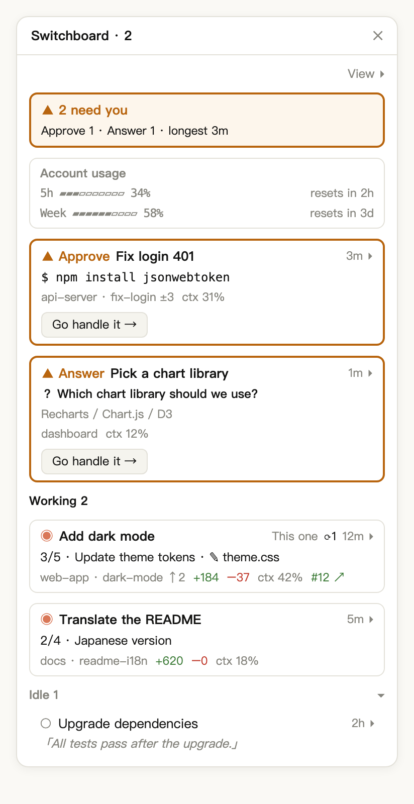
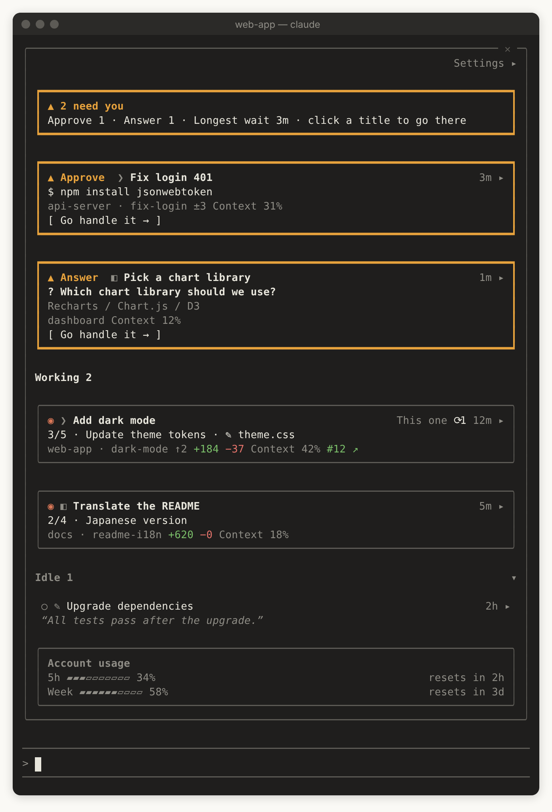

<p align="center">
  
</p>

English | [繁體中文](README.zh-TW.md) | [简体中文](README.zh-CN.md) | [日本語](README.ja.md) | [한국어](README.ko.md)

# switchboard: a session board for Claude Code (a Claude Code mod)

A **Claude Code plugin**, built on **Claude Code mods**, that lists every local Claude Code session in one **Board** pane, so you can see at a glance which sessions are working, which are idle, and which are **blocked on you**. Sessions in the Desktop Code tab and sessions in iTerm, Terminal.app or the VS Code terminal all show up in the same list. Desktop and the terminal are supported equally; either one alone gets you everything.

<p align="center">
  
</p>

<p align="center"><sub>Illustration: two sessions need you (an approval and a question), two are working, one is idle.</sub></p>

[](https://ko-fi.com/Y8H028VWRF)

The way a switchboard operator sees which lines are lit, switchboard has every session report its own state and puts the ones waiting on you at the top:

| State | Meaning | Example |
|---|---|---|
| **Needs You** | Nothing moves until you look | A permission prompt for `npm install`, a multiple-choice question, a question box at the end of a Desktop turn, a turn stopped by an API error |
| **Working** | Claude is running a turn | Thinking, calling tools, running subagents |
| **Idle** | The turn is over and nothing is blocked | Finished and waiting for your next prompt; a turn you interrupted yourself |
| **Ended** | The session was closed or its process exited | Removed from the list at once |

**Why does a plain-text question count as Idle?** Needs You only reacts to explicit signals (permission prompts, choice cards, the question box Desktop shows at the end of a turn, errors), so when it lights up, something really is waiting on you. A question Claude asks in plain text is Idle, and the last-reply preview on its row lets you spot it.

## Quick start

```bash
claude plugin marketplace add wide3751/switchboard
claude plugin install switchboard@switchboard
```

Then follow the path for where you use Claude Code (or both):

**Desktop**: restart Claude Desktop and open any session in the Code tab. The Board appears on the right by itself, with a line such as `▲ 2 need you` at the top, and from then on it opens in every Desktop session. If it doesn't appear, type `/switchboard:open`.

**Terminal**: restart `claude`. An **▦ Open board** button appears above the prompt, with the needs-you count when sessions are waiting on you, for example **▦ Open board · ▲2**. Click it or type `/switchboard:open` and the Board opens in the terminal. To keep it showing, turn on **Show in every CLI session** under **Settings ▸** at the top right of the Board; the terminal has to be at least 144 columns wide for it to open by itself (see [Limitations](#limitations)).

<p align="center">
  
</p>

<p align="center"><sub>Illustration: the Board above the prompt in an 80-column terminal. The symbol before a title shows where the session runs: <code>❯</code> a terminal, <code>◧</code> Desktop, <code>✎</code> VS Code.</sub></p>

While yours is the only session on the list, the Board says "Start other sessions (Desktop or terminal) and they will show up here. Sessions that were already open before you installed switchboard need a restart". See [Install](#install) and [Usage](#usage) for details.

## Install with an AI agent

Paste this to Claude Code or any other coding agent:

> Install switchboard by following https://github.com/wide3751/switchboard/blob/main/README.md

## Requirements

- macOS
- Claude Code in either place (or both):
  - the Code tab of the [Claude Desktop](https://claude.ai/download) app
  - `claude` in a terminal (iTerm, Terminal.app, the VS Code integrated terminal, …)
- A Claude Code version with mods support: developed and tested on **v2.1.299**; the oldest version that works hasn't been determined yet. In Desktop, type `/status` in the Code tab to check; in a terminal, run `claude --version`. The Claude Code bundled with Desktop can be a different version from the one in your terminal, so check both
- Optional: `git` for branch and change details, and [`gh`](https://cli.github.com/) signed in for pull request details

## Install

1. Add the marketplace and install. There are two ways; **GitHub is recommended**:

   **Option A: from GitHub (recommended)** — no need to download the project:

```bash
claude plugin marketplace add wide3751/switchboard
claude plugin install switchboard@switchboard
```

   To update to a new version later, update the marketplace, then the plugin, and restart Claude Desktop or `claude` (running `install` again on an installed plugin does not upgrade it):

```bash
claude plugin marketplace update switchboard
claude plugin update switchboard@switchboard
```

   **Option B: from a local folder** — for when you have cloned the project and want to install your own changes:

```bash
git clone https://github.com/wide3751/switchboard.git ~/Projects/switchboard
claude plugin marketplace add ~/Projects/switchboard
claude plugin install switchboard@switchboard
```

2. Restart Claude Desktop or `claude`, then type `/switchboard:open` and check that the Board opens.

Sessions that were already open before you installed do not load the mod. They still appear on the Board, but with basic status only; restart them to get full details.

## Uninstall or disable

**Disable for now** (stays installed, so you can turn it back on):

```bash
claude plugin disable switchboard@switchboard
```

To turn it back on, run `claude plugin enable switchboard@switchboard`.

**Remove completely**:

```bash
claude plugin uninstall switchboard@switchboard
claude plugin marketplace remove switchboard
rm -rf ~/.claude/switchboard
```

- `marketplace remove` also uninstalls the plugins from that marketplace, so running it alone is enough; running it after `uninstall` works too
- `~/.claude/switchboard/` holds the sessions' status reports and is not deleted when the plugin is removed. If you set `CLAUDE_CONFIG_DIR`, delete `$CLAUDE_CONFIG_DIR/switchboard` instead
- After disabling or removing, restart Claude Desktop and any open `claude` for it to take effect

## Usage

| Command | Description |
|---|---|
| `/switchboard:open` | Open the Board in this session, Desktop or CLI |

**On the Board:**

- **Header**: how many sessions need you and how long the longest one has waited; when at least one of them can be jumped to, it reads "Longest wait 3m · click a title to go there". The same count appears in the pane title, for example `Switchboard · 2`
- **Sections**: Needs You → Working → Idle. Needs You is ordered by how long each session has been waiting, longest first (the "longest" age in the header is the top card), and new arrivals join at the bottom. Working is ordered by when each session started, so a session doesn't jump around as it goes to an approval and back. Idle is ordered by most recent activity first. Idle sessions stay on the list however long they sit, and the Idle section can be collapsed
- **Account usage**: on a subscription, 5-hour and weekly rate-limit usage with their reset times; on API billing, the total spent across sessions. It sits at the end of the list so it never pushes Needs You cards down, and moves up under the header only once 5-hour or weekly usage reaches 95%
- **Titles**: a Desktop session shows its own title, and a CLI session renamed with `/rename` shows that name. Any other CLI session is titled with the first ~40 characters of its first prompt, or the project folder before you send one (for a worktree, the repo name). Rows that would share a title get their branch added, or `#2`, `#3` in the order the sessions started. A one-cell symbol before each title shows where the session runs: `◧` Claude Desktop, `❯` a terminal (iTerm, Terminal.app, …), `✎` the VS Code integrated terminal. The session you're in is marked **This one**, or `✦` when the Board is too narrow
- **Click a title** to jump to that session: a Desktop session opens in Claude Desktop; a CLI session in iTerm or Terminal.app switches to its tab. When these sessions need you, their rows also have **Go handle it →**
- **Click the time and arrow** at the right end of a row (for example `3m ▸`, or just `▸` with the Time field off) to expand it: the arrow turns into `▾` and the row shows every Detailed field, plus a context usage bar, the base branch, the environment, connectors, the full path and up to 5 background tasks
- **Settings ▸** opens the settings below

While the Board is closed in a Desktop or CLI session, an **▦ Open board** button sits above the prompt; one click opens it without typing the command. When a session is waiting for you, the button shows the count, for example **▦ Open board · ▲2** (up to about 15 seconds behind). When nothing is waiting, or session status can't be read right now, it shows just the button. If you only use the terminal, this is the only signal while the Board is closed.

If you close the Board in a session yourself, it no longer opens there by itself until you restart the session, run `/switchboard:open` or click that button again. Closing it while it opens by itself shows a note saying so; to stop it opening in every session, uncheck **Show in every Desktop session** or **Show in every CLI session** under **Settings ▸**.

### In a terminal

In a CLI session (iTerm, Terminal.app, the VS Code integrated terminal), `/switchboard:open` opens the Board right in that terminal, with the same content as in Desktop, truncated to the terminal's width. In a fullscreen terminal at least 110 columns wide it docks beside the conversation; otherwise it sits above the prompt.

If your terminal doesn't report mouse clicks, use the keyboard (these are Claude Code's default keys):

| Key | Action |
|---|---|
| `ctrl+x tab` | Move from the prompt into the Board (while the Board is closed, onto the **▦ Open board** button above the prompt) |
| `tab` / `shift+tab` | Move between the buttons and titles on the Board |
| `enter` | Press the selected button or title |
| `↑` / `↓` | Scroll the Board |
| `esc` | Go back to the prompt, leaving the Board open |
| `ctrl+x x` | Close the Board (or click the ✕ at the top right of its frame) |

**Supported terminals:**

| Where `claude` runs | Listed on the Board | Opens the Board | Click to jump | Tested |
|---|---|---|---|---|
| Claude Desktop Code tab | ✓ | ✓ | ✓ switches to that session | ✓ |
| iTerm | ✓ | ✓ | ✓ switches to its tab | ✓ |
| Terminal.app | ✓ | ✓ | ✓ switches to its tab | ✓ |
| VS Code integrated terminal | ✓ | ✓ | Shows the folder | Not yet |
| Other terminals (Warp, Ghostty, …) and tmux | ✓ | ✓ | Shows the folder | Partly (tmux: listing and opening the Board) |
| VS Code extension (graphical UI) | — | ✕ | — | Not yet |

Every terminal session is listed and reports its status, because that only needs Claude Code itself. Jumping needs the terminal to let another app switch its tabs, so for now it only works in iTerm and Terminal.app. Inside tmux, a session counts as tmux rather than the terminal around it, so it shows the folder too. Everything for iTerm and Terminal.app has been tested by hand, including jumping. Inside tmux only listing and opening the Board were tested. The VS Code integrated terminal, Warp, Ghostty and the VS Code extension haven't been tested yet; their rows describe what should happen.

**Jumping to iTerm and Terminal.app:** the first jump makes macOS ask whether to allow Claude Desktop (or the terminal running Claude Code) to control iTerm or Terminal; choose Allow. If you denied it, turn it on in System Settings › Privacy & Security › Automation; switchboard then shows a note pointing there. When a jump can't happen, you see why (and, except for the permission note, the folder the session is in):

- Terminals that aren't supported, such as VS Code, Warp and Ghostty: "Can't jump to sessions in VS Code yet. It is in …"
- CLI sessions started before 0.6.0 (they didn't record their terminal): "Reopen this session to jump to it"
- The session's tab can't be found in iTerm or Terminal.app: "Couldn't find the tab in iTerm. The session is in …"
- The terminal doesn't answer within 10 seconds: the jump is dropped with "Couldn't switch to …"

### Getting notified when a session needs you

switchboard sends no notifications of its own ([ADR-0005](docs/adr/0005-no-own-needs-you-alert.md)). Alerts for permission prompts and questions come from Claude Code and Claude Desktop themselves:

- **Terminal**: type `/config` in `claude` and set the notification method (shown as **Notifications** or **Local notifications**, depending on the version). The default `auto` sends desktop notifications in iTerm, kitty and Ghostty and rings the bell in Terminal.app; in VS Code, Warp, tmux and other terminals `auto` sends nothing, so pick `terminal_bell`. Also allow your terminal app in System Settings › Notifications
- **Claude Desktop**: allow Claude in System Settings › Notifications

**Settings** (the **Settings ▸** panel; stored globally and shared by all sessions. When you change a setting in one session, other open Boards follow on their next refresh, within about 3 seconds):

| Name | Default | Values |
|---|---|---|
| Show in every Desktop session | on | on: the Board opens whenever a Desktop session starts or finishes a turn, so it stays in view as you switch; off: only in sessions where you ran `/switchboard:open` or clicked **▦ Open board** |
| Show in every CLI session | off | on: the Board opens whenever a CLI session (a terminal running `claude`) starts or finishes a turn; off: only in sessions where you ran `/switchboard:open` or clicked **▦ Open board**. Set separately from the Desktop option |
| Language | Auto | Auto, EN, 日本語, 한국어, 简中, 繁中. Auto checks the `LC_ALL` and `LANG` environment variables in that order, then the macOS language preference only if neither is set (or is `C` or `POSIX`), and falls back to English. So in a terminal it usually follows `LANG`, and in Desktop it usually follows the macOS language |
| Billing | Auto | Auto, Subscription (shows rate limits), API (shows cost) |
| Section | Working | Which section the density and fields below apply to: Needs you, Working or Idle |
| Density | Standard (Idle: Compact) | Compact, Standard, Detailed, or Custom when you pick fields yourself |

**Fields** each row can show:

| Field | Shows |
|---|---|
| Time | How long the session has been in its current state |
| Location | Project folder |
| Branch | git branch, ahead/behind, uncommitted files |
| Changes | Lines added and removed against the base branch, like Desktop's Changes |
| PR | The branch's pull request; when there is no PR but the branch has changes against the base branch or unpushed commits, **Go create PR →** jumps to that session (not on Idle rows; Desktop sessions and sessions in iTerm or Terminal.app) |
| Progress | Todo progress and the current item |
| Activity | The tool call in progress |
| Background tasks | Running subagents and background shell commands |
| Context | Context window usage |
| Connectors | Connected MCP connectors, and ones that need auth |
| Last reply | A short excerpt of Claude's latest reply |
| Model | The model; shown anyway when an active session uses a different model from the rest |
| Usage | Turns, plus cost on API billing |
| Environment | Worktree or Remote Control |
| Source | The name of the terminal a CLI session runs in (the symbol before the title always shows) |
| Full path | The full working directory |

On a Needs You row the approval preview (the command it wants to run), the question with its options, or the error that stopped the turn always shows. Progress and Activity show only on Working rows, and Last reply only on Idle rows. Connectors and Full path show on the row when you pick them (Detailed includes both); when you expand the row they move into the expanded details instead.

### Examples

Three Desktop sessions are running: one is stuck on a permission prompt, one is working, one is done. The Board header shows:

```
▲ 1 needs you
Approve 1 · Longest wait 3m · click a title to go there
```

Its row shows the command it wants to run, for example `$ npm install jsonwebtoken`, with **Go handle it →** below it.

Once nothing is waiting:

```
✓ Nothing needs you
Working 1 · Idle 2
```

## Limitations

- **macOS only**: the Board opens in Claude Desktop and in Claude Code in a terminal; the VS Code extension's graphical UI isn't supported. On Linux and other systems `/switchboard:open` still opens it and explains that clicking a card won't take you to that session; Windows has no `ps`, so session status can't be seen there.
- **CLI sessions jump only in iTerm and Terminal.app**: in other terminals (VS Code, Warp, Ghostty, …) clicking one shows the folder it runs in.
- **Narrow terminals don't open it by themselves**: with **Show in every CLI session** on, Claude Code only draws a pane it wasn't asked for once the terminal is at least 144 columns wide (110 if you've opened the Board there before). Until then the **▦ Open board** button stays above the prompt; click it or run `/switchboard:open` to open the Board at any width. Widen the terminal and the waiting Board appears by itself.
- **Updated by polling**: the Board refreshes every 3 seconds, so changes show up within a few seconds, not instantly. Each session that shows the Board scans on its own, and sessions without the Board open do a light scan every 15 seconds so the open button can show the count. Both scans read only session records and status reports and run `ps` once; `git` and `gh` are run by each session's reporter in its own folder, when the session starts and after each turn. The button and the Board may briefly disagree.
- **Sessions without the mod show basic status only**: no Errored state, approval preview or last reply, for example sessions that were open before you installed.
- **Local sessions only**: subagents and cloud sessions are not listed.

## Troubleshooting

| Symptom | What to do |
|---|---|
| `/switchboard:open` answers that the hooks did not load | 1. Check that your Claude Code version supports mods, and update it if not. 2. Restart this session: sessions open before you installed don't load it. 3. If it still fails, start `claude --debug` and look for `hooks module switchboard` errors in the debug log |
| The command says the Board can't be shown here | You ran it in the VS Code extension's graphical UI; type it in the Desktop Code tab or in Claude Code in a terminal instead |
| The header shows `⚠ Can’t see session status right now` and says no session records were found, not even for this session | Your Claude Code version is too old to write session records, or `CLAUDE_CONFIG_DIR` points somewhere other than the folder Claude Code actually uses |
| The header shows `⚠ Can’t see session status right now` and says a folder can't be read | Check that the folder exists and that you can read it; if you set `CLAUDE_CONFIG_DIR`, check that it points to the folder Claude Code actually uses |
| A row says `switchboard not loaded, basic status only` | That session was opened before you installed; restart it |
| No PR shown | Install `gh` and run `gh auth login`; the session's folder must be a GitHub repository |
| Clicking a CLI session only shows a path | Only iTerm and Terminal.app can jump; switch to other terminals yourself. If iTerm or Terminal.app doesn't jump either, follow the note to System Settings › Privacy & Security › Automation and allow controlling them, or restart that session (sessions started before 0.6.0 did not record their terminal) |
| **Show in every CLI session** is on, but the Board doesn't appear in a terminal | The terminal is too narrow for a pane that opens by itself (under 144 columns). Click **▦ Open board** above the prompt or run `/switchboard:open`, or widen the terminal |
| Code changes have no effect | Installed copies are cached by the `version` in `plugin.json`. While developing, start `claude --plugin-dir ./agens-view` from the project folder instead; it hot-reloads as you edit. If an installed copy doesn't get a new release, run `claude plugin marketplace update switchboard` and `claude plugin update switchboard@switchboard`, then restart |

## Privacy and data

switchboard runs entirely on your Mac and sends nothing to any service of its own.

- **Written locally**: each session's status report, as a plain-text JSON file at `<Claude config dir>/switchboard/reports/<sessionId>.json`, with the first ~40 characters of the first prompt (used as the title), the model, branch, todo progress, current activity, approval preview, question, error, a short excerpt of the last reply, background tasks, rate limits, connectors, the pull request, the terminal it runs in (`TERM_PROGRAM`), context usage, cost, turn count and timestamps. A report whose `sessionId` isn't in any session record and that hasn't been updated for a minute is removed the next time any session scans, even if you never open the Board. If no session records can be found at all, nothing is removed
- **Masking is best effort**: before writing, fragments that look like secrets in commands, approval previews, questions, the first prompt, the last-reply excerpt and error messages (such as `Bearer …`, `token=…`, `--token …`, `API_KEY=…`, `sk-…`, `ghp_…`) are replaced with `•••`. This can't catch everything, and the rest of each command is still stored in plain text
- **Read locally**: Claude Code's own `<Claude config dir>/sessions/*.json` records and these reports. Other sessions' `.jsonl` transcripts are never read
- **Commands it runs**: when scanning, `ps` (which sessions are alive; also every 15 seconds while the Board is closed, for the count on the open button) and `rm` (removing leftover reports); in each session's own folder, when it starts and after each turn, `git` (branch and changes) and `gh pr view` (the pull request, which contacts GitHub with your own `gh` login); also `uname -s` (checking the operating system on `/switchboard:open`), `defaults read -g AppleLanguages` (UI language, only when `LC_ALL` and `LANG` don't settle it), `open` (jumping to a Desktop session, and opening pull request pages and the author link), `osascript` (switching to the session's tab in iTerm or Terminal.app). Time limits: `ps` and `git` 5 seconds, `gh` 8 seconds, `osascript` 10 seconds, `defaults` and `uname` 3 seconds

## How it works

Every session loads the mod, which has two jobs:

1. **Reporter**: listens to its own session's events (`session.start`, `turn.start`, `tool.call`, `turn.complete`, …) and writes its status report. When the session starts and after each turn, it also runs `git` and `gh` in its own folder for the branch, changes and pull request.
2. **Board**: a session that shows the Board merges the reports with Claude Code's session records every 3 seconds, drops sessions whose process is gone, and draws the list; it never runs `git` or `gh` itself. A session without the Board open does the same merge every 15 seconds, only to count the sessions that need you for the button above the prompt.

Whether a session exists is decided only by Claude Code's records and whether its process is alive, so a stale report can never keep an ended session on the list. When the two sources disagree, a fixed order decides: if the record says Working or Needs You, the record wins; otherwise a turn error in the report makes the session Errored, and a question in the report while the record says Idle makes it Needs You; in every other case the record wins.

## Contributing

Issues and pull requests are welcome. Before changing behavior, read [GLOSSARY.md](GLOSSARY.md) for the terminology and the decisions in [docs/adr/](docs/adr/) (both in Chinese). When you add or change UI text, update all five languages in [agens-view/hooks/i18n.ts](agens-view/hooks/i18n.ts).

## Docs

- [GLOSSARY.md](GLOSSARY.md): terminology (Session, Needs You, Board, Status Report…)
- [docs/adr/](docs/adr/): architecture decisions

## License

[MIT](LICENSE)
