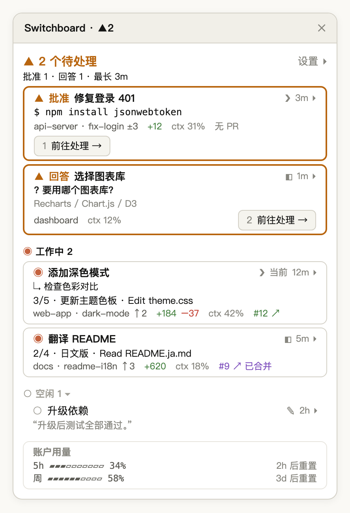
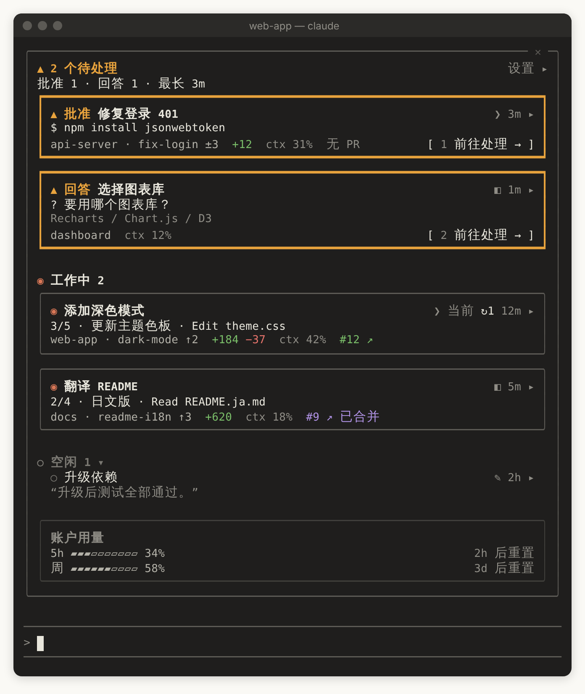

<p align="center">
  
</p>

[English](README.md) | [繁體中文](README.zh-TW.md) | 简体中文 | [日本語](README.ja.md) | [한국어](README.ko.md)

[](https://ko-fi.com/Y8H028VWRF)

# switchboard：Claude Code 的 Session 监控窗口（Claude Code mod）

一个 **Claude Code plugin**，基于 **Claude Code mods** 构建。同时开着很多个 Claude Code Session 时，它把所有本地 Session 列在同一个 **监控窗口** 里，让你一眼看清哪些在工作、哪些空闲、哪些**在等你**，点一下就跳过去处理。

Claude Desktop Code 标签页里的 Session，和 iTerm、Terminal.app、VS Code 终端里的 `claude`，都列在同一份列表中。Desktop 和终端同等支持，只用其中一种也能完整使用。

<p align="center">
  
</p>

<p align="center"><sub>示意图：两个待处理（一个待批准、一个待回答，各有带数字快捷键的「前往处理」）、两个工作中、一个空闲，最下面是账户用量。</sub></p>

就像总机接线员能看到哪几条线亮着灯，switchboard 让每个 Session 自己报告状态，再把在等你的排在最上面：

| 状态 | 含义 | 例子 |
|---|---|---|
| **▲ 待处理** | 你不去看，事情就不会推进 | 停在 `npm install` 的权限提示、用选项卡提问、Desktop 回合结尾的提问框、回合因 API 错误停止 |
| **◉ 工作中** | Claude 正在执行回合 | 思考、调用工具、运行 Subagent；回合已结束但后台任务（后台 Subagent、后台 Bash）还在跑。每个运行中的后台任务在卡片下方列一行标题 |
| **○ 空闲** | 回合已结束，没有被卡住 | 完成后在等下一条指令；你自己中断的回合 |
| **已结束** | Session 已关闭或进程已不存在 | 立即从列表中移除 |

待处理只响应明确的信号，所以它亮起时，一定是真的在等你。Claude 用普通文字提问时算空闲，你可以从那一行的最后回复摘要中发现。

## 快速开始

```bash
claude plugin marketplace add wide3751/switchboard
claude plugin install switchboard@switchboard
```

接下来按你使用 Claude Code 的地方，走其中一条（两条都走也可以）：

**Desktop**：重启 Claude Desktop，打开 Code 标签页里的任意一个 Session。监控窗口会自动出现在右侧，之后每个 Desktop Session 都会自动打开它。没有出现的话，输入 `/switchboard:open`。

**终端**：重启 `claude`，输入框上方会出现 **▦ 打开监控窗口** 按钮，点击它或输入 `/switchboard:open` 就会打开。想让它每次自动打开，在监控窗口的 **设置 ▸** › 常规，勾选「自动打开监控窗口」的 **CLI Session**（终端至少要 144 列宽）。

安装前就已打开的 Session 仍会出现在列表中，但只有基本状态；重启这些 Session 才能看到完整详情。

Claude Code 默认不会自动更新第三方 marketplace 的 plugin。输入 `/plugin`，到 **Marketplaces** 开启 switchboard 的自动更新，之后有新版时 Claude Code 会自己装好。

也可以把这段话粘贴给 Claude Code 或其他 coding agent，让它帮你安装：

> Install switchboard by following https://github.com/wide3751/switchboard/blob/main/README.md

## 使用方法

| 命令 | 说明 |
|---|---|
| `/switchboard:open` | 在当前 Session 打开监控窗口，Desktop 和终端都可以 |

<p align="center">
  
</p>

<p align="center"><sub>示意图：80 列的终端里，监控窗口嵌在输入框上方，内容和 Desktop 一样。</sub></p>

**监控窗口上有什么：**

- **顶部**：有 Session 在等你时显示 `▲ 2 个待处理`，下一行是细分和等得最久的时间，例如 `批准 1 · 回答 1 · 最长 3m`；没有时显示 `✓ 没有待处理的 Session`。
- **分区**：待处理 → 工作中 → 空闲。待处理按等待时间排，等最久的在最上面。点击空闲的分区标题可以折叠。
- **卡片**：第一行是状态和标题；第二行只写一件最重要的事，例如想执行的命令、问题和选项、当前进度，或空闲时的最后回复；最后一行是文件夹、分支、变更行数、`ctx 31%`、PR 等字段。
- **前往处理**：待处理卡片右下角是 **1 前往处理 →**，点击它，或在监控窗口有焦点时按 `1`–`9`，就跳转到那个 Session。
- **点击标题**：跳转到那个 Session。Desktop Session 切到 Claude Desktop 中对应的 Session；iTerm、Terminal.app 切到对应的标签页。
- **点击时间和 `▸`**（例如 `3m ▸`）：展开卡片，显示分支与比较的基准、Context 用量条、连接器、完整路径和后台任务。
- **账户用量**：订阅制显示 5 小时与每周的 rate limit；API 计费显示总花费。用量达到 95% 时会移到顶部下方提醒你。
- **新版提示**：GitHub 上有新版时，顶部下方出现一行 `⇡ 新版 0.12.0`，旁边是 **立即更新** 和 **跳过这个版本**。**立即更新** 替你运行下面「更新」的两行命令，没有更新成功时改为显示这两行让你自己运行；**跳过这个版本** 让提示消失，直到更高的版本出现。
- **监控窗口关闭时**：输入框上方的按钮会带上待处理数量，例如 **▲2 待处理 · ▦ 打开**，点一下就能打开。有新版时按钮再加上 `⇡ 新版`，例如 **▲2 待处理 · ⇡ 新版 · ▦ 打开**。

<p align="center">
  
</p>

<p align="center"><sub>示意图：左上是出错中止（红色粗框）；右边是没有在等你，其中一张卡片展开了明细；左下是看不到状态时的警示卡。</sub></p>

**终端里的键盘操作**（终端不报告鼠标点击时使用）：

| 按键 | 操作 |
|---|---|
| `ctrl+x tab` | 从输入框移进监控窗口 |
| `tab`／`shift+tab` | 在按钮和标题之间移动 |
| `enter` | 按下当前的按钮或标题 |
| `1`–`9` | 按下那个编号的 **前往处理 →** |
| `esc` | 回到输入框，监控窗口保留 |
| `ctrl+x x` | 关闭监控窗口 |

**设置**（点击顶部右端的 **设置 ▸**，所有 Session 共享）：

- **卡片内容**：分别调整待处理、工作中、空闲要显示哪些字段，或直接选精简、标准、详细
- **自动打开**：Desktop Session 默认开启，CLI Session 默认关闭，可以分开设置
- **检查更新**：默认开启，关闭后不连 GitHub 查新版，也不显示新版提示。同一行显示当前版本（`当前版本 0.12.0`），有新版时再接 `⇡ 新版` 和 **立即更新**
- **语言**：自动、English、日本語、한국어、简体中文、繁體中文
- **计费**：自动、订阅制（显示 rate limit）、API（显示花费）

**通知**：switchboard 自己不发通知，交给 Claude Code 和 Claude Desktop 本身的通知。终端在 `claude` 里输入 `/config` 设置通知方式；Desktop 到「系统设置 › 通知」允许 Claude 发通知。

所有字段、符号、排序规则和各终端的细节，见 [完整使用说明](docs/guide/usage.zh-CN.md)。

## 支持的环境

| `claude` 在哪里运行 | 列在列表中 | 打开监控窗口 | 点击标题跳转 | 实测 |
|---|---|---|---|---|
| Claude Desktop 的 Code 标签页 | ✓ | ✓ | ✓ | ✓ |
| iTerm | ✓ | ✓ | ✓ | ✓ |
| Terminal.app | ✓ | ✓ | ✓ | ✓ |
| VS Code 集成终端 | ✓ | ✓ | 显示文件夹 | 尚未 |
| 其他终端（Warp、Ghostty 等）与 tmux | ✓ | ✓ | 显示文件夹 | 部分 |
| VS Code 扩展（图形界面） | — | ✕ | — | 尚未 |

第一次跳转到 iTerm 或 Terminal.app 时，macOS 会询问是否允许控制它，请点允许。

## 隐私与安全

switchboard **完全在你的电脑上运行**，不会把数据发送到任何它自己的服务。

**它会读取什么**

- Claude Code 自身的 Session 记录（`~/.claude/sessions/*.json`），用来知道有哪些 Session
- 它自己写的状态报告
- **不会读取其他 Session 的对话记录**

**它会写入什么**

- 每个 Session 一份状态报告，存放在 `~/.claude/switchboard/reports/`，是普通的 JSON 文件，随时可以打开查看
- 内容包括标题（第一句 prompt 的前约 40 字）、模型、分支、当前操作、批准请求摘要、最后回复的简短摘录、Context 用量等
- 写入前会把疑似机密的片段（例如 `Bearer …`、`token=…`、`sk-…`、`ghp_…`）换成 `•••`；这只是尽力而为，不保证能全部抓到
- Session 结束后，过期的报告会自动清除

**它会执行什么命令**

- `ps`（Windows 上是 `tasklist`）：查看哪些 Session 还存活
- `git`：在 Session 自己的文件夹里读取分支与变更
- `gh pr view`：查询 PR，用的是你自己的 `gh` 登录
- `claude plugin marketplace update switchboard`、`claude plugin update switchboard@switchboard`：只在你点击新版提示的 **立即更新** 时才运行，由 Claude Code 下载并安装新版
- `open`、`osascript`（Windows 上是 `rundll32`）：只在你点击时才运行，用来切到对应的 Session、标签页，或在浏览器打开 PR

**它什么时候联网**

- `gh pr view`：连接 GitHub 查询 PR。没装 `gh` 就不会联网
- 检查更新：每小时最多一次，从 GitHub（`raw.githubusercontent.com`）读取 switchboard 公开的 `plugin.json`，比对版本号。这只是下载一个公开文件，不带任何本地数据。要停用，在 **设置 ▸ › 常规** 关闭「检查更新」，或设置 `DISABLE_UPDATES`、`CLAUDE_CODE_DISABLE_NONESSENTIAL_TRAFFIC` 其中一个环境变量

除了清除自己的过期报告，switchboard 不会修改你的任何文件或 repo。代码全部开源（MIT），可以自己检查。逐项说明见 [隐私与数据](docs/guide/privacy.zh-CN.md)。

## 系统要求

- macOS、Linux 或 Windows；跳转到 Session 支持 macOS，Windows 上可以跳转到 Claude Desktop 的 Session
- Claude Code，以下其中一种（两种都用也可以）：
  - [Claude Desktop](https://claude.ai/download) app 的 Code 标签页
  - 终端里的 `claude`（iTerm、Terminal.app、VS Code 集成终端等）
- Claude Code **v2.1.299 或更新**。更旧的版本不接受监控窗口的画法，打开后会是一片空白。Desktop 在 Code 标签页输入 `/status`，终端运行 `claude --version`；Desktop 自带的版本可能和终端的不同，两边要分别查看
- 可选：`git`（分支与变更信息）、已登录的 [`gh`](https://cli.github.com/)（PR 信息）

## 更新、停用与移除

**更新**（对已安装的 plugin 再运行一次 `install` 不会升级）：

```bash
claude plugin marketplace update switchboard
claude plugin update switchboard@switchboard
```

监控窗口出现新版提示时，点击 **立即更新** 运行的也是这两行。

**暂时停用**（保留安装，之后用 `enable` 再启用）：

```bash
claude plugin disable switchboard@switchboard
```

**完全移除**：

```bash
claude plugin uninstall switchboard@switchboard
claude plugin marketplace remove switchboard
rm -rf ~/.claude/switchboard
```

- 最后一行删除状态报告，plugin 移除后它不会自动删除。设置了 `CLAUDE_CONFIG_DIR` 的话，改为删除 `$CLAUDE_CONFIG_DIR/switchboard`。Windows 上删除 `%USERPROFILE%\.claude\switchboard`
- 无论更新、停用还是移除，都要重启 Claude Desktop 和开着的 `claude` 才会生效

## 限制

- **跳转支持 macOS，Windows 上只能跳转到 Desktop 的 Session**：在 Windows 上点击 Claude Desktop 的 Session 会跳转过去，终端里的 CLI Session 还不能跳转；在 Linux 上看得到 Session 状态，但点击标题不会跳转过去。
- **CLI Session 只能跳转到 iTerm 和 Terminal.app**：其他终端只会显示它所在的文件夹。
- **终端太窄时不会自动打开**：至少要 144 列宽；较窄时点击输入框上方的按钮，不管多窄都能打开。
- **每 3 秒更新一次**：状态变化会在几秒内反映，而非实时。
- **安装前就已打开的 Session 只有基本状态**：没有出错中止、批准请求摘要和最后回复，重启就好。
- **只列出本地 Session**：不列出 Subagent 和云端 Session。

## 故障排除

看不到 Session 状态时，监控窗口警示卡上的「故障排除 ↗」会链接到这里。

| 症状 | 处理方式 |
|---|---|
| 某一行显示 `未加载 switchboard，仅基本状态` | 该 Session 在安装前就已打开，重启它 |
| `/switchboard:open` 回复 hooks 没有加载 | 确认 Claude Code 版本支持 mods，然后重启这个 Session。仍然不行的话，用 `claude --debug` 启动，在 log 里查找 `hooks module switchboard` |
| `⚠ 目前看不到 Session 状态`，说找不到任何 Session 记录 | Claude Code 版本太旧，或 `CLAUDE_CONFIG_DIR` 指向了 Claude Code 实际使用的以外的文件夹 |
| `⚠ 目前看不到 Session 状态`，下面有一段红字 | 红字是原始的错误信息。每 3 秒自动重试，暂时的错误会自己消失；一直出现的话，用 `claude --debug` 查看 |
| `⚠ 目前看不到 Session 状态`，说无法读取某个文件夹 | 确认那个文件夹存在、你有读取权限 |
| 监控窗口打开了，但整片空白 | Claude Code 比 v2.1.299 旧。运行 `claude update`，再重启 Session |
| Windows 上显示的文件夹是 `/.claude/sessions` | 0.10.0 之前的版本在 Windows 上找不到主目录。更新 switchboard 后开一个新的 Session |
| 没有显示 PR | 安装 `gh` 并运行 `gh auth login`；文件夹必须是 GitHub repository |
| 点击 CLI Session 跳转不过去 | 只有 iTerm、Terminal.app 能跳转。这两个也跳转不过去时，到「系统设置 › 隐私与安全性 › 自动化」允许控制它们 |

其他情况见 [完整故障排除](docs/guide/troubleshooting.zh-CN.md)。

## 参与贡献

欢迎提交 Issue 和 Pull Request。修改行为之前，请先阅读 [GLOSSARY.md](GLOSSARY.md) 中的术语和 [docs/adr/](docs/adr/) 中的决策。新增或修改界面文字时，请同步更新 [agens-view/hooks/i18n.ts](agens-view/hooks/i18n.ts) 的五种语言。

## 许可证

[MIT](LICENSE)
