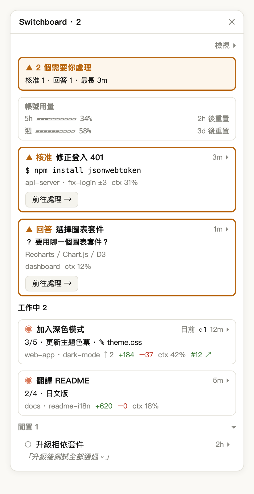
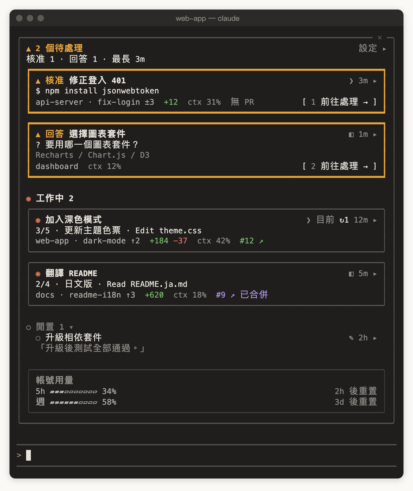
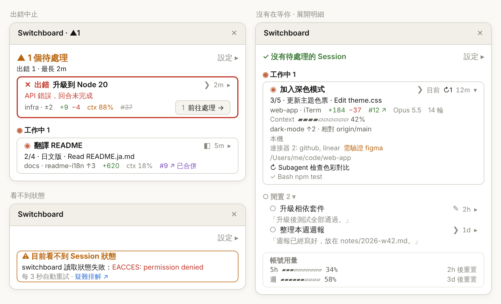

<p align="center">
  
</p>

[English](README.md) | 繁體中文 | [简体中文](README.zh-CN.md) | [日本語](README.ja.md) | [한국어](README.ko.md)

[](https://ko-fi.com/Y8H028VWRF)

# switchboard：Claude Code 的 Session 監看視窗（Claude Code mod）

一個 **Claude Code plugin**，以 **Claude Code mods** 打造。同時開很多個 Claude Code Session 時，它把所有本機 Session 列在同一個 **監看視窗** 裡，讓你一眼看出哪些在工作、哪些閒置、哪些**在等你**，點一下就跳過去處理。

Claude Desktop Code 分頁裡的 Session，和 iTerm、Terminal.app、VS Code 終端機裡的 `claude`，都列在同一份清單上。Desktop 和終端機對等支援，只用其中一種也能完整使用。

<p align="center">
  
</p>

<p align="center"><sub>示意圖：兩個待處理（一個待核准、一個待回答，各有帶數字快捷鍵的「前往處理」）、兩個工作中、一個閒置，最下面是帳號用量。</sub></p>

就像總機接線生看得到哪幾條線亮著燈，switchboard 讓每個 Session 自己回報狀態，再把在等你的排在最上面：

| 狀態 | 意義 | 例子 |
|---|---|---|
| **▲ 待處理** | 你不去看，事情就不會往前走 | 停在 `npm install` 的權限提示、用選項卡提問、Desktop 回合結尾的提問框、回合因 API 錯誤停下 |
| **◉ 工作中** | Claude 正在執行回合 | 思考、呼叫工具、執行 Subagent |
| **○ 閒置** | 回合已結束，沒有被卡住 | 做完了在等下一個指令；你自己中斷的回合 |
| **已結束** | Session 已關閉或程序已不存在 | 立即從清單移除 |

待處理只認明確的訊號，所以它亮起來時，一定是真的在等你。Claude 用一般文字提問時算閒置，可以從那一列的最後回覆摘要看出來。

## 快速開始

```bash
claude plugin marketplace add wide3751/switchboard
claude plugin install switchboard@switchboard
```

接下來依你用 Claude Code 的地方，走其中一條（兩條都走也可以）：

**Desktop**：重新啟動 Claude Desktop，打開 Code 分頁的任一 Session。監看視窗會自動出現在右側，之後每個 Desktop Session 都會自動打開它。沒有出現的話，輸入 `/switchboard:open`。

**終端機**：重新啟動 `claude`，輸入框上方會出現 **▦ 打開監看視窗** 按鈕，點它或輸入 `/switchboard:open` 就會打開。想讓它每次自動打開，到監看視窗的 **設定 ▸ › 一般**，勾選「自動打開監看視窗」的 **CLI Session**（終端機要至少 144 欄寬）。

安裝前就已經開著的 Session 仍會列在清單上，但只有基本狀態；重新啟動它們才會有完整資訊。

也可以把這句話貼給 Claude Code 或其他 coding agent，讓它幫你安裝：

> Install switchboard by following https://github.com/wide3751/switchboard/blob/main/README.md

## 使用方式

| 指令 | 說明 |
|---|---|
| `/switchboard:open` | 在這個 Session 打開監看視窗，Desktop 和終端機都可以 |

<p align="center">
  
</p>

<p align="center"><sub>示意圖：80 欄的終端機裡，監看視窗嵌在輸入框上方，內容和 Desktop 一樣。</sub></p>

**監看視窗上有什麼：**

- **頁首**：有 Session 在等你時顯示 `▲ 2 個待處理`，下一行是細分和等最久的時間，例如 `核准 1 · 回答 1 · 最長 3m`；沒有時顯示 `✓ 沒有待處理的 Session`。
- **分區**：待處理 → 工作中 → 閒置。待處理依等待時間排，等最久的在最上面。閒置可以點分區標題收合。
- **卡片**：第一行是狀態和標題；第二行只寫一件最重要的事，例如想執行的指令、問題和選項、目前進度，或閒置時的最後回覆；最後一行是資料夾、分支、變更行數、`ctx 31%`、PR 等欄位。
- **前往處理**：待處理卡片右下角是 **1 前往處理 →**，點它，或在監看視窗有焦點時按 `1`–`9`，就跳到那個 Session。
- **點標題**：跳到那個 Session。Desktop Session 切到 Claude Desktop 裡對應的 Session；iTerm、Terminal.app 切到對應的分頁。
- **點時間和 `▸`**（例如 `3m ▸`）：展開卡片，顯示分支與比較基底、Context 用量條、連接器、完整路徑和背景任務。
- **帳號用量**：訂閱制顯示 5 小時與每週的 rate limit；API 計費顯示總花費。用量達 95% 時會移到頁首下方提醒你。
- **監看視窗關著時**：輸入框上方的按鈕會帶上待處理數量，例如 **▲2 待處理 · ▦ 打開**，點一下就打開。

<p align="center">
  
</p>

<p align="center"><sub>示意圖：左上是出錯中止（紅色粗框）；右邊是沒有在等你，其中一張卡片展開了明細；左下是看不到狀態時的警示卡。</sub></p>

**終端機的鍵盤操作**（終端機不回報滑鼠點擊時使用）：

| 按鍵 | 動作 |
|---|---|
| `ctrl+x tab` | 從輸入框移進監看視窗 |
| `tab`／`shift+tab` | 在按鈕和標題之間移動 |
| `enter` | 按下目前的按鈕或標題 |
| `1`–`9` | 按下那個號碼的 **前往處理 →** |
| `esc` | 回到輸入框，監看視窗留著 |
| `ctrl+x x` | 關掉監看視窗 |

**設定**（點頁首右端的 **設定 ▸**，所有 Session 共用）：

- **卡片內容**：分別調整待處理、工作中、閒置要顯示哪些欄位，或直接選精簡、標準、詳細
- **自動打開**：Desktop Session 預設開啟，CLI Session 預設關閉，可以分開設定
- **語言**：自動、English、日本語、한국어、简体中文、繁體中文
- **計費**：自動、訂閱制（顯示 rate limit）、API（顯示花費）

**通知**：switchboard 自己不發通知，交給 Claude Code 和 Claude Desktop 本身的通知。終端機在 `claude` 裡輸入 `/config` 設定通知方式；Desktop 到「系統設定 › 通知」允許 Claude。

所有欄位、符號、排序規則和各終端機的細節，見 [完整使用說明](docs/guide/usage.zh-TW.md)。

## 支援的環境

| `claude` 在哪裡執行 | 列在清單上 | 打開監看視窗 | 點標題跳轉 | 實測 |
|---|---|---|---|---|
| Claude Desktop 的 Code 分頁 | ✓ | ✓ | ✓ | ✓ |
| iTerm | ✓ | ✓ | ✓ | ✓ |
| Terminal.app | ✓ | ✓ | ✓ | ✓ |
| VS Code 整合終端機 | ✓ | ✓ | 顯示資料夾 | 還沒 |
| 其他終端機（Warp、Ghostty 等）與 tmux | ✓ | ✓ | 顯示資料夾 | 部分 |
| VS Code 擴充套件（圖形介面） | — | ✕ | — | 還沒 |

第一次跳轉到 iTerm 或 Terminal.app 時，macOS 會詢問是否允許控制它，要按允許。

## 隱私與安全

switchboard **完全在你的 Mac 上執行**，不會把資料送到任何自己的服務。

**它會讀什麼**

- Claude Code 自己的 Session 紀錄（`~/.claude/sessions/*.json`），用來知道有哪些 Session
- 它自己寫的狀態回報
- **不會讀其他 Session 的對話紀錄**

**它會寫什麼**

- 每個 Session 一個狀態回報，存在 `~/.claude/switchboard/reports/`，是一般的 JSON 檔，隨時可以打開來看
- 內容有標題（第一句 prompt 的前約 40 字）、模型、分支、目前動作、核准請求摘要、最後回覆的簡短節錄、Context 用量等
- 寫入前會把疑似機密的片段（例如 `Bearer …`、`token=…`、`sk-…`、`ghp_…`）換成 `•••`；這是盡力而為，不保證抓得到全部
- Session 結束後，過期的回報會自動清掉

**它會跑什麼指令**

- `ps`：看哪些 Session 還活著
- `git`：在 Session 自己的資料夾讀分支與變更
- `gh pr view`：查 PR，用的是你自己的 `gh` 登入；這是唯一會連上網路的指令，沒裝 `gh` 就不會連
- `open`、`osascript`：只在你點擊時才跑，用來切到對應的 Session、分頁，或在瀏覽器打開 PR

除了清掉自己的過期回報，switchboard 不會修改你的任何檔案或 repo。程式碼全部開源（MIT），可以自己檢查。逐項說明見 [隱私與資料](docs/guide/privacy.zh-TW.md)。

## 系統需求

- macOS
- Claude Code，以下其中一種（兩種都用也可以）：
  - [Claude Desktop](https://claude.ai/download) app 的 Code 分頁
  - 終端機裡的 `claude`（iTerm、Terminal.app、VS Code 整合終端機等）
- 支援 mods 的 Claude Code 版本：在 **v2.1.299** 開發與測試。Desktop 在 Code 分頁輸入 `/status`，終端機執行 `claude --version`；Desktop 自帶的版本可能和終端機的不同，兩邊要分開看
- 選用：`git`（分支與變更資訊）、已登入的 [`gh`](https://cli.github.com/)（PR 資訊）

## 更新、停用與移除

**更新**（對已安裝的 plugin 再跑一次 `install` 不會升級）：

```bash
claude plugin marketplace update switchboard
claude plugin update switchboard@switchboard
```

**暫時停用**（保留安裝，之後用 `enable` 打開）：

```bash
claude plugin disable switchboard@switchboard
```

**完整移除**：

```bash
claude plugin uninstall switchboard@switchboard
claude plugin marketplace remove switchboard
rm -rf ~/.claude/switchboard
```

- 最後一行刪掉狀態回報，plugin 移除後它不會自己消失。有設 `CLAUDE_CONFIG_DIR` 的話，改刪 `$CLAUDE_CONFIG_DIR/switchboard`
- 不論更新、停用或移除，都要重新啟動 Claude Desktop 和開著的 `claude` 才會生效

## 限制

- **只支援 macOS**：Linux 上可以打開但不能跳轉；Windows 沒有 `ps`，看不到狀態。
- **CLI Session 只能跳轉到 iTerm 和 Terminal.app**：其他終端機只會顯示它所在的資料夾。
- **終端機太窄時不會自動打開**：至少要 144 欄寬；比較窄時按輸入框上方的按鈕，多窄都能打開。
- **每 3 秒更新一次**：狀態變化會在幾秒內反映，不是即時。
- **安裝前就開著的 Session 只有基本狀態**：沒有出錯中止、核准請求摘要和最後回覆，重開就好。
- **只列本機 Session**：不列 Subagent 和雲端 Session。

## 疑難排解

看不到 Session 狀態時，監看視窗警示卡上的「疑難排解 ↗」會連到這裡。

| 症狀 | 處理方式 |
|---|---|
| 某一列顯示 `未載入 switchboard，僅基本狀態` | 那個 Session 在安裝前就開著，重新啟動它 |
| `/switchboard:open` 回覆 hooks 沒有載入 | 確認 Claude Code 版本支援 mods，然後重開這個 Session。還是不行，用 `claude --debug` 啟動，在 log 裡找 `hooks module switchboard` |
| `⚠ 目前看不到 Session 狀態`，說找不到任何 Session 紀錄 | Claude Code 版本太舊，或 `CLAUDE_CONFIG_DIR` 指到 Claude Code 實際用的以外的資料夾 |
| `⚠ 目前看不到 Session 狀態`，下面有一段紅字 | 紅字是原始錯誤。每 3 秒會自動重試，暫時的錯誤會自己消失；一直出現的話用 `claude --debug` 查看 |
| `⚠ 目前看不到 Session 狀態`，說讀不到某個資料夾 | 確認資料夾存在、你有讀取權限 |
| 沒有顯示 PR | 安裝 `gh` 並執行 `gh auth login`；資料夾必須是 GitHub repository |
| 點 CLI Session 跳不過去 | 只有 iTerm、Terminal.app 能跳轉。這兩個也跳不過去時，到「系統設定 › 隱私權與安全性 › 自動化」允許控制它們 |

其他情況見 [完整疑難排解](docs/guide/troubleshooting.zh-TW.md)。

## 參與貢獻

歡迎提出 Issue 和 Pull Request。修改行為之前，請先讀 [GLOSSARY.md](GLOSSARY.md) 的用語和 [docs/adr/](docs/adr/) 的決策。新增或修改介面文字時，請同步更新 [agens-view/hooks/i18n.ts](agens-view/hooks/i18n.ts) 的五種語言。

## 授權

[MIT](LICENSE)
