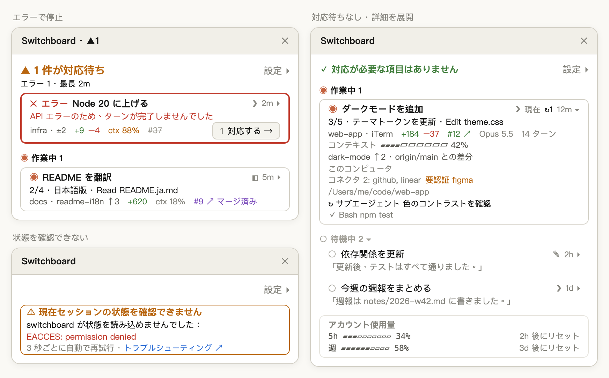

[English](usage.md) | [繁體中文](usage.zh-TW.md) | [简体中文](usage.zh-CN.md) | 日本語 | [한국어](usage.ko.md)

# 詳しい使い方

[← README に戻る](../../README.ja.md)

## 監視ウィンドウの見かた

- **ヘッダー**：状況に応じて次の 3 種類のどれかで、右端に **設定 ▸** があります
  - あなたを待っているセッションがある：`▲ 2 件が対応待ち`。次の行に内訳と最長の待ち時間（例：`承認 1 · 回答 1 · 最長 3m`）。同じ数がペインのタイトルにも表示されます（例：`Switchboard · ▲2`）
  - 待っているものがない：`✓ 対応が必要な項目はありません` の 1 行
  - セッションの状態を確認できない：琥珀色の細い枠の警告カード `⚠ 現在セッションの状態を確認できません`。原因（エンジンの元のエラーだけ赤字）と、「3 秒ごとに自動で再試行」、[トラブルシューティング](troubleshooting.ja.md)へのリンク「トラブルシューティング ↗」を表示します
- **セクション**：対応が必要 → 作業中 → 待機中。作業中と待機中の見出しは `◉ 作業中 2`、`○ 待機中 3 ▾` です。対応が必要は待っている時間が長い順で（ヘッダーの「最長」が一番上のカード）、新しく入ったものは下に追加されます。作業中はセッションを開始した順で、承認で行き来しても位置は変わりません。待機中は最終アクティビティが新しい順。待機中のセッションはどれだけ時間が経っても自動では消えず、待機中の見出しをクリックすると折りたためます
- **フォーカスが監視ウィンドウにある間は並びが止まります**：Tab や数字キーで操作している間、カードが目の前で入れ替わることはありません。対応が必要でなくなったカードはその場に残り、枠と内容が新しい状態に変わって **対応する →** が消えます。新しく対応が必要になったものは対応が必要の最後に付きます。フォーカスが監視ウィンドウから離れると並べ直します
- **カード**：太い枠は対応が必要なカードだけ（琥珀色、エラーで停止は赤）で、作業中は細い枠、待機中は枠のない 1 行です。1 行目は状態とタイトルで、対応が必要なカードはタイトルの前に種類（`▲ 承認`、`▲ 回答`、`✕ エラー`）が付きます。2 行目は状態に応じて 1 つだけ：実行しようとしているコマンド、質問と選択肢、ターンを止めたエラー、進捗と現在の操作（例：`3/5 · テーマトークンを更新 · Edit theme.css`）、または待機中の最後の返信。最後の行は場所とブランチ、変更行数、`ctx 31%`、PR などの項目です
- **対応する**：対応が必要なカードの最後の行の右端に **1 対応する →** があります。薄い色の数字がショートカットです（監視ウィンドウにフォーカスがあるときに `1`–`9`。10 枚目以降はショートカットなし）。幅が足りないときは次の行に回ります。このボタンがあるのは Desktop と iTerm・Terminal.app のセッションだけです
- **アカウント使用量**：サブスクリプションでは 5 時間と週ごとのレート制限の使用率とリセットまでの時間、API 課金では全セッションの合計コスト。普段は一覧の最後に薄い枠で表示され、対応が必要なカードを押し下げません。5 時間または週の使用量が 95% に達したときだけ、ヘッダーの下に移ります
- **新しいバージョンのお知らせ**：GitHub で公開されているバージョンがインストール済みのものより新しいと、ヘッダーの下に `⇡ 新しいバージョン 0.12.0` という行が表示されます。**今すぐ更新** と **このバージョンをスキップ** の 2 つのボタンがあり、その下の薄い文字で `/plugin › Marketplaces` から switchboard の自動更新をオンにするよう案内します。使用量の警告と同時に出たときは両方を表示し、使用量の警告が上です
  - **今すぐ更新**：`claude plugin marketplace update switchboard`、`claude plugin update switchboard@switchboard` を順に実行します。実行中は「更新中…」と表示され、もう一度押しても二重には実行しません。成功すると、その行は「0.12.0 に更新しました。セッションを再起動するか /reload-plugins を入力すると反映されます」に変わり、すべてのセッションの `⇡ 新しいバージョン` がすぐに消えます。`claude` コマンドが見つからない、どちらかのステップが失敗した、または 60 秒以内に終わらなかったときは、「更新できませんでした。次のコマンドを自分で実行してください：」と 2 つのコマンドを表示します
  - **このバージョンをスキップ**：お知らせと開くボタンの `⇡ 新しいバージョン` が、すべてのセッションでまとめて消えます。さらに新しいバージョンが出ると、また表示されます
  - 公開されているバージョン番号がインストール済みのものより大きいときだけ、新しいバージョンとみなします。確認できない、または読み取れないときは新しいバージョンなしとして扱い、エラーは表示しません
- **タイトル**：Desktop のセッションはそのタイトル、`/rename` で名前を付けた CLI セッションはその名前を表示します。それ以外の CLI セッションは最初のプロンプトの先頭約 40 文字、まだ送信していなければプロジェクトフォルダ名（worktree ではリポジトリ名）です。同じタイトルになる行にはブランチ名、またはセッションを開始した順に `#2`、`#3` が付きます。タイトル行の右側、時間の前の記号でセッションの場所がわかります：`◧` Claude Desktop、`❯` ターミナル（iTerm、Terminal.app など）、`✎` VS Code の統合ターミナル。今いるセッションには **現在** が付き、監視ウィンドウが狭いときは `✦` になります
- **タイトルをクリック** してもそのセッションへ移動します。Desktop セッションは Claude Desktop の該当セッションへ、iTerm・Terminal.app の CLI セッションは該当するタブへ切り替わります
- タイトル行の右端の時間と `▸`（例：`3m ▸`。この 2 つで 1 つのボタンです）をクリックすると展開します。矢印が `▾` に変わり、「詳細」のすべての項目に加え、コンテキストの使用量バー、ブランチと比較の基準（例：`origin/main との差分`）、環境、コネクタ、フルパス、最大 5 件のバックグラウンドタスクを表示します。展開している間、カード上の `ctx` とブランチは詳細のほうに表示され、重複しません
- **設定 ▸** でヘッダーの下に下の設定を開きます

<p align="center">
  
</p>

<p align="center"><sub>イメージ図：左上はエラーで停止（赤い太枠）、右は待っているものがなく 1 枚のカードを展開した状態、左下は状態を確認できないときの警告カード。</sub></p>

**記号：**

| 記号 | 意味 |
|---|---|
| `▲` `◉` `○` `✕` `◌` | 対応が必要、作業中、待機中、エラーで停止、状態不明 |
| `◧` `❯` `✎` | セッションの場所：Claude Desktop、ターミナル、VS Code の統合ターミナル |
| `↻2` `⏸︎1` `!1` | バックグラウンドタスク：実行中、待機中、失敗の数（展開した詳細では完了したものが `✓`）。作業中のカードは `↻` の代わりに実行中のタスクを一覧表示 |
| `↳` | 作業中のカードの下にある実行中のバックグラウンドタスク。タイトルのみ（最大 3 行、残りは `+n`） |
| `✦` | 今いるセッション（**現在** が入らないとき） |
| `▸` `▾` | 折りたたみ中（押すと展開）、展開中（押すと折りたたむ） |
| `→` `↗` | そのセッションへ移動、ブラウザで開く |
| `⇡` | 新しいバージョンあり（お知らせと、開くボタンの `⇡ 新しいバージョン`） |
| `#12 ↗`、`#12 ↗ マージ済み`、~~`#12`~~ | PR がオープン、マージ済み、クローズ |

Desktop セッションでも CLI セッションでも、監視ウィンドウが閉じているときは、入力欄の上に **▦ 監視ウィンドウを開く** ボタンが表示され、コマンドを入力せずにワンクリックで開けます。あなたを待っているセッションがあると、ボタンは件数から始まります（例：**▲2 件が対応待ち · ▦ 開く**、最大 15 秒ほど遅れます）。待っているセッションがないとき、またはセッションの状態を読み取れないときは、**▦ 監視ウィンドウを開く** だけが表示されます。 新しいバージョンがあるときは、件数の後ろに `⇡ 新しいバージョン` が付きます（例：**▲2 件が対応待ち · ⇡ 新しいバージョン · ▦ 開く**、件数がないときは **⇡ 新しいバージョン · ▦ 開く**）。スクリーンリーダーが読み上げるラベルにも、新しいバージョンがあることが含まれます。ターミナルだけを使う場合、監視ウィンドウを閉じている間の手がかりはこれだけです。

あるセッションで監視ウィンドウを自分で閉じると、セッションを再起動するか、`/switchboard:open` を実行するか、このボタンを押すまで、そのセッションでは自動で開きません。自動で開く設定のときに閉じると、すべてで閉じるための手順（監視ウィンドウ › 設定 ▸ › 一般 › 「監視ウィンドウを自動で開く › Desktop セッション」をオフ）がメッセージで表示され、開くボタンの横に **自動で開かない** ボタンも出ます。押すとその項目がオフになり（CLI セッションでは CLI セッションの項目）、以降その種類のセッションでは自動で開きません。このボタンは次に監視ウィンドウを開くか、ターンが終わると消えます。

## ターミナルで使う

CLI セッション（iTerm、Terminal.app、VS Code の統合ターミナル）で `/switchboard:open` を入力すると、そのターミナルの中に監視ウィンドウが開きます。内容は Desktop と同じで、ターミナルの幅に合わせて切り詰められます。全画面で幅が 110 桁以上あれば会話の横に、そうでなければ入力欄の上に表示されます。

マウスのクリックを伝えないターミナルでは、キーボードで操作します（Claude Code のデフォルトのキー）：

| キー | 動作 |
|---|---|
| `ctrl+x tab` | 入力欄から監視ウィンドウに移動（監視ウィンドウが閉じているときは、入力欄の上の **▦ 監視ウィンドウを開く** ボタンに移動） |
| `tab`／`shift+tab` | 監視ウィンドウ内のボタンとタイトルの間を移動。Claude Desktop では、フォーカスがタイトルに移ったとき、監視ウィンドウが直前の 10 秒間フォーカスを受けていなければそのセッションに移動します（1 回のクリックで切り替えられるようにするため）。Tab を続けて押している間は移動しません |
| `enter` | 選択中のボタンやタイトルを押す（常に移動します） |
| `1`–`9` | 監視ウィンドウにフォーカスがあるとき、その番号のカードの **対応する →** を押す（番号はボタンの前に淡い色で表示） |
| `↑`／`↓` | 監視ウィンドウをスクロール |
| `esc` | 監視ウィンドウを開いたまま入力欄に戻る |
| `ctrl+x x` | 監視ウィンドウを閉じる（枠の右上の ✕ をクリックしても閉じられます） |

**対応ターミナル：**

| `claude` を実行している場所 | 一覧に表示 | 監視ウィンドウを開く | タイトルから移動 | 動作確認 |
|---|---|---|---|---|
| Claude Desktop の Code タブ | ✓ | ✓ | ✓ そのセッションへ切り替え | ✓ |
| iTerm | ✓ | ✓ | ✓ 該当するタブへ切り替え | ✓ |
| Terminal.app | ✓ | ✓ | ✓ 該当するタブへ切り替え | ✓ |
| VS Code の統合ターミナル | ✓ | ✓ | フォルダを表示 | 未確認 |
| その他のターミナル（Warp、Ghostty など）と tmux | ✓ | ✓ | フォルダを表示 | 一部（tmux：一覧表示と監視ウィンドウを開く） |
| VS Code 拡張機能（グラフィカル UI） | — | ✕ | — | 未確認 |

どのターミナルのセッションも一覧に表示され、状態を報告します。これは Claude Code 自体だけで動くためです。移動にはターミナルがほかのアプリからのタブ切り替えを許可している必要があるため、今のところ iTerm と Terminal.app のみ対応です。tmux の中で動くセッションは外側のターミナルではなく tmux として扱われるため、フォルダの表示になります。iTerm と Terminal.app は移動を含めてすべて実際に確認しました。tmux では一覧表示と監視ウィンドウを開くことだけを確認しています。VS Code の統合ターミナル、Warp、Ghostty、VS Code 拡張機能はまだ確認しておらず、表は想定される動作です。

**iTerm・Terminal.app への移動：** 初回の移動時に、macOS が Claude Desktop（または Claude Code を実行しているターミナル）に iTerm や Terminal の操作を許可するか尋ねるので、許可してください。拒否した場合は「システム設定 › プライバシーとセキュリティ › オートメーション」でオンにします。そのときは switchboard もここを案内するメッセージを表示します。移動できないときは、理由が表示されます（権限の案内以外では、セッションのフォルダも表示されます）：

- VS Code、Warp、Ghostty など対応していないターミナル：「VS Code のセッションへはまだ直接移動できません。場所：…」
- 0.6.0 より前に開いた CLI セッション（ターミナルを記録していない）：「このセッションを開き直すと移動できるようになります」
- iTerm・Terminal.app でセッションのタブが見つからない：「iTerm に該当するタブが見つかりません。場所：…」
- ターミナルが 10 秒以内に応答しない：移動をあきらめ、「…に切り替えられませんでした」と表示

## 設定

**設定**（**設定 ▸** パネル。ヘッダーの下に開き、**完了** で閉じます。グローバルに保存され、すべてのセッションで共有。あるセッションで設定を変えると、ほかの開いている監視ウィンドウも次の更新時、約 3 秒以内に反映されます）。パネルは 2 つに分かれています。上が「カードの内容 · セクション」（設定対象、密度、項目）、下が「一般」（自動で開く、更新を確認、言語、課金）です：

| 名前 | デフォルト | 値 |
|---|---|---|
| 設定対象 | 対応が必要 | 下の密度と項目をどのセクションに適用するか：対応が必要、作業中、待機中。最後に選んだセクションを覚えています |
| 密度 | 標準（待機中：コンパクト） | コンパクト、標準、詳細。項目を自分で選ぶとカスタムになります |
| 監視ウィンドウを自動で開く › Desktop セッション | オン | オン：Desktop セッションの開始時とターン終了時に自動で開くので、セッションを切り替えても表示されたまま。オフ：`/switchboard:open` を実行したか **▦ 監視ウィンドウを開く** を押したセッションだけに表示 |
| 監視ウィンドウを自動で開く › CLI セッション | オフ | オン：CLI セッション（ターミナルで実行した `claude`）の開始時とターン終了時に自動で開きます。オフ：`/switchboard:open` を実行したか **▦ 監視ウィンドウを開く** を押したセッションだけに表示。Desktop セッションの項目とは別に設定します |
| 更新を確認 | オン | オン：1 時間に 1 回まで GitHub で公開されているバージョン番号を読み、新しければお知らせを表示します。オフ：ネットワークに接続せず、表示中のお知らせと `⇡ 新しいバージョン` も消えます。環境変数 `DISABLE_UPDATES`、`CLAUDE_CODE_DISABLE_NONESSENTIAL_TRAFFIC` のどれかが設定されているときは、この設定にかかわらず確認しません |
| 言語 | 自動 | 自動、English、日本語、한국어、简体中文、繁體中文（Desktop ではドロップダウン）。自動では環境変数 `LC_ALL`、`LANG` の順に見て、どちらもない（または `C`、`POSIX`）ときだけ macOS の言語設定を使い、それもなければ英語になります。そのためターミナルではたいてい `LANG` に、Desktop ではたいてい macOS の言語に従います |
| 課金 | 自動 | 自動、サブスク（レート制限を表示）、API（コストを表示）（Desktop ではドロップダウン） |

各行に表示できる **項目**：

| 項目 | 表示内容 |
|---|---|
| 時間 | 現在の状態になってからの時間 |
| 場所 | プロジェクトフォルダ |
| ブランチ | git ブランチ、ahead/behind、未コミットのファイル数 |
| 変更行数 | ベースブランチに対する追加／削除行数（Desktop の Changes と同じ）。0 のほうは表示しません |
| PR | このブランチのプルリクエスト：オープン `#12 ↗`、マージ済み `#12 ↗ マージ済み`、クローズ `#12`（取り消し線）。クリックするとブラウザで開きます。PR がなく、ブランチにベースブランチからの変更か未プッシュのコミットがある場合は、クリックできない「PR なし」を表示します（待機中の行を除く） |
| 進捗 | ToDo の進捗と現在の項目 |
| 現在の操作 | 実行中のツール呼び出し（例：`Edit theme.css`、`$ npm test`） |
| バックグラウンドタスク | 実行中、待機中、失敗したサブエージェントとバックグラウンドのシェルコマンドの数（`↻2`、`⏸︎1`、`!1`）。作業中のカードではタイトルの下に実行中のタスクを表示（`↳`） |
| コンテキスト | コンテキストウィンドウの使用率。カードでは `ctx 31%` と表示し、80% 以上で色が変わります |
| コネクタ | 接続済みの MCP コネクタと、認証が必要なもの |
| 最後の返信 | Claude の最新の返信の短い抜粋 |
| モデル | 使用モデル。作業中のセッションが他と異なるモデルを使っている場合は常に表示 |
| 使用量 | ターン数。API 課金ではコストも表示 |
| 環境 | Worktree または Remote Control |
| ソース | CLI セッションが動いているターミナルの名前（タイトル行の右側の記号は常に表示） |
| フルパス | 作業ディレクトリのフルパス |

対応が必要な行には、承認リクエストの概要（実行しようとしているコマンド）、質問と選択肢、またはターンを止めたエラーが必ず表示されます。進捗と現在の操作は作業中の行だけ、最後の返信は待機中の行だけに表示されるので、設定パネルには選んだセクションで意味のある項目だけが並びます。コネクタとフルパスは、選ぶと行に表示されます（「詳細」には両方が含まれます）。その行を展開すると、展開した詳細のほうに表示されます。

## 対応が必要なときに通知を受け取る

switchboard 自身は通知を送りません（[ADR-0005](../adr/0005-no-own-needs-you-alert.md)）。権限確認や質問の通知は Claude Code と Claude Desktop 自身が送ります：

- **ターミナル**：`claude` で `/config` を入力し、通知方法を設定します（バージョンによって **Notifications** または **Local notifications** と表示されます）。デフォルトの `auto` では iTerm、kitty、Ghostty でデスクトップ通知、Terminal.app でベルが鳴ります。VS Code、Warp、tmux などほかのターミナルでは `auto` だと何も通知されないので、`terminal_bell` を選んでください。あわせて「システム設定 › 通知」でターミナルアプリの通知を許可します
- **Claude Desktop**：「システム設定 › 通知」で Claude の通知を許可します

## 例

Desktop のセッションが 3 つ動いています。1 つは権限確認で止まっていて、1 つは作業中、1 つは完了しています。監視ウィンドウのヘッダーには次のように表示されます：

```
▲ 1 件が対応待ち                                  設定 ▸
承認 1 · 最長 3m
```

そのカードには実行しようとしているコマンド（例：`$ npm install jsonwebtoken`）が表示され、最後の行の右端に **1 対応する →** があります。監視ウィンドウにフォーカスがあるときに `1` を押しても同じです。

待っているものがないとき：

```
✓ 対応が必要な項目はありません                    設定 ▸
```

各セクションの数は見出し（`◉ 作業中 1`、`○ 待機中 2 ▾`）にあるので、ヘッダーでは繰り返しません。

## 制限事項

- **すべての移動に対応するのは macOS のみ**：監視ウィンドウは Claude Desktop とターミナルの Claude Code で開けます。VS Code 拡張機能のグラフィカル UI には対応していません。Linux などほかの OS でも `/switchboard:open` で開けますが、カードをクリックしても移動できないことが表示されます。Windows ではカードをクリックすると Claude Desktop のセッションへ移動できますが、ターミナルの CLI セッションへはまだ移動できません。生きているセッションは `tasklist` で確認します。
- **CLI セッションへの移動は iTerm と Terminal.app のみ**：ほかのターミナル（VS Code、Warp、Ghostty など）ではクリックするとフォルダが表示されるだけです。
- **ターミナルが狭いと自動では開きません**：「監視ウィンドウを自動で開く › CLI セッション」にチェックを入れても、Claude Code が自動で開いたペインを描くのはターミナルの幅が 144 桁以上（ここで開いたことがあれば 110 桁以上）のときだけです。それまでは入力欄の上に **▦ 監視ウィンドウを開く** ボタンが表示されたままです。ボタンを押すか `/switchboard:open` を入力すれば、幅に関係なく開きます。ターミナルを広げると、待機中の監視ウィンドウも自動で表示されます。
- **ポーリングで更新**：監視ウィンドウは 3 秒ごとなので、変化は即時ではなく数秒以内に反映されます。監視ウィンドウを表示している各セッションがそれぞれスキャンし、監視ウィンドウを開いていないセッションは、開くボタンに件数を付けるために 15 秒ごとに軽いスキャンをします。どちらのスキャンもセッション記録とステータスレポートを読み、`ps` を 1 回実行するだけです。`git`、`gh` は各セッションの Reporter が、セッションの開始時と各ターンの終了後に自分のフォルダで実行します。ボタンの件数と監視ウィンドウの件数が一時的に食い違うことがあります。
- **mod が読み込まれていないセッションは基本状態のみ**：エラー停止、承認リクエストの概要、最後の返信は表示されません（インストール前から開いていたセッションなど）。
- **ローカルのセッションのみ**：サブエージェントとクラウドセッションは表示しません。
