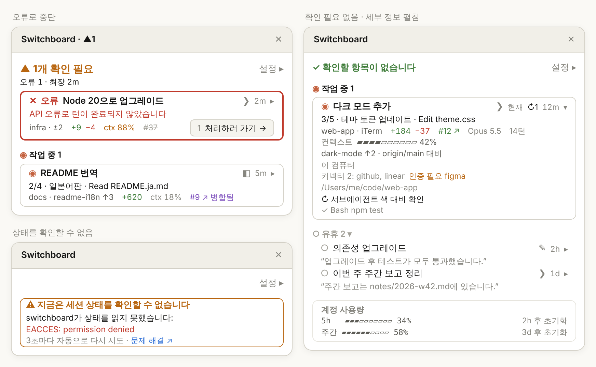

[English](usage.md) | [繁體中文](usage.zh-TW.md) | [简体中文](usage.zh-CN.md) | [日本語](usage.ja.md) | 한국어

# 전체 사용 설명서

[← README로 돌아가기](../../README.ko.md)

## 모니터 창 구성

- **헤더**: 상황에 따라 다음 세 가지 중 하나이며, 오른쪽 끝에 **설정 ▸**이 있습니다
  - 나를 기다리는 세션이 있을 때: `▲ 2개 확인 필요`. 다음 줄에 종류별 개수와 최장 대기 시간(예: `승인 1 · 답변 1 · 최장 3m`). 같은 숫자가 패널 제목에도 표시됩니다(예: `Switchboard · ▲2`)
  - 기다리는 세션이 없을 때: `✓ 확인할 항목이 없습니다` 한 줄
  - 세션 상태를 확인할 수 없을 때: 호박색 얇은 테두리의 경고 카드 `⚠ 지금은 세션 상태를 확인할 수 없습니다`. 원인(엔진의 원래 오류만 빨간색)과 「3초마다 자동으로 다시 시도」, [문제 해결](troubleshooting.ko.md)로 가는 「문제 해결 ↗」 링크를 보여 줍니다
- **섹션**: 확인 필요 → 작업 중 → 유휴. 작업 중과 유휴의 섹션 제목은 `◉ 작업 중 2`, `○ 유휴 3 ▾`입니다. 확인 필요는 오래 기다린 순서이며(헤더의 "최장"이 맨 위 카드), 새로 들어온 세션은 맨 아래에 추가됩니다. 작업 중은 세션을 시작한 순서이며, 승인으로 상태가 오가도 위치가 바뀌지 않습니다. 유휴는 최근 활동 순. 유휴 세션은 오래 지나도 자동으로 사라지지 않으며, 유휴 섹션 제목을 클릭하면 접을 수 있습니다
- **모니터 창에 포커스가 있는 동안은 순서가 멈춥니다**: Tab이나 숫자 키로 조작하는 동안 카드가 눈앞에서 자리를 바꾸지 않습니다. 더 이상 확인이 필요 없는 카드는 그 자리에 남아 테두리와 내용만 새 상태로 바뀌고 **처리하러 가기 →**가 사라집니다. 새로 확인이 필요해진 세션은 확인 필요의 맨 끝에 붙습니다. 포커스가 모니터 창을 떠나면 다시 정렬합니다
- **카드**: 굵은 테두리는 확인 필요 카드에만 있으며(호박색, 오류로 중단은 빨간색), 작업 중은 얇은 테두리, 유휴는 테두리 없는 한 줄입니다. 첫 줄은 상태와 제목이고, 확인 필요 카드는 제목 앞에 종류(`▲ 승인`, `▲ 답변`, `✕ 오류`)가 붙습니다. 둘째 줄은 상태에 따라 하나만 보여 줍니다: 실행하려는 명령, 질문과 선택지, 턴을 멈춘 오류, 진행률과 현재 작업(예: `3/5 · 테마 토큰 업데이트 · Edit theme.css`), 또는 유휴 세션의 마지막 응답. 마지막 줄은 위치와 브랜치, 변경 줄 수, `ctx 31%`, PR 같은 항목입니다
- **처리하러 가기**: 확인 필요 카드 마지막 줄 오른쪽 끝에 **1 처리하러 가기 →**가 있습니다. 흐린 숫자가 단축키입니다(모니터 창에 포커스가 있을 때 `1`–`9`. 10번째 카드부터는 단축키 없음). 너비가 모자라면 다음 줄로 내려갑니다. 이 버튼은 Desktop과 iTerm·Terminal.app의 세션에만 있습니다
- **계정 사용량**: 구독 요금제는 5시간·주간 사용 한도 사용률과 초기화까지 남은 시간, API 과금은 모든 세션의 총 비용. 평소에는 목록 맨 끝에 흐린 테두리로 있어 확인 필요 카드를 밀어내지 않으며, 5시간 또는 주간 사용량이 95%에 이르면 헤더 아래로 올라옵니다
- **새 버전 알림**: GitHub에 공개된 버전이 설치된 버전보다 새로우면 헤더 아래에 `⇡ 새 버전 0.12.0` 줄이 나타납니다. **지금 업데이트**와 **이 버전 건너뛰기** 두 버튼이 있고, 그 아래 흐린 글씨로 `/plugin › Marketplaces`에서 switchboard 자동 업데이트를 켜라고 안내합니다. 사용량 알림과 함께 나타나면 둘 다 표시하며, 사용량 알림이 위에 옵니다
  - **지금 업데이트**: `claude plugin marketplace update switchboard`, `claude plugin update switchboard@switchboard`를 차례로 실행합니다. 실행 중에는 「업데이트 중…」이 표시되고, 다시 눌러도 한 번 더 실행하지 않습니다. 성공하면 그 줄이 「0.12.0(으)로 업데이트했습니다. 세션을 다시 시작하거나 /reload-plugins를 입력하면 적용됩니다」로 바뀌고, 모든 세션의 `⇡ 새 버전`이 바로 사라집니다. `claude` 명령을 찾을 수 없거나, 어느 단계든 실패하거나, 60초 안에 끝나지 않으면 「업데이트하지 못했습니다. 다음 명령을 직접 실행하세요:」와 두 명령을 표시합니다
  - **이 버전 건너뛰기**: 알림과 열기 버튼의 `⇡ 새 버전`이 모든 세션에서 함께 사라지고, 더 높은 버전이 나오면 다시 나타납니다
  - 공개된 버전 번호가 설치된 버전보다 클 때만 새 버전으로 봅니다. 확인할 수 없거나 읽을 수 없으면 새 버전이 없는 것으로 처리하고 오류는 표시하지 않습니다
- **제목**: Desktop 세션은 자체 제목을, `/rename`으로 이름을 붙인 CLI 세션은 그 이름을 표시합니다. 그 밖의 CLI 세션은 첫 프롬프트의 앞 약 40자, 아직 보내지 않았다면 프로젝트 폴더 이름(worktree는 저장소 이름)을 씁니다. 제목이 같은 행에는 브랜치 이름이, 그래도 같으면 세션을 시작한 순서대로 `#2`, `#3`이 붙습니다. 제목 줄 오른쪽, 시간 앞의 기호로 세션이 어디서 실행 중인지 알 수 있습니다: `◧` Claude Desktop, `❯` 터미널(iTerm, Terminal.app 등), `✎` VS Code 통합 터미널. 지금 있는 세션에는 **현재**가 붙고, 모니터 창이 좁을 때는 `✦`로 바뀝니다
- **제목을 클릭** 해도 해당 세션으로 이동합니다. Desktop 세션은 Claude Desktop의 해당 세션으로, iTerm·Terminal.app의 CLI 세션은 해당 탭으로 전환됩니다
- 제목 줄 오른쪽 끝의 시간과 `▸`(예: `3m ▸`, 둘이 한 버튼입니다)를 클릭하면 펼쳐집니다. 화살표가 `▾`로 바뀌며 「자세히」의 모든 항목과 함께 컨텍스트 사용량 막대, 브랜치와 비교 기준(예: `origin/main 대비`), 환경, 커넥터, 전체 경로, 최대 5개의 백그라운드 작업을 보여 줍니다. 펼친 동안 카드의 `ctx`와 브랜치는 세부 정보 쪽에 표시되어 겹치지 않습니다
- **설정 ▸**으로 헤더 아래에 아래 설정을 엽니다

<p align="center">
  
</p>

<p align="center"><sub>예시 이미지: 왼쪽 위는 오류로 중단(빨간 굵은 테두리), 오른쪽은 기다리는 세션이 없고 카드 하나를 펼친 상태, 왼쪽 아래는 상태를 확인할 수 없을 때의 경고 카드입니다.</sub></p>

**기호:**

| 기호 | 뜻 |
|---|---|
| `▲` `◉` `○` `✕` `◌` | 확인 필요, 작업 중, 유휴, 오류로 중단, 상태 알 수 없음 |
| `◧` `❯` `✎` | 세션 위치: Claude Desktop, 터미널, VS Code 통합 터미널 |
| `↻2` `⏸︎1` `!1` | 백그라운드 작업: 실행 중, 대기 중, 실패한 개수(펼친 세부 정보에서 끝난 작업은 `✓`). 작업 중 카드는 `↻` 대신 실행 중인 작업을 나열 |
| `↳` | 작업 중 카드 아래의 실행 중인 백그라운드 작업. 제목만 표시(최대 3줄, 나머지는 `+n`) |
| `✦` | 지금 있는 세션(**현재**가 들어가지 않을 때) |
| `▸` `▾` | 접힘(누르면 펼침), 펼침(누르면 접힘) |
| `→` `↗` | 해당 세션으로 이동, 브라우저에서 열기 |
| `⇡` | 새 버전 있음(새 버전 알림, 열기 버튼의 `⇡ 새 버전`) |
| `#12 ↗`, `#12 ↗ 병합됨`, ~~`#12`~~ | PR 열림, 병합됨, 닫힘 |

Desktop 세션이든 CLI 세션이든 모니터 창이 닫혀 있으면 입력창 위에 **▦ 모니터 창 열기** 버튼이 표시되어, 명령을 입력하지 않고 한 번에 열 수 있습니다. 기다리는 세션이 있으면 버튼이 개수부터 보여 줍니다(예: **▲2 확인 필요 · ▦ 열기**, 최대 약 15초 늦을 수 있음). 기다리는 세션이 없거나 세션 상태를 지금 읽을 수 없으면 **▦ 모니터 창 열기**만 표시됩니다. 새 버전이 있으면 개수 뒤에 `⇡ 새 버전`이 붙습니다(예: **▲2 확인 필요 · ⇡ 새 버전 · ▦ 열기**, 개수가 없으면 **⇡ 새 버전 · ▦ 열기**). 스크린 리더가 읽는 레이블에도 새 버전이 있다는 내용이 들어갑니다. 터미널만 쓴다면 모니터 창이 닫혀 있는 동안 알 수 있는 신호는 이것뿐입니다.

어떤 세션에서 모니터 창을 직접 닫으면, 세션을 다시 시작하거나 `/switchboard:open`을 다시 실행하거나 이 버튼을 누를 때까지 그 세션에서는 자동으로 열리지 않습니다. 자동으로 열리도록 설정된 상태에서 닫으면 모두 끄는 경로(모니터 창 › 설정 ▸ › 일반 › 「모니터 창 자동으로 열기 › Desktop 세션」 해제)를 알려 주는 메시지가 표시되고, 열기 버튼 옆에 **자동으로 열지 않기** 버튼도 나타납니다. 누르면 그 항목이 해제되어(CLI 세션에서는 CLI 세션 항목) 이후 그 종류의 세션에서는 자동으로 열리지 않습니다. 이 버튼은 다음에 모니터 창을 열거나 턴이 끝나면 사라집니다.

## 터미널에서

CLI 세션(iTerm, Terminal.app, VS Code 통합 터미널)에서 `/switchboard:open`을 입력하면 그 터미널 안에 모니터 창이 열립니다. 내용은 Desktop과 같고, 터미널 너비에 맞춰 잘립니다. 전체 화면이고 너비가 110열 이상이면 대화 옆에, 아니면 입력창 위에 표시됩니다.

마우스 클릭을 전달하지 않는 터미널에서는 키보드로 조작합니다(Claude Code의 기본 단축키):

| 키 | 동작 |
|---|---|
| `ctrl+x tab` | 입력창에서 모니터 창으로 이동(모니터 창이 닫혀 있으면 입력창 위의 **▦ 모니터 창 열기** 버튼으로 이동) |
| `tab`／`shift+tab` | 모니터 창 안의 버튼과 제목 사이를 이동. Claude Desktop에서는 포커스가 제목으로 옮겨질 때, 모니터 창이 직전 10초 동안 포커스를 받은 적이 없을 때만 해당 세션으로 이동합니다(한 번 클릭으로 전환할 수 있도록). Tab을 연달아 누르는 동안에는 이동하지 않습니다 |
| `enter` | 선택한 버튼이나 제목을 누름(항상 이동) |
| `1`–`9` | 모니터 창에 포커스가 있을 때, 해당 번호 카드의 **처리하러 가기 →**를 누름(번호는 버튼 앞에 흐린 색으로 표시) |
| `↑`／`↓` | 모니터 창 스크롤 |
| `esc` | 모니터 창을 연 채로 입력창으로 돌아감 |
| `ctrl+x x` | 모니터 창 닫기(테두리 오른쪽 위의 ✕를 클릭해도 됩니다) |

**지원하는 터미널:**

| `claude` 실행 위치 | 목록에 표시 | 모니터 창 열기 | 제목 클릭으로 이동 | 실제 확인 |
|---|---|---|---|---|
| Claude Desktop의 Code 탭 | ✓ | ✓ | ✓ 해당 세션으로 전환 | ✓ |
| iTerm | ✓ | ✓ | ✓ 해당 탭으로 전환 | ✓ |
| Terminal.app | ✓ | ✓ | ✓ 해당 탭으로 전환 | ✓ |
| VS Code 통합 터미널 | ✓ | ✓ | 폴더 표시 | 아직 |
| 기타 터미널(Warp, Ghostty 등)과 tmux | ✓ | ✓ | 폴더 표시 | 일부(tmux: 목록 표시와 모니터 창 열기) |
| VS Code 확장(그래픽 UI) | — | ✕ | — | 아직 |

어느 터미널의 세션이든 목록에 표시되고 상태를 보고합니다. 이는 Claude Code 자체만으로 동작하기 때문입니다. 이동은 터미널이 다른 앱의 탭 전환을 허용해야 하므로 지금은 iTerm과 Terminal.app만 지원합니다. tmux 안에서 실행 중인 세션은 바깥 터미널이 아니라 tmux로 취급되므로 폴더만 표시합니다. iTerm과 Terminal.app은 이동까지 모두 직접 확인했습니다. tmux에서는 목록 표시와 모니터 창 열기만 확인했습니다. VS Code 통합 터미널, Warp, Ghostty, VS Code 확장은 아직 확인하지 않았으며, 표의 내용은 예상 동작입니다.

**iTerm·Terminal.app으로 이동:** 처음 이동할 때 macOS가 Claude Desktop(또는 Claude Code를 실행 중인 터미널)이 iTerm이나 Terminal을 제어하도록 허용할지 물으면 허용을 누르세요. 거부했다면 「시스템 설정 › 개인정보 보호 및 보안 › 자동화」에서 켜세요. 이때 switchboard도 이곳을 안내하는 메시지를 보여 줍니다. 이동할 수 없을 때는 이유가 표시됩니다(권한 안내를 제외하면 세션이 있는 폴더도 표시됩니다):

- VS Code, Warp, Ghostty 등 지원하지 않는 터미널: 「VS Code의 세션으로는 아직 바로 이동할 수 없습니다. 위치: …」
- 0.6.0 이전에 연 CLI 세션(터미널을 기록하지 않음): 「이 세션을 다시 열면 이동할 수 있습니다」
- iTerm·Terminal.app에서 세션의 탭을 찾지 못함: 「iTerm에서 해당 탭을 찾지 못했습니다. 위치: …」
- 터미널이 10초 안에 응답하지 않음: 이동을 포기하고 「…(으)로 전환할 수 없습니다」를 표시

## 설정

**설정**(**설정 ▸** 패널. 헤더 아래에 열리고 **완료**로 닫습니다. 전역으로 저장되어 모든 세션이 공유. 한 세션에서 설정을 바꾸면 열려 있는 다른 모니터 창도 다음 갱신 때, 약 3초 안에 따라 바뀝니다). 패널은 두 부분으로 나뉩니다. 위는 「카드 내용 · 섹션」(설정 대상, 밀도, 항목), 아래는 「일반」(자동으로 열기, 업데이트 확인, 언어, 요금제)입니다:

| 이름 | 기본값 | 값 |
|---|---|---|
| 설정 대상 | 확인 필요 | 아래 밀도와 항목을 적용할 섹션: 확인 필요, 작업 중, 유휴. 마지막으로 고른 섹션을 기억합니다 |
| 밀도 | 표준(유휴: 간단히) | 간단히, 표준, 자세히. 항목을 직접 고르면 사용자 지정이 됩니다 |
| 모니터 창 자동으로 열기 › Desktop 세션 | 켜기 | 켜기: Desktop 세션이 시작되거나 턴이 끝날 때 자동으로 열려 세션을 바꿔도 계속 보입니다. 끄기: `/switchboard:open`을 실행했거나 **▦ 모니터 창 열기**를 누른 세션에만 표시 |
| 모니터 창 자동으로 열기 › CLI 세션 | 끄기 | 켜기: CLI 세션(터미널에서 실행한 `claude`)이 시작되거나 턴이 끝날 때 자동으로 열립니다. 끄기: `/switchboard:open`을 실행했거나 **▦ 모니터 창 열기**를 누른 세션에만 표시. Desktop 세션 항목과 따로 설정합니다 |
| 업데이트 확인 | 켜기 | 켜기: 한 시간에 최대 한 번 GitHub에 공개된 버전 번호를 읽고, 새 버전이면 새 버전 알림을 표시합니다. 끄기: 네트워크에 연결하지 않으며, 표시 중인 새 버전 알림과 `⇡ 새 버전`도 사라집니다. 환경 변수 `DISABLE_UPDATES`, `DISABLE_AUTOUPDATER`, `CLAUDE_CODE_DISABLE_NONESSENTIAL_TRAFFIC` 중 하나라도 설정되어 있으면 이 설정과 관계없이 확인하지 않습니다 |
| 언어 | 자동 | 자동, English, 日本語, 한국어, 简体中文, 繁體中文(Desktop에서는 드롭다운). 자동이면 환경 변수 `LC_ALL`, `LANG` 순서로 보고, 둘 다 없을 때(또는 `C`, `POSIX`일 때)만 macOS 언어 설정을 쓰며, 그것도 없으면 영어입니다. 그래서 터미널에서는 보통 `LANG`을, Desktop에서는 보통 macOS 언어를 따릅니다 |
| 요금제 | 자동 | 자동, 구독(사용 한도 표시), API(비용 표시)(Desktop에서는 드롭다운) |

각 행에 표시할 수 있는 **항목**:

| 항목 | 표시 내용 |
|---|---|
| 시간 | 현재 상태가 지속된 시간 |
| 위치 | 프로젝트 폴더 |
| 브랜치 | git 브랜치, ahead/behind, 커밋하지 않은 파일 수 |
| 변경 줄 수 | 기준 브랜치 대비 추가/삭제 줄 수(Desktop의 Changes와 동일). 0인 쪽은 표시하지 않습니다 |
| PR | 이 브랜치의 Pull Request: 열림 `#12 ↗`, 병합됨 `#12 ↗ 병합됨`, 닫힘 `#12`(취소선). 클릭하면 브라우저에서 엽니다. PR이 없고 브랜치에 기준 브랜치 대비 변경이나 푸시하지 않은 커밋이 있으면 클릭할 수 없는 「PR 없음」을 표시합니다(유휴 행 제외) |
| 진행률 | 할 일 목록 진행률과 현재 항목 |
| 현재 작업 | 진행 중인 도구 호출(예: `Edit theme.css`, `$ npm test`) |
| 백그라운드 작업 | 실행 중, 대기 중, 실패한 서브에이전트와 백그라운드 셸 명령의 개수(`↻2`, `⏸︎1`, `!1`). 작업 중 카드에서는 제목 아래에 실행 중인 작업을 표시(`↳`) |
| 컨텍스트 | 컨텍스트 창 사용률. 카드에는 `ctx 31%`로 표시되고 80% 이상이면 색이 바뀝니다 |
| 커넥터 | 연결된 MCP 커넥터와 인증이 필요한 커넥터 |
| 마지막 응답 | Claude의 최근 응답 요약 |
| 모델 | 사용 중인 모델. 작업 중인 세션이 다른 세션과 다른 모델을 쓰면 항상 표시 |
| 사용량 | 턴 수. API 과금이면 비용도 표시 |
| 환경 | Worktree 또는 Remote Control |
| 출처 | CLI 세션이 실행 중인 터미널 이름(제목 줄 오른쪽의 기호는 항상 표시) |
| 전체 경로 | 작업 디렉터리 전체 경로 |

확인 필요 행에는 승인 요청 요약(실행하려는 명령), 질문과 선택지, 또는 턴을 멈춘 오류가 항상 표시됩니다. 진행률과 현재 작업은 작업 중 행에만, 마지막 응답은 유휴 행에만 표시되므로, 설정 패널에는 고른 섹션에서 의미 있는 항목만 나옵니다. 커넥터와 전체 경로는 선택하면 행에 표시됩니다(「자세히」에는 둘 다 포함됩니다). 그 행을 펼치면 펼친 세부 정보 쪽에 표시됩니다.

## 확인이 필요할 때 알림 받기

switchboard는 자체 알림을 보내지 않습니다([ADR-0005](../adr/0005-no-own-needs-you-alert.md)). 권한 확인이나 질문 알림은 Claude Code와 Claude Desktop이 직접 보냅니다:

- **터미널**: `claude`에서 `/config`를 입력해 알림 방식을 설정합니다(버전에 따라 **Notifications** 또는 **Local notifications**로 표시). 기본값 `auto`는 iTerm, kitty, Ghostty에서 데스크톱 알림을 보내고 Terminal.app에서는 벨을 울립니다. VS Code, Warp, tmux 등 다른 터미널에서는 `auto`로 아무 알림도 오지 않으니 `terminal_bell`을 고르세요. 또한 「시스템 설정 › 알림」에서 터미널 앱의 알림을 허용하세요
- **Claude Desktop**: 「시스템 설정 › 알림」에서 Claude의 알림을 허용하세요

## 예시

Desktop 세션 세 개가 실행 중입니다. 하나는 권한 확인에서 멈췄고, 하나는 작업 중이며, 하나는 끝났습니다. 모니터 창 헤더에는 다음과 같이 표시됩니다:

```
▲ 1개 확인 필요                                   설정 ▸
승인 1 · 최장 3m
```

해당 카드에는 실행하려는 명령(예: `$ npm install jsonwebtoken`)이 표시되고, 마지막 줄 오른쪽 끝에 **1 처리하러 가기 →**가 있습니다. 모니터 창에 포커스가 있을 때 `1`을 눌러도 같습니다.

기다리는 세션이 없을 때:

```
✓ 확인할 항목이 없습니다                          설정 ▸
```

섹션별 개수는 섹션 제목(`◉ 작업 중 1`, `○ 유휴 2 ▾`)에 있으므로 헤더에서는 반복하지 않습니다.

## 제한 사항

- **모든 이동은 macOS에서만 지원**: 모니터 창은 Claude Desktop과 터미널의 Claude Code에서 열 수 있습니다. VS Code 확장의 그래픽 UI는 지원하지 않습니다. Linux 등 다른 OS에서도 `/switchboard:open`으로 열리지만, 카드를 클릭해도 이동할 수 없다는 안내가 나옵니다. Windows에서는 카드를 클릭하면 Claude Desktop 세션으로 이동하지만, 터미널의 CLI 세션으로는 아직 이동할 수 없습니다. 살아 있는 세션은 `tasklist`로 확인합니다.
- **CLI 세션 이동은 iTerm과 Terminal.app만 지원**: 다른 터미널(VS Code, Warp, Ghostty 등)에서는 클릭하면 폴더만 보여 줍니다.
- **터미널이 좁으면 자동으로 열리지 않음**: 「모니터 창 자동으로 열기 › CLI 세션」을 체크해도 Claude Code는 터미널 너비가 144열 이상(여기서 연 적이 있으면 110열 이상)일 때만 자동으로 연 패널을 그립니다. 그 전까지는 입력창 위에 **▦ 모니터 창 열기** 버튼이 계속 표시됩니다. 버튼을 누르거나 `/switchboard:open`을 입력하면 너비와 상관없이 열립니다. 터미널을 넓히면 대기 중이던 모니터 창도 저절로 나타납니다.
- **폴링으로 갱신**: 모니터 창은 3초마다 갱신하므로 변화가 즉시가 아니라 몇 초 안에 반영됩니다. 모니터 창을 표시하는 세션마다 각자 스캔하고, 모니터 창을 열지 않은 세션은 열기 버튼에 개수를 붙이기 위해 15초마다 가벼운 스캔을 합니다. 두 스캔 모두 세션 기록과 상태 보고서만 읽고 `ps`를 한 번 실행합니다. `git`, `gh`는 각 세션의 Reporter가 세션이 시작될 때와 턴이 끝날 때마다 자기 폴더에서 실행합니다. 버튼의 숫자와 모니터 창의 숫자가 잠시 다를 수 있습니다.
- **mod가 로드되지 않은 세션은 기본 상태만 표시**: 오류 중단, 승인 요청 요약, 마지막 응답이 없습니다(설치 전에 열려 있던 세션 등).
- **로컬 세션만 표시**: 서브에이전트와 클라우드 세션은 표시하지 않습니다.
