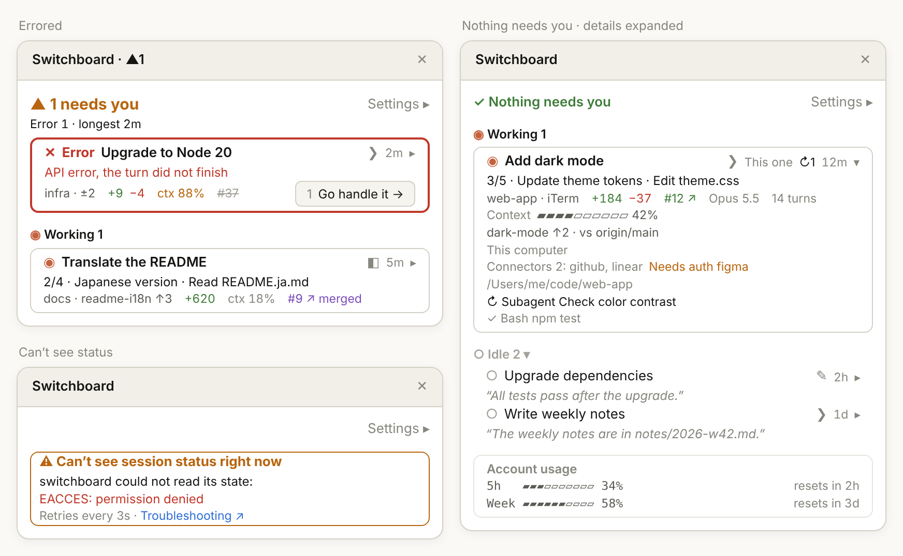

English | [繁體中文](usage.zh-TW.md) | [简体中文](usage.zh-CN.md) | [日本語](usage.ja.md) | [한국어](usage.ko.md)

# Full usage guide

[← Back to README](../../README.md)

## What’s on the Board

- **Header**: one of three, with **Settings ▸** at its right end
  - Sessions are waiting on you: `▲ 2 need you`, then a line with the breakdown and the longest wait, for example `Approve 1 · Answer 1 · longest 3m`. The same count appears in the pane title, for example `Switchboard · ▲2`
  - Nothing is waiting: a single line, `✓ Nothing needs you`
  - Session status can't be seen: an amber, thin-bordered alert card, `⚠ Can’t see session status right now`, that says why (only the raw error from the engine is red), followed by "Retries every 3s" and a "Troubleshooting ↗" link to [Troubleshooting](troubleshooting.md)
- **Sections**: Needs You → Working → Idle; the Working and Idle headings read `◉ Working 2` and `○ Idle 3 ▾`. Needs You is ordered by how long each session has been waiting, longest first (the "longest" age in the header is the top card), and new arrivals join at the bottom. Working is ordered by when each session started, so a session doesn't jump around as it goes to an approval and back. Idle is ordered by most recent activity first. Idle sessions stay on the list however long they sit; click the Idle heading to collapse the section
- **The order holds while the Board has focus**: while you use Tab or the number keys, cards don't move under you. A card that no longer needs you stays where it is, with its border and content updated to its new state and its **Go handle it →** removed; a session that newly needs you joins the end of Needs You. The Board re-sorts once focus leaves it
- **Cards**: only Needs You cards get a thick border (amber, or red for Errored); Working cards have a thin border, and Idle sessions are borderless rows. The first line shows the state and the title, with the kind before the title on Needs You cards (`▲ Approve`, `▲ Answer`, `✕ Error`). The second line shows one thing for the state: the command it wants to run, the question and its options, the error that stopped the turn, progress and activity (for example `3/5 · Update theme tokens · Edit theme.css`), or an idle session's last reply. The last line holds fields such as location and branch, changes, `ctx 31%` and the PR
- **Go handle it**: a Needs You card has **1 Go handle it →** at the right end of its last line; the dim number is its shortcut (press `1`–`9` while the Board has focus; cards past the ninth have none). It moves to a line of its own when there isn't room. Only Desktop sessions and sessions in iTerm or Terminal.app have this button
- **Account usage**: on a subscription, 5-hour and weekly rate-limit usage with their reset times; on API billing, the total spent across sessions. It sits at the end of the list with a faint border so it never pushes Needs You cards down, and moves up under the header only once 5-hour or weekly usage reaches 95%
- **Update notice**: when the version published on GitHub is newer than the one you have installed, a line such as `⇡ New version 0.12.0` appears under the header. It has **Update now** and **Skip this version** buttons, and a faint line under them suggests turning on auto-update for switchboard in `/plugin › Marketplaces`. If the usage warning is up at the same time, both show, the usage warning first
  - **Update now** runs `claude plugin marketplace update switchboard` and then `claude plugin update switchboard@switchboard`. While they run, the line shows **Updating…**, and pressing again doesn’t start a second run. On success the line reads “Updated to 0.12.0. Restart the session or run /reload-plugins to use it”, and `⇡ New version` disappears in every session. If `claude` can’t be found, a step fails, or the two don’t finish within 60 seconds, the line shows “The update didn’t go through. Run these yourself:” followed by the two commands
  - **Skip this version** hides the notice and the `⇡ New version` on the open button, in every session, until a higher version comes out
  - A version counts as new only when its number is higher than the installed one. If the check fails or the file can’t be read, switchboard treats it as no new version and shows no error
- **Titles**: a Desktop session shows its own title, and a CLI session renamed with `/rename` shows that name. Any other CLI session is titled with the first ~40 characters of its first prompt, or the project folder before you send one (for a worktree, the repo name). Rows that would share a title get their branch added, or `#2`, `#3` in the order the sessions started. A symbol on the right of the title row, before the time, shows where the session runs: `◧` Claude Desktop, `❯` a terminal (iTerm, Terminal.app, …), `✎` the VS Code integrated terminal. The session you're in is marked **This one**, or `✦` when the Board is too narrow
- **Click a title** to jump to that session too: a Desktop session opens in Claude Desktop; a CLI session in iTerm or Terminal.app switches to its tab
- **Click the time and `▸`** at the right end of the title row (for example `3m ▸`, one button) to expand a card: the arrow turns into `▾` and the card shows every Detailed field, plus a context usage bar, the branch and the base it is compared with (for example `vs origin/main`), the environment, connectors, the full path and up to 5 background tasks. While a card is expanded, `ctx` and the branch move from the card into the details instead of showing twice
- **Settings ▸** opens the settings below, under the header

<p align="center">
  
</p>

<p align="center"><sub>Illustration: top left, an errored session (thick red border); right, nothing needs you and one card is expanded; bottom left, the alert card when session status can't be seen.</sub></p>

**Symbols:**

| Symbol | Meaning |
|---|---|
| `▲` `◉` `○` `✕` `◌` | Needs You, Working, Idle, Errored, unknown status |
| `◧` `❯` `✎` | The session runs in Claude Desktop, a terminal, the VS Code integrated terminal |
| `↻2` `⏸︎1` `!1` | Background tasks running, waiting and failed (a finished one is `✓` in the expanded details). A Working card lists its running tasks instead of showing `↻` |
| `↳` | A running background task under a Working card, by title only (up to 3, then `+n`) |
| `✦` | The session you're in (when **This one** doesn't fit) |
| `▸` `▾` | Collapsed, press to expand; expanded, press to collapse |
| `→` `↗` | Jumps to that session; opens in the browser |
| `⇡` | A new version is out (the update notice, and `⇡ New version` on the open button) |
| `#12 ↗`, `#12 ↗ merged`, ~~`#12`~~ | PR open, merged, closed |

While the Board is closed in a Desktop or CLI session, an **▦ Open board** button sits above the prompt; one click opens it without typing the command. When a session is waiting for you, the button leads with the count, for example **▲2 need you · ▦ Open** (up to about 15 seconds behind). When nothing is waiting, or session status can't be read right now, it shows just **▦ Open board**. When a new version is out, the button adds `⇡ New version` after the count, for example **▲2 need you · ⇡ New version · ▦ Open**, or **⇡ New version · ▦ Open** when nothing is waiting. Its screen-reader label says so too. If you only use the terminal, this is the only signal while the Board is closed.

If you close the Board in a session yourself, it no longer opens there by itself until you restart the session, run `/switchboard:open` or click that button again. Closing it while it opens by itself shows a note with the full path to turn it off everywhere (board › Settings ▸ › General › uncheck “Open the board automatically in › Desktop sessions”), and a **Don’t open automatically** button appears next to the open button: pressing it unchecks that option (the CLI sessions option in a CLI session), so no session of that kind opens the Board by itself any more. The button goes away the next time you open the Board or a turn ends.

## In a terminal

In a CLI session (iTerm, Terminal.app, the VS Code integrated terminal), `/switchboard:open` opens the Board right in that terminal, with the same content as in Desktop, truncated to the terminal's width. In a fullscreen terminal at least 110 columns wide it docks beside the conversation; otherwise it sits above the prompt.

If your terminal doesn't report mouse clicks, use the keyboard (these are Claude Code's default keys):

| Key | Action |
|---|---|
| `ctrl+x tab` | Move from the prompt into the Board (while the Board is closed, onto the **▦ Open board** button above the prompt) |
| `tab` / `shift+tab` | Move between the buttons and titles on the Board. In Claude Desktop, focus landing on a title jumps to that session only when the Board hasn't had focus in the last 10 seconds, so that one click is enough; while you keep pressing Tab it doesn't jump |
| `enter` | Press the selected button or title (always jumps) |
| `1`–`9` | While the Board has focus, press **Go handle it →** on the card with that number (shown dim in front of the button) |
| `↑` / `↓` | Scroll the Board |
| `esc` | Go back to the prompt, leaving the Board open |
| `ctrl+x x` | Close the Board (or click the ✕ at the top right of its frame) |

**Supported terminals:**

| Where `claude` runs | Listed on the Board | Opens the Board | Click to jump | Tested |
|---|---|---|---|---|
| Claude Desktop Code tab | ✓ | ✓ | ✓ switches to that session | ✓ |
| iTerm | ✓ | ✓ | ✓ switches to its tab | ✓ |
| Terminal.app | ✓ | ✓ | ✓ switches to its tab | ✓ |
| VS Code integrated terminal | ✓ | ✓ | Shows the folder | Not yet |
| Other terminals (Warp, Ghostty, …) and tmux | ✓ | ✓ | Shows the folder | Partly (tmux: listing and opening the Board) |
| VS Code extension (graphical UI) | — | ✕ | — | Not yet |

Every terminal session is listed and reports its status, because that only needs Claude Code itself. Jumping needs the terminal to let another app switch its tabs, so for now it only works in iTerm and Terminal.app. Inside tmux, a session counts as tmux rather than the terminal around it, so it shows the folder too. Everything for iTerm and Terminal.app has been tested by hand, including jumping. Inside tmux only listing and opening the Board were tested. The VS Code integrated terminal, Warp, Ghostty and the VS Code extension haven't been tested yet; their rows describe what should happen.

**Jumping to iTerm and Terminal.app:** the first jump makes macOS ask whether to allow Claude Desktop (or the terminal running Claude Code) to control iTerm or Terminal; choose Allow. If you denied it, turn it on in System Settings › Privacy & Security › Automation; switchboard then shows a note pointing there. When a jump can't happen, you see why (and, except for the permission note, the folder the session is in):

- Terminals that aren't supported, such as VS Code, Warp and Ghostty: "Can't jump to sessions in VS Code yet. It is in …"
- CLI sessions started before 0.6.0 (they didn't record their terminal): "Reopen this session to jump to it"
- The session's tab can't be found in iTerm or Terminal.app: "Couldn't find the tab in iTerm. The session is in …"
- The terminal doesn't answer within 10 seconds: the jump is dropped with "Couldn't switch to …"

## Settings

**Settings** (the **Settings ▸** panel, which opens under the header and closes with **Done**; stored globally and shared by all sessions. When you change a setting in one session, other open Boards follow on their next refresh, within about 3 seconds). The panel has two parts: "Card content · section" on top (Section, Density, fields) and "General" below (automatic opening, Check for updates, Language, Billing):

| Name | Default | Values |
|---|---|---|
| Section | Needs you | Which section the density and fields below apply to: Needs you, Working or Idle. Remembers the section you picked last |
| Density | Standard (Idle: Compact) | Compact, Standard, Detailed, or Custom when you pick fields yourself |
| Open the board automatically in › Desktop sessions | on | on: the Board opens whenever a Desktop session starts or finishes a turn, so it stays in view as you switch; off: only in sessions where you ran `/switchboard:open` or clicked **▦ Open board** |
| Open the board automatically in › CLI sessions | off | on: the Board opens whenever a CLI session (a terminal running `claude`) starts or finishes a turn; off: only in sessions where you ran `/switchboard:open` or clicked **▦ Open board**. Set separately from the Desktop option |
| Check for updates | on | on: at most once an hour, reads the version published on GitHub and shows the update notice when it’s newer; off: no network request, and any update notice and `⇡ New version` disappear. If `DISABLE_UPDATES` or `CLAUDE_CODE_DISABLE_NONESSENTIAL_TRAFFIC` is set, switchboard doesn’t check, whatever this says. The row also shows the version you have (`Version 0.12.0`); when the update notice is up, it repeats `⇡ New version` with **Update now**, which works the same as the one under the header |
| Language | Auto | Auto, English, 日本語, 한국어, 简体中文, 繁體中文 (a drop-down in Desktop). Auto checks the `LC_ALL` and `LANG` environment variables in that order, then the macOS language preference only if neither is set (or is `C` or `POSIX`), and falls back to English. So in a terminal it usually follows `LANG`, and in Desktop it usually follows the macOS language |
| Billing | Auto | Auto, Subscription (shows rate limits), API (shows cost) (a drop-down in Desktop) |

**Fields** each row can show:

| Field | Shows |
|---|---|
| Time | How long the session has been in its current state |
| Location | Project folder |
| Branch | git branch, ahead/behind, uncommitted files |
| Changes | Lines added and removed against the base branch, like Desktop's Changes; a side that is 0 isn't shown |
| PR | The branch's pull request: open `#12 ↗`, merged `#12 ↗ merged`, closed `#12` (struck through); click it to open it in the browser. When there is no PR but the branch has changes against the base branch or unpushed commits, a plain "No PR" shows instead (not on Idle rows) |
| Progress | Todo progress and the current item |
| Activity | The tool call in progress, for example `Edit theme.css` or `$ npm test` |
| Background tasks | How many subagents and background shell commands are running, waiting or failed (`↻2`, `⏸︎1`, `!1`). On a Working card, the running ones are listed under the title (`↳`) |
| Context | Context window usage, shown on the card as `ctx 31%` and colored from 80% |
| Connectors | Connected MCP connectors, and ones that need auth |
| Last reply | A short excerpt of Claude's latest reply |
| Model | The model; shown anyway when an active session uses a different model from the rest |
| Usage | Turns, plus cost on API billing |
| Environment | Worktree or Remote Control |
| Source | The name of the terminal a CLI session runs in (the symbol on the title row always shows) |
| Full path | The full working directory |

On a Needs You row the approval preview (the command it wants to run), the question with its options, or the error that stopped the turn always shows. Progress and Activity show only on Working rows, and Last reply only on Idle rows, so the settings panel lists only the fields that do something in the section you picked. Connectors and Full path show on the row when you pick them (Detailed includes both); when you expand the row they move into the expanded details instead.

## Getting notified when a session needs you

switchboard sends no notifications of its own ([ADR-0005](../adr/0005-no-own-needs-you-alert.md)). Alerts for permission prompts and questions come from Claude Code and Claude Desktop themselves:

- **Terminal**: type `/config` in `claude` and set the notification method (shown as **Notifications** or **Local notifications**, depending on the version). The default `auto` sends desktop notifications in iTerm, kitty and Ghostty and rings the bell in Terminal.app; in VS Code, Warp, tmux and other terminals `auto` sends nothing, so pick `terminal_bell`. Also allow your terminal app in System Settings › Notifications
- **Claude Desktop**: allow Claude in System Settings › Notifications

## Examples

Three Desktop sessions are running: one is stuck on a permission prompt, one is working, one is done. The Board header shows:

```
▲ 1 needs you                                 Settings ▸
Approve 1 · longest 3m
```

Its card shows the command it wants to run, for example `$ npm install jsonwebtoken`, with **1 Go handle it →** at the right end of its last line; pressing `1` while the Board has focus does the same.

Once nothing is waiting:

```
✓ Nothing needs you                           Settings ▸
```

Each section's count is on its heading (`◉ Working 1`, `○ Idle 2 ▾`), so the header doesn't repeat them.

## Limitations

- **Jumping works fully on macOS only**: the Board opens in Claude Desktop and in Claude Code in a terminal; the VS Code extension's graphical UI isn't supported. On Linux and other systems `/switchboard:open` still opens it and explains that clicking a card won't take you to that session; on Windows, clicking a card takes you to Claude Desktop sessions, but not yet to CLI sessions in a terminal, and it checks which sessions are alive with `tasklist`.
- **CLI sessions jump only in iTerm and Terminal.app**: in other terminals (VS Code, Warp, Ghostty, …) clicking one shows the folder it runs in.
- **Narrow terminals don't open it by themselves**: with **Open the board automatically in › CLI sessions** checked, Claude Code only draws a pane it wasn't asked for once the terminal is at least 144 columns wide (110 if you've opened the Board there before). Until then the **▦ Open board** button stays above the prompt; click it or run `/switchboard:open` to open the Board at any width. Widen the terminal and the waiting Board appears by itself.
- **Updated by polling**: the Board refreshes every 3 seconds, so changes show up within a few seconds, not instantly. Each session that shows the Board scans on its own, and sessions without the Board open do a light scan every 15 seconds so the open button can show the count. Both scans read only session records and status reports and run `ps` once; `git` and `gh` are run by each session's reporter in its own folder, when the session starts and after each turn. The button and the Board may briefly disagree.
- **Sessions without the mod show basic status only**: no Errored state, approval preview or last reply, for example sessions that were open before you installed.
- **Local sessions only**: subagents and cloud sessions are not listed.
