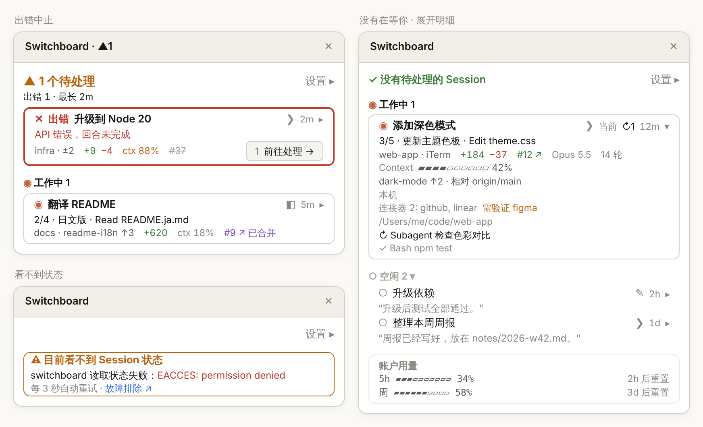

[English](usage.md) | [繁體中文](usage.zh-TW.md) | 简体中文 | [日本語](usage.ja.md) | [한국어](usage.ko.md)

# 完整使用说明

[← 返回 README](../../README.zh-CN.md)

## 监控窗口上有什么

- **顶部**：按情况是下面三种之一，右端是 **设置 ▸**
  - 有 Session 在等你：`▲ 2 个待处理`，下一行是细分和等得最久的时间，例如 `批准 1 · 回答 1 · 最长 3m`。Pane 标题也会带上这个数字，例如 `Switchboard · ▲2`
  - 没有在等你：一行 `✓ 没有待处理的 Session`
  - 看不到 Session 状态：一张琥珀色细框的警示卡 `⚠ 目前看不到 Session 状态`，写出原因（只有引擎的原始错误是红字），下面是「每 3 秒自动重试」和链接到[故障排除](troubleshooting.zh-CN.md)的「故障排除 ↗」
- **分区**：待处理 → 工作中 → 空闲，工作中和空闲的分区标题是 `◉ 工作中 2`、`○ 空闲 3 ▾`。待处理按进入的时间由旧到新，等最久的在最上面（顶部的「最长」就是第一张卡片），新进来的加在底部；工作中按 Session 开始的时间排，批准来回不会改变位置；空闲按最后活动时间由新到旧。空闲再久也不会自动消失，点击空闲的分区标题可以折叠
- **焦点在监控窗口里时顺序暂停**：用 Tab 或数字键操作时，卡片不会在你眼前换位置。已经不在待处理的卡片留在原位，外框和内容按新的状态更新、去掉「前往处理」；新进入待处理的接在待处理的最后面。焦点离开监控窗口后才重新排序
- **卡片**：粗框只给待处理（琥珀色，出错中止是红色），工作中是细框，空闲是没有外框的一行。第一行是状态和标题，待处理的标题前写出种类（`▲ 批准`、`▲ 回答`、`✕ 出错`）；第二行按状态只写一件事：想执行的命令、问题和选项、导致回合停止的错误、进度和当前操作（例如 `3/5 · 更新主题色板 · Edit theme.css`），或空闲的最后回复；最后一行是位置与分支、变更行数、`ctx 31%`、PR 等字段
- **前往处理**：待处理卡片最后一行的右端是 **1 前往处理 →**，淡色的数字是快捷键（监控窗口有焦点时按 `1`–`9`，第 10 张以后没有快捷键）；宽度不够时换到下一行。Desktop 和 iTerm、Terminal.app 的 Session 才有这个按钮
- **账户用量**：订阅制显示 5 小时与每周的 rate limit 使用率和重置时间；API 计费显示所有 Session 的总花费。平时放在列表最后、外框淡色，不挤掉待处理的卡片；5 小时或每周用量达到 95% 时才移到顶部下方
- **新版提示**：GitHub 上公布的版本比你装的新时，顶部下方出现一行 `⇡ 新版 0.12.0`，有 **立即更新** 和 **跳过这个版本** 两个按钮，下面一行淡色字提醒你到 `/plugin › Marketplaces` 开启 switchboard 的自动更新。和用量提醒同时出现时两个都显示，用量提醒在上面
  - **立即更新**：依次运行 `claude plugin marketplace update switchboard`、`claude plugin update switchboard@switchboard`，运行中显示「更新中…」，再点也不会多运行一次。成功后那一行改为「已更新到 0.12.0，重启 Session 或输入 /reload-plugins 生效」，所有 Session 的 `⇡ 新版` 立刻消失。找不到 `claude` 命令、任一步失败，或 60 秒内没运行完时，改为显示「没有更新成功，请自己运行：」和这两行命令
  - **跳过这个版本**：提示和打开按钮上的 `⇡ 新版` 一起消失，所有 Session 都是，直到更高的版本出现
  - 只有公布的版本号大于你装的版本才算新版；查不到或读不懂时当作没有新版，不显示错误
- **标题**：Desktop 的 Session 用它自己的标题，用 `/rename` 改过名的 CLI Session 用那个名称；其他 CLI Session 用第一句 prompt 的前约 40 字，还没发送 prompt 时用项目文件夹名称（worktree 用 repo 名称）。标题相同的几行会补上分支名，分不出来时按 Session 开始的先后补 `#2`、`#3`。标题行右侧、时间前面的符号表示 Session 在哪里：`◧` Claude Desktop、`❯` 终端（iTerm、Terminal.app 等）、`✎` VS Code 集成终端。你所在的 Session 标示「当前」，监控窗口太窄时改成 `✦`
- **点击标题** 也会跳转到那个 Session：Desktop Session 切到 Claude Desktop 中对应的 Session；iTerm、Terminal.app 里的 CLI Session 切到对应的标签页
- 点击标题行最右端的时间和 `▸`（例如 `3m ▸`，两者是同一个按钮）即可展开：箭头变成 `▾`，并显示「详细」的全部字段，另外还有 Context 用量条、分支与比较的基准（例如 `相对 origin/main`）、环境、连接器、完整路径和最多 5 个后台任务。卡片上的 `ctx` 和分支在展开时改到明细里显示，不重复
- **设置 ▸** 在顶部下方打开下面的设置

<p align="center">
  
</p>

<p align="center"><sub>示意图：左上是出错中止（红色粗框）；右边是没有在等你，其中一张卡片展开了明细；左下是看不到状态时的警示卡。</sub></p>

**符号：**

| 符号 | 含义 |
|---|---|
| `▲` `◉` `○` `✕` `◌` | 待处理、工作中、空闲、出错中止、状态不明 |
| `◧` `❯` `✎` | Session 在 Claude Desktop、终端、VS Code 集成终端 |
| `↻2` `⏸︎1` `!1` | 后台任务：运行中、等待中、失败的数量（展开的明细里已完成的是 `✓`）。工作中卡片改为列出运行中的任务，不显示 `↻` |
| `↳` | 工作中卡片下方运行中的后台任务，只有标题（最多 3 行，其余是 `+n`） |
| `✦` | 你所在的 Session（放不下「当前」时） |
| `▸` `▾` | 折叠中，点击展开；展开中，点击折叠 |
| `→` `↗` | 跳转到那个 Session；在浏览器打开 |
| `⇡` | 有新版（新版提示，以及打开按钮上的 `⇡ 新版`） |
| `#12 ↗`、`#12 ↗ 已合并`、~~`#12`~~ | PR 开启中、已合并、已关闭 |

监控窗口关闭时，Desktop Session 和 CLI Session 的输入框上方都会有 **▦ 打开监控窗口** 按钮，点一下即可打开，无需输入命令。有 Session 在等你时，按钮改为先写等你计数，例如 **▲2 待处理 · ▦ 打开**（最多晚约 15 秒）；没有 Session 在等你、或暂时看不到 Session 状态时，只显示 **▦ 打开监控窗口**。有新版时，按钮在等你计数后面加上 `⇡ 新版`，例如 **▲2 待处理 · ⇡ 新版 · ▦ 打开**；没有等你计数时是 **⇡ 新版 · ▦ 打开**。屏幕阅读器读出的 label 也会说有新版。只用终端时，这是监控窗口关闭时唯一的信号。

在某个 Session 中手动关闭监控窗口后，该 Session 不会再自动打开，直到重启 Session、再次输入 `/switchboard:open` 或点击这个按钮。开着自动打开时关闭，会弹出一条提示，写出全部关掉的路径（监控窗口 › 设置 ▸ › 常规 › 取消「自动打开监控窗口 › Desktop Session」）；打开按钮旁也会出现 **不再自动打开**，点击即可取消这一项（在 CLI Session 里是 CLI Session 那一项），之后所有这类 Session 都不再自动打开。下一次打开监控窗口或回合结束后，这个按钮就不再显示。

## 在终端里

在 CLI Session（iTerm、Terminal.app、VS Code 集成终端）输入 `/switchboard:open`，监控窗口就出现在那个终端里，内容和 Desktop 一样，按终端宽度截断。终端全屏且至少 110 列宽时停靠在对话旁边，否则嵌在输入框上方。

终端不报告鼠标点击时，用键盘操作（以下是 Claude Code 的默认快捷键）：

| 按键 | 操作 |
|---|---|
| `ctrl+x tab` | 从输入框移进监控窗口（监控窗口关闭时，移到输入框上方的 **▦ 打开监控窗口** 按钮） |
| `tab`／`shift+tab` | 在监控窗口里的按钮和标题之间移动。在 Claude Desktop，焦点移到标题时，只有监控窗口前 10 秒内没有获得过焦点才会跳转，这样点一下就能切换；连续按 Tab 时不会跳走 |
| `enter` | 按下当前的按钮或标题（一律跳转） |
| `1`–`9` | 监控窗口有焦点时，按下那个编号的卡片上的 **前往处理 →**（编号以淡色写在按钮前面） |
| `↑`／`↓` | 滚动监控窗口 |
| `esc` | 回到输入框，监控窗口保留 |
| `ctrl+x x` | 关闭监控窗口（也可以点击边框右上角的 ✕） |

**支持的终端：**

| `claude` 在哪里运行 | 列在列表中 | 打开监控窗口 | 点击标题跳转 | 实测 |
|---|---|---|---|---|
| Claude Desktop 的 Code 标签页 | ✓ | ✓ | ✓ 切到那个 Session | ✓ |
| iTerm | ✓ | ✓ | ✓ 切到对应的标签页 | ✓ |
| Terminal.app | ✓ | ✓ | ✓ 切到对应的标签页 | ✓ |
| VS Code 集成终端 | ✓ | ✓ | 显示文件夹 | 尚未 |
| 其他终端（Warp、Ghostty 等）与 tmux | ✓ | ✓ | 显示文件夹 | 部分（tmux：列在列表中、打开监控窗口） |
| VS Code 扩展（图形界面） | — | ✕ | — | 尚未 |

任何终端里的 Session 都会列在列表中并报告状态，因为这只依赖 Claude Code 本身。跳转需要终端允许其他 app 切换它的标签页，所以目前只支持 iTerm 和 Terminal.app。在 tmux 里运行的 Session 算作 tmux，而不是外层的终端，所以也只会显示文件夹。iTerm 和 Terminal.app 的每一项都实际测过，包括跳转。tmux 只测了列在列表中和打开监控窗口。VS Code 集成终端、Warp、Ghostty 和 VS Code 扩展尚未测试，表格里写的是预期行为。

**跳转到 iTerm、Terminal.app：** 第一次跳转时，macOS 会询问是否允许 Claude Desktop（或运行 Claude Code 的终端）控制 iTerm 或 Terminal，请点允许。拒绝过的话，到「系统设置 › 隐私与安全性 › 自动化」开启，switchboard 这时也会显示指向这里的提示。跳转不过去时会显示原因（权限的提示以外，也会显示 Session 所在的文件夹）：

- VS Code、Warp、Ghostty 等不支持的终端：「VS Code 里的 Session 还不能直接跳转，它在 …」
- 0.6.0 之前打开的 CLI Session（没有记下终端）：「重新打开这个 Session 后才能跳转」
- iTerm、Terminal.app 里找不到 Session 的标签页：「在 iTerm 里找不到对应的标签页，Session 在 …」
- 终端 10 秒内没有响应：放弃跳转，显示「无法切换到…」

## 设置

**设置**（**设置 ▸** 面板，在顶部下方打开，点击 **完成** 收起；全局保存，所有 Session 共享。在一个 Session 改了设置，其他开着的监控窗口下次刷新时，约 3 秒内就跟着变）。面板分两区：上面是「卡片内容 · 分区」（应用到、密度、字段），下面是「常规」（自动打开、检查更新、语言、计费）：

| 名称 | 默认 | 可选值 |
|---|---|---|
| 应用到 | 待处理 | 下面的密度和字段应用到哪一区：待处理、工作中、空闲。会记住上次选的分区 |
| 密度 | 标准（空闲：精简） | 精简、标准、详细；自己挑选字段时显示为自定义 |
| 自动打开监控窗口 › Desktop Session | 开启 | 开启：Desktop Session 启动或回合结束时自动打开监控窗口，切换 Session 时它一直都在；关闭：只在输入过 `/switchboard:open` 或点击过 **▦ 打开监控窗口** 的 Session 显示 |
| 自动打开监控窗口 › CLI Session | 关闭 | 开启：CLI Session（在终端运行的 `claude`）启动或回合结束时自动打开监控窗口；关闭：只在输入过 `/switchboard:open` 或点击过 **▦ 打开监控窗口** 的 Session 显示。和 Desktop Session 那一项分开设置 |
| 检查更新 | 开启 | 开启：每小时最多一次到 GitHub 读取公布的版本号，有新版时显示新版提示；关闭：不联网，显示中的新版提示和 `⇡ 新版` 一起消失。设置了环境变量 `DISABLE_UPDATES`、`DISABLE_AUTOUPDATER`、`CLAUDE_CODE_DISABLE_NONESSENTIAL_TRAFFIC` 其中一个时，不论这里怎么设置都不检查 |
| 语言 | 自动 | 自动、English、日本語、한국어、简体中文、繁體中文（Desktop 是下拉菜单）。自动时依次看环境变量 `LC_ALL`、`LANG`，都没有（或是 `C`、`POSIX`）时才看 macOS 的语言偏好，最后是英文。所以终端里通常跟随 `LANG`，Desktop 通常跟随 macOS 语言 |
| 计费 | 自动 | 自动、订阅制（显示 rate limit）、API（显示花费）（Desktop 是下拉菜单） |

每一行可以显示的 **字段**：

| 字段 | 显示内容 |
|---|---|
| 时间 | 在当前状态停留了多久 |
| 位置 | 项目文件夹 |
| 分支 | git 分支、ahead/behind、未 commit 的文件数 |
| 变更行数 | 相对基准分支的新增／删除行数，与 Desktop 的 Changes 一致；为 0 的那一边不显示 |
| PR | 该分支的 Pull Request：开启中 `#12 ↗`、已合并 `#12 ↗ 已合并`、已关闭 `#12`（删除线），点击即可在浏览器打开。没有 PR、但分支相对基准分支有变更或有未推送的 commit 时，显示不可点击的「无 PR」（空闲的行没有） |
| 进度 | 待办列表的完成度与当前项目 |
| 当前操作 | 正在进行的工具调用，例如 `Edit theme.css`、`$ npm test` |
| 后台任务 | 运行中、等待中、失败的 Subagent 与后台 shell 命令数量（`↻2`、`⏸︎1`、`!1`）。工作中卡片会在标题下方列出运行中的任务（`↳`） |
| Context | context window 使用率，卡片上写成 `ctx 31%`，80% 以上变色 |
| 连接器 | 已连接的 MCP 连接器，以及需要验证的 |
| 最后回复 | Claude 最近一条回复的简短摘录 |
| 模型 | 使用的模型；进行中的 Session 用了与其他不同的模型时一定显示 |
| 用量 | 回合数，API 计费时加上花费 |
| 环境 | Worktree 或 Remote Control |
| 来源 | CLI Session 所在终端的名称（标题行右侧的符号一律显示） |
| 完整路径 | 完整的工作目录 |

待处理的行一定会显示批准请求摘要（想执行的命令）、问题和选项，或导致回合停止的错误。进度和当前操作只在工作中的行显示，最后回复只在空闲的行显示，所以设置面板只列出所选分区有作用的字段。连接器和完整路径勾选后会显示在行上（「详细」包含这两项）；展开那一行时改为显示在展开的明细里。

## 有 Session 在等你时通知你

switchboard 自己不发通知（[ADR-0005](../adr/0005-no-own-needs-you-alert.md)）。权限提示、提问时的提醒交给 Claude Code 和 Claude Desktop 本身的通知：

- **终端**：在 `claude` 里输入 `/config`，设置通知方式（因版本不同显示为 **Notifications** 或 **Local notifications**）。默认的 `auto` 在 iTerm、kitty、Ghostty 会发桌面通知，在 Terminal.app 是响铃；VS Code、Warp、tmux 等其他终端用 `auto` 不会有任何通知，可以改成 `terminal_bell`。另外到「系统设置 › 通知」允许你的终端 app 发通知
- **Claude Desktop**：到「系统设置 › 通知」允许 Claude 发通知

## 示例

开着三个 Desktop Session：一个卡在权限提示、一个在工作、一个已完成。监控窗口的顶部显示：

```
▲ 1 个待处理                                    设置 ▸
批准 1 · 最长 3m
```

那张卡片会显示它想执行的命令，例如 `$ npm install jsonwebtoken`，最后一行右端是 **1 前往处理 →**；监控窗口有焦点时按 `1` 也一样。

没有在等你的时候：

```
✓ 没有待处理的 Session                          设置 ▸
```

各分区的数量写在分区标题上（`◉ 工作中 1`、`○ 空闲 2 ▾`），顶部不再重复。

## 限制

- **完整的跳转仅支持 macOS**：监控窗口可以在 Claude Desktop 和终端里的 Claude Code 打开；VS Code 扩展的图形界面不支持。在 Linux 等其他系统上 `/switchboard:open` 照样会打开，但会说明点击卡片跳转不能用；在 Windows 上点击卡片可以跳转到 Claude Desktop 的 Session，还不能跳转到终端里的 CLI Session，并改用 `tasklist` 查看哪些 Session 还存活。
- **CLI Session 只能跳转到 iTerm 和 Terminal.app**：其他终端（VS Code、Warp、Ghostty 等）点击后只会显示它所在的文件夹。
- **终端太窄时不会自动打开**：勾选「自动打开监控窗口 › CLI Session」后，Claude Code 只在终端至少 144 列宽（在这里打开过的话 110 列）时才画出自动打开的 Pane。在那之前输入框上方会一直有 **▦ 打开监控窗口** 按钮；点击按钮或输入 `/switchboard:open`，不管多窄都会打开。把终端拉宽，等待中的监控窗口也会自己出现。
- **通过轮询更新**：监控窗口每 3 秒一次，状态变化会在几秒内反映，而非实时。每个显示监控窗口的 Session 都会各自扫描，没开监控窗口的 Session 每 15 秒做一次轻量扫描，让打开按钮带上等你计数。两种扫描都只读 Session 记录和状态报告、运行一次 `ps`；`git`、`gh` 是每个 Session 的报告者在 Session 启动时和每个回合结束后，在自己的文件夹里运行的。按钮上的数字和监控窗口的数字短时间内可能不一致。
- **未加载 mod 的 Session 只有基本状态**：没有出错中止、批准请求摘要和最后回复，例如安装前就已打开的 Session。
- **只列出本地 Session**：不列出 Subagent 和云端 Session。
